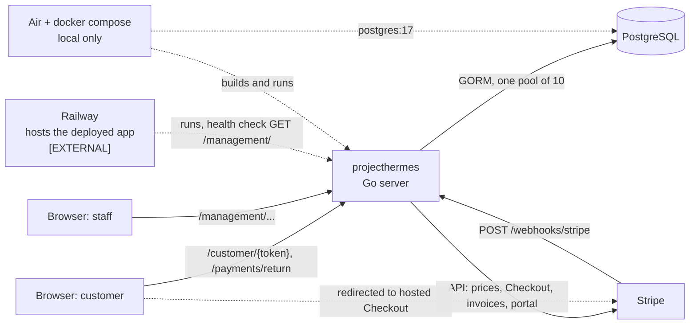
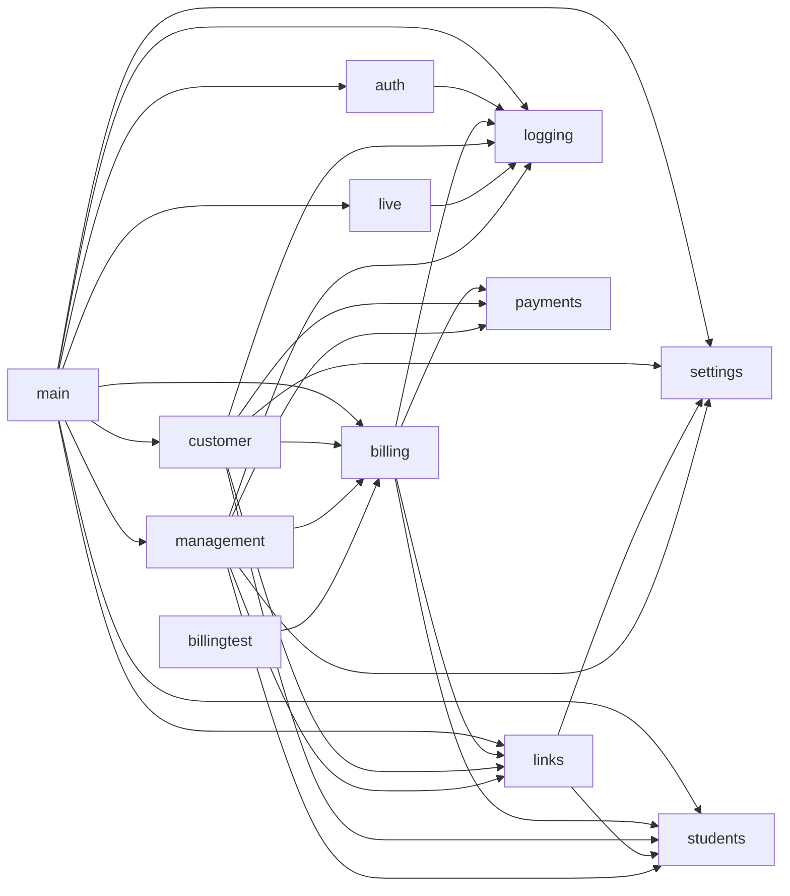
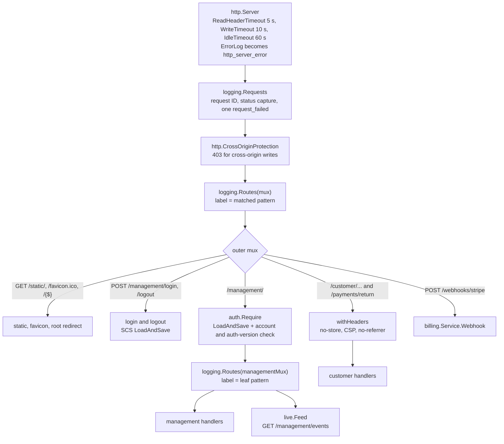

# Architecture

How the process is assembled: stack, packages, the routes `newServer` mounts, and the middleware every request passes. Startup and shutdown order live in [Startup and shutdown](operations/startup-shutdown.md); the business story starts at [Lifecycle](domain/lifecycle.md).

## Stack

Versions are the ones pinned in `go.mod`.

| Layer | Choice | Version | Notes |
|---|---|---|---|
| Language | Go | `1.27.3` (`go` directive; no `toolchain` line) | `net/http` `ServeMux` with method and path patterns, `html/template` |
| Database | PostgreSQL through GORM | `gorm.io/gorm` v1.31.2, `gorm.io/driver/postgres` v1.6.3 (pgx v5.10.0, indirect) | Schema comes from `AutoMigrate(models()...)`; there are no migration files |
| Payments | `github.com/stripe/stripe-go/v87` | v87.0.0 | Used by `internal/billing` only |
| Staff passwords | `github.com/alexedwards/argon2id` | v1.0.0 | |
| Staff sessions | `github.com/alexedwards/scs/v2` + `scs/postgresstore` | v2.9.0 + a pinned pseudo-version | The store shares the application's SQL pool |
| Login limiter, password prompt | `golang.org/x/time` (`rate`), `golang.org/x/term` | v0.16.0, v0.47.0 | See [Staff authentication](staff-auth.md) |
| Phone validation | `github.com/nyaruka/phonenumbers/v2` | v2.0.15 | Root package only, imported by `internal/students/fields.go`; offline validation and E.164 formatting |
| Browser script | HTMX | 2.0.11 from jsDelivr, pinned with an `integrity` hash | Plus small page scripts in `static/`; no frontend build step. See [Frontend](frontend.md) |
| Dev server | Air (`tool github.com/air-verse/air`) | v1.67.4 | Run as `go tool air`. See [Local development](operations/local-development.md) |
| Local database | `postgres:17` image in `compose.yaml` | 17 | |
| Host | Railway | n/a | [EXTERNAL] see [Railway](operations/railway.md) |

There is no CSRF-token library. Cross-site writes are refused by the standard library's `http.CrossOriginProtection`, which sits in the global middleware chain below.

## System context

## Packages

The graph shows non-test imports between the module's own packages, produced by `go list -f '{{.ImportPath}}: {{join .Imports " "}}' ./...`. `internal/testdb` carries the `integration` build tag and so is absent; `billingtest` is an ordinary package that only tests import.

`logging`, `payments`, `settings` and `students` import no other module package. `management` does not import `auth`: staff identity arrives as a function argument (see Wiring).

| Path | Responsibility |
|---|---|
| `main.go` | CLI dispatch, logger metadata, startup order, `newServer` wiring, `serve` drain |
| `internal/auth` | Staff accounts, sessions, login limiter, `Require`, the `user` CLI ([Staff authentication](staff-auth.md)) |
| `internal/billing` | Stripe configuration and catalog, Checkout, invoices, webhook intake, the leased worker ([Billing overview](billing/overview.md)) |
| `internal/billing/billingtest` | Billing services backed by a fake Stripe, for other packages' tests ([Testing](testing.md)) |
| `internal/customer` | Private `/customer/{token}` pages and the payment return page ([Customer flow](domain/customer-flow.md)) |
| `internal/links` | Customer links by token digest; `Enroll` turns a paid link into a Student ([Links](domain/links.md)) |
| `internal/live` | In-process server-sent-event fan-out ([Live updates](live-updates.md)) |
| `internal/logging` | JSON events, request correlation, slow-query summaries ([Observability](operations/observability.md)) |
| `internal/management` | Staff pages and fragments ([Management overview](management/overview.md)) |
| `internal/payments` | Plans, integer-cent installments, due-date schedules, money formatting |
| `internal/settings` | The single settings row: link lifetime, program start date ([Agreement](domain/agreement.md)), bootcamp date |
| `internal/students` | Student record, contact-field registry, municipalities ([Students](domain/students.md)) |
| `internal/testdb` | One PostgreSQL schema per integration test ([Testing](testing.md)) |
| `static/` | Embedded scripts, stylesheets, images, favicon (`//go:embed static`) |
| `compose.yaml`, `.air.toml`, `.env.example` | Local database and dev server ([Local development](operations/local-development.md)) |
| `user.fish` | Railway wrapper for the `user` CLI ([Railway](operations/railway.md)) |
| `loadtest/` | k6 scripts ([Testing](testing.md)) |

## Mounted routes

All GET patterns also answer HEAD (`ServeMux` behavior). On the outer mux, a method that matches a path but no pattern gets 405 and a path matching nothing gets 404; both are labelled `unmatched` (no event is logged for 4xx).

### Outer mux (`newServer`)

| Pattern | Wrapper after the global chain | Owner | Access |
|---|---|---|---|
| `GET /static/` | `http.FileServerFS(assets)`; `GET /static/{$}` answers 404 | main (embedded `static/`) | Public |
| `GET /favicon.ico` | `http.ServeFileFS` | main | Public |
| `GET /{$}` | 302 to `/management/` | main | Public |
| `POST /management/login` | SCS `LoadAndSave` | `auth` | Public, rate-limited |
| `POST /management/logout` | SCS `LoadAndSave` | `auth` | Session optional; answers 303 to `/management/` |
| `/management/` (any method) | `auth.Require`, then `logging.Routes(managementMux)` | `auth` guards, `management` serves | Signed-in staff |
| `GET /customer/{token}`, `GET /customer/{token}/forms`, `POST /customer/{token}` | `withHeaders` | `customer` | Bearer token in the URL |
| `POST /customer/{token}/draft/{field}`, `POST /customer/{token}/pin` | `withHeaders` | `customer` | Bearer token |
| `GET`/`POST /customer/{token}/edit`, `/agreement`, `/payments` | `withHeaders` | `customer` | Bearer token |
| `GET /payments/return` | `withHeaders` | `customer` | Token-free; session id in query |
| `POST /webhooks/stripe` | `biller.Webhook` | `billing` (mounted in `main.go`) | Stripe signature, 1 MiB body cap |

`GET /management/login` is not a route: it falls into `/management/` and is answered like any other signed-out request.

### Management mux (behind `auth.Require`)

| Pattern | Registered by |
|---|---|
| `GET /management/events` | `newServer` (`live.Feed`) |
| `GET /management/{$}`, `GET /management/trash`, `POST /management/program-start-date`, `POST /management/bootcamp-date`, `POST /management/links`, `POST /management/links/{id}/cancel`, `POST /management/links/cancel`, `GET`/`POST /management/settings` | `management.RegisterRoutes` |
| `GET /management/dashboard` | `registerDashboardRoutes` |
| `GET /management/students`, `GET /management/students/{id}`, `GET`/`POST /management/students/{id}/fields/{field}`, `GET /management/students/{id}/billing`, `POST .../billing/reconcile`, `POST .../billing/reinstatement`, `GET .../billing/invoices/{obligation}`, `POST .../billing/portal` | `registerStudentRoutes` |

Behavior of each route is documented in [Management overview](management/overview.md), [Students](management/students.md) and [Dashboard](management/dashboard.md). Inside the management mux a wrong method gives 405 and an unknown path 404, both only after sign-in.

### Signed-out answers from `auth.Require`

Evaluated in this order; the first match wins.

| Request | Answer |
|---|---|
| Session or account lookup fails | 500 (`RecordError` stages `session` or `authenticate`) |
| Signed in | Served, with the username exposed through `auth.Staff` |
| `HX-Request: true` | 401 `Sign in required.` with `HX-Redirect: /management/` |
| `GET`/`HEAD` on exactly `/management/` | 200 with the login form (keeps the Railway health check green) |
| Anything else | 303 to `/management/` |

Session lifetime, auth-version revocation and the limiter are in [Staff authentication](staff-auth.md).

## Request middleware

The 403 from `CrossOriginProtection` fires for non-safe methods (such as POST) when a request carries a `Sec-Fetch-Site` other than `same-origin` or `none` (refusing both `cross-site` and `same-site`), or a foreign `Origin`; a request with neither header passes (`TestCrossOriginWritesAreRejected`, case `neither`). There is no bypass for the webhook: it relies on server-to-server calls carrying neither header.

## Wiring

- `newServer` builds the `links`, `students` and `settings` stores once and shares them: the customer and management packages both receive all three, plus the billing service.
- `feed.Changed` is passed to `links.New`, `students.New` and `billing.New`, so committed writes there refresh open management pages. `settings.New(db)` takes no feed: settings writes publish no live event ([Live updates](live-updates.md)).
- `auth.Staff` is passed to `management.RegisterRoutes` as a `func(context.Context) string`. The management package never imports `auth`, so it cannot decide access; it only reads the username `Require` verified.
- The webhook is mounted in `main.go` but owned by billing, and sits outside `/management/`: its credential is the Stripe signature ([Webhooks](billing/webhooks.md)).
- `auth.Require` on the `/management/` prefix is the staff boundary. Folder layout is not: a handler registered on the outer mux, even from the `management` package, would be public. New staff routes must be registered on `managementMux`.
- `biller.Run` starts in one goroutine from `run` and is stopped and awaited on exit ([Worker](billing/worker.md)).
- The module has no `init()` function and no mutable package-level state; package-level values are registries and sentinel errors.

## Deliberate choices

- **`logging.Routes` is applied twice** (outer mux and `managementMux`). `Require` and `LoadAndSave` hand the next handler a copy of the request, so the outer mux cannot see which leaf pattern matched; the inner `Routes` records it. The outer one still labels auth failures with `/management/`.
- **`startupError` carries a stage** and is returned from `newServer` as well as `run`, so route-registration failures are logged with the same `startup_failed` shape ([Configuration](operations/configuration.md) lists the stages).
- **Air is a `tool` line in `go.mod`.** It pins the dev server per project, at the price of Hugo, Sass and other modules in the indirect requirements; no module package imports them.
- **`billingtest` is untagged but test-only.** Untagged tests such as `internal/billing/stripe_test.go` import it, so it cannot carry the `integration` build tag.
- **The login limiter is shared across clients.** An accepted tradeoff, argued in [Staff authentication](staff-auth.md).

## Source

- `main.go`: `newServer`, `serve`, `run`, `models`, `startupError`, `assets`
- `go.mod`: `github.com/air-verse/air`, `github.com/nyaruka/phonenumbers/v2`, `github.com/stripe/stripe-go/v87`, `gorm.io/gorm`, `gorm.io/driver/postgres`
- `internal/auth/http.go`: `Manager.RegisterRoutes`, `Require`, `Staff`
- `internal/logging/http.go`: `Requests`, `Routes`, `RecordError`
- `internal/customer/customer.go`: `RegisterRoutes`, `withHeaders`
- `internal/management/management.go`: `RegisterRoutes`
- `internal/management/dashboard.go`: `registerDashboardRoutes`
- `internal/management/students.go`: `registerStudentRoutes`
- `internal/billing/webhook.go`: `Service.Webhook`, `maxWebhookBody`
- `internal/live/live.go`: `Feed.Changed`, `Feed.Close`
- `internal/billing/billingtest/billingtest.go`: `Config`
- `main_wiring_integration_test.go`: `TestRoutesAreMounted`, `TestCrossOriginWritesAreRejected`
