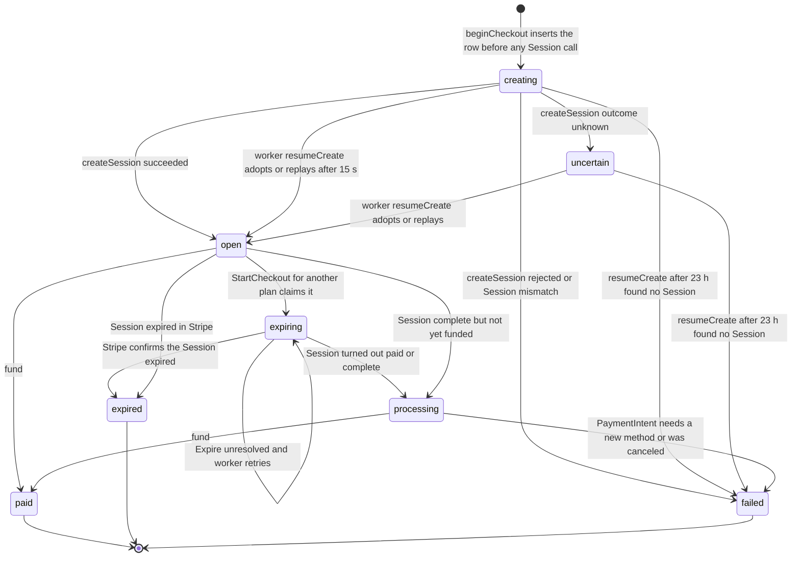
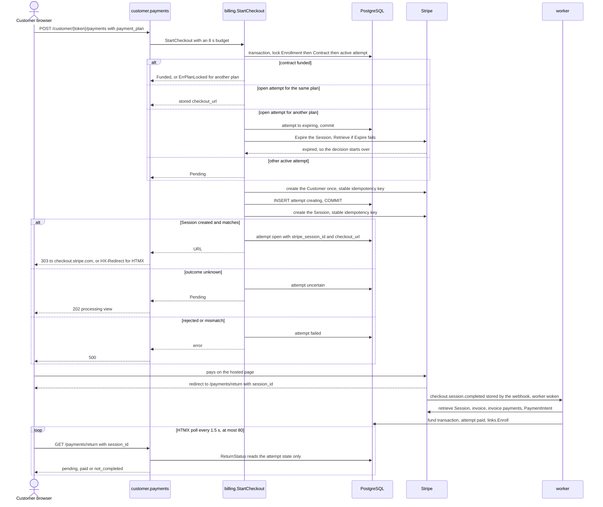

# Checkout

How the first tuition payment becomes a hosted Stripe Checkout Session: the attempt state machine, the `StartCheckout` decision, the Session parameters, the time budgets and the return-page status. Webhook intake is in [Webhooks](webhooks.md), what the worker does with an attempt in [Worker](worker.md), and the customer pages around it in [Customer flow](../domain/customer-flow.md). Funding and the model overall: [Billing overview](overview.md).

## Attempt states

A `billing_checkout_attempts` row tracks one Session creation and payment. Its `state` is check-constrained to eight values. Stripe's own Session status `complete` is not an attempt state: a completed but unfunded Session leaves the attempt `processing`, and funding moves it to `paid`.

`fund` can run from any active state once the Session reads `paid`, and `moveAttempt` lets the worker move any active state to `expired`, `processing` or `failed` (never to the state it is already in). Not every such arrow is drawn.

| State | Active | In flight | `ReturnStatus` |
|---|---|---|---|
| `creating` | yes | no | `pending` |
| `open` | yes | no | `pending` |
| `processing` | yes | yes | `pending` |
| `expiring` | yes | yes | `pending` |
| `uncertain` | yes | yes | `pending` |
| `paid` | no | no | `paid` |
| `expired` | no | no | `not_completed` |
| `failed` | no | no | `not_completed` |

- **Active** (`activeAttemptStates`) means guarded by the partial unique index `idx_active_checkout_attempt`: a contract has at most one active attempt, and a new attempt cannot start while one exists.
- **In flight** (`inFlightAttemptStates`) means money may be moving. A funded contract or an in-flight attempt locks customer contact edits (`UpdateContact` refuses, `ContactEditable` hides the edit link); `creating` and `open` do not lock them. The `/edit` page rules are in [Customer flow](../domain/customer-flow.md).

## `StartCheckout`

`StartCheckout(ctx, enrollmentID, planID)` creates or resumes the single hosted first-payment attempt for an Enrollment. It rejects an unknown plan first, then runs `beginCheckout`, one transaction that locks the Enrollment, then the Contract, then the active attempt (all `FOR UPDATE`), and persists the new attempt before any Session call. Conditions are checked in this order:

| Condition | Outcome |
|---|---|
| Unknown plan ID | `ErrUnknownPlan` (the handler validates the plan first) |
| No such Enrollment, or it is unusable, unsubmitted or has no accepted terms | `ErrUnavailable` |
| No contract yet | Contract and one tuition obligation per installment are created from the plan, with `next_sync_at` one minute ahead; a new attempt follows |
| Funded, same plan | `Funded` |
| Funded, other plan | `ErrPlanLocked` |
| Active `open` attempt, same plan, URL stored | The stored `checkout_url` |
| Active `open` attempt, other plan, Session ID stored | Attempt becomes `expiring` and commits; `expireAttempt` calls Stripe `Expire` (falling back to `Retrieve`). Expired: the loop starts over and a new attempt follows. Paid or complete: attempt `processing`, `Pending`. Unresolved: stays `expiring`, `Pending` |
| Any other active attempt | `Pending` |
| No active attempt, other plan | Tuition obligations are deleted and recreated, the contract's plan columns updated, a live event published; a new attempt follows |
| No active attempt, same plan | A new attempt follows |

A new attempt first creates the Stripe Customer if the contract has none, inserts the attempt as `creating`, writes the contract columns this start changed (plan, Customer) in one `Select(...).Updates`, commits, and only then calls `createSession`. Switching plans only deletes obligations when every earlier attempt is terminal; unfunded contracts have no provider invoices, so the old obligations are plain rows.

### Session creation outcomes

| Stripe result | Attempt | Returned |
|---|---|---|
| Session created, matches the attempt, URL present | `open`, with `stripe_session_id` and `checkout_url` | URL |
| `outcomeUnknown`: any non-Stripe error (transport, timeout, cancellation), 5xx, 429 or 409 | `uncertain`; logs `checkout_create_uncertain` | `Pending` |
| Any other 4xx | `failed` | Error |
| Session differs from the quote (currency, mode, customer, amount) or has no URL | `failed`, keeping the Session ID for staff and webhooks; its URL is never exposed | `errCheckoutMismatch` |

`uncertain` never starts a second Checkout: the unique index keeps the contract's slot until the worker settles the attempt. For an attempt with no stored Session ID, `resumeCreate` leaves a `creating` attempt younger than 15 s to its own request, then lists the Customer's Sessions and adopts the one whose `client_reference_id` equals the attempt's reference (several matches set a contract review, see [Reviews](reviews.md)). With none found it replays the create under the same idempotency key while the attempt is younger than 23 h, and otherwise marks it `failed` so the contract is free again.

## Session parameters

`sessionParams` builds the request from persisted attempt values only.

| Parameter | Value | Applies to |
|---|---|---|
| `mode`, `currency` | `payment`, `usd` | all plans |
| `customer` | The contract's Stripe Customer | all |
| `line_items` | The attempt's stored Price ID, quantity 1 | all |
| `client_reference_id` | The attempt's opaque `reference` | all |
| `integration_identifier` | `tuition_checkout` (constant, so replays stay byte-identical) | all |
| `locale` | `es-419` (`stripeLocale`) | all |
| `invoice_creation` | Enabled, with the metadata keys below on the invoice | all |
| `adaptive_pricing.enabled` | `false` | all |
| `success_url` | `<PUBLIC_BASE_URL>/payments/return?session_id={CHECKOUT_SESSION_ID}` | all |
| `cancel_url` | `<PUBLIC_BASE_URL>/payments/return?attempt=<attempt reference>` | all |
| `allowed_payment_method_types` | `["card"]` | `three`, `six` |
| `payment_intent_data.setup_future_usage` | `off_session` | `three`, `six` |
| `payment_intent_data.metadata` | The metadata keys below | `three`, `six` |
| `custom_text.submit.message` | Spanish note that the remaining payments are processed automatically on the agreed dates | `three`, `six` |
| `payment_method_configuration` | `STRIPE_PAYMENT_METHOD_CONFIGURATION_ID` | `full` only |
| Idempotency key | `tuition:<attempt reference>:checkout` | all |

- **Metadata keys:** `tuition_contract` (contract reference), `tuition_obligation` (the first obligation's reference), `tuition_attempt` (attempt reference). The Session itself carries none; they ride on the generated invoice and, for installment plans, the PaymentIntent.
- **Card only for installments:** later invoices charge the saved card, so installment Sessions skip the payment-method configuration and take cards only; Apple Pay, Google Pay and Link ride on card. The code comment says Stripe rejects an allow-list together with a payment-method configuration `[EXTERNAL]`. Klarna therefore exists only on the single payment. The dashboard side is in [Stripe setup](../operations/stripe-setup.md).
- **Stripe Customer:** created inside the locking transaction, once per enrollment, from the Enrollment's name and email, with `preferred_locales` `es-419`, metadata `tuition_contract` and the idempotency key `tuition:<contract reference>:customer`. The worker keeps name and email in sync later ([Worker](worker.md)).
- **Return URLs** are token-free; see [Customer flow](../domain/customer-flow.md) for the page.

## Budgets and idempotency

| Budget | Value | Where |
|---|---|---|
| `providerBudget` | 8 s | One `StartCheckout` call end to end, plus `InvoiceURL`, `PortalURL`, `ReconcileStudent`, `RequestReinstatement` and `Withdraw`. Stays under the server's 10 s write timeout, so a slower outcome is recorded and resumed instead of holding the browser |
| `persistCtx` | `persistBudget`, 5 s, detached from the request | Recording a Stripe outcome after a call, for example `setAttempt` in `createSession` and `expireAttempt`, so a closed browser or spent budget still saves it |
| Stripe HTTP client | 5 s timeout, 2 network retries, SDK logging off | `NewStripeClient` |
| `checkoutKeyRetention` | 23 h | How long the worker replays a Session create under its original idempotency key; Stripe may prune keys after 24 h |
| `creatingGrace` | 15 s | A fresh `creating` attempt is left to its own request before the worker touches it: that request's `providerBudget` plus `persistBudget` plus 2 s |

`setAttempt` writes `WHERE id = ? AND state = from`, so a newer state is never overwritten by a slower writer.

## Return status

`ReturnStatus(sessionID)` (the `success_url` return) and `CancelStatus(attemptRef)` (the `cancel_url` back link) in `summary.go` read one attempt, by `stripe_session_id` or by `reference`. Both share `attemptOutcome` and return only a status, the attempt's first amount in cents and, for `declined`, a reason group. Neither funds and neither exposes identity.

| Attempt state | `ReturnStatus` | `CancelStatus` |
|---|---|---|
| `paid` | `paid` | `paid` |
| `open` | `pending`: Checkout redirects to `success_url` only after completion, so a decline followed by a successful retry never reads as declined | `declined` when `decline_code` is set, else `not_completed` |
| `expired`, `failed` | `declined` when `decline_code` is set, else `not_completed` | same |
| `creating`, `processing`, `expiring`, `uncertain` | `pending` | `pending` |

An empty or unknown `session_id` or attempt reference is `ErrUnavailable` (the page answers 404). Polling limits are in [Customer flow](../domain/customer-flow.md).

### Declines

A card decline on hosted Checkout leaves the Session `open`: Stripe shows the error inline and sends no `checkout.session.*` event. Only `payment_intent.payment_failed` arrives. The worker finds the Session by `payment_intent` and re-syncs it, and `syncAttempt` stores the PaymentIntent's `last_payment_error` (decline code, else error code, else type) in `billing_checkout_attempts.decline_code`. The attempt's state is untouched, so the same Session stays payable. The 15-minute in-flight re-sync records a decline whose webhook was missed.

A stored code only counts while nothing is paying (`idleAttemptStates`: `open`, `failed`, `expired`), so a later try in `processing` or `paid` supersedes it. `declineReason` groups the code for customers: `funds` (`insufficient_funds`, `card_velocity_exceeded`), `card_details` (expired card, bad CVC, number, ZIP or expiry), `authentication`, and `generic` for everything else, including lost, stolen and fraud codes, as Stripe advises. The group shows in three places:

- the "Pago rechazado" variant of `/payments/return`, reached through the back link;
- a callout on `/customer/{token}/payments` (`Summary.Decline`, set only while the unfunded contract's newest attempt is declined);
- the "Payment declined" badge on `Awaiting payment` rows of the staff links list (`DeclinedEnrollments`).

## Deliberate choices

- **The attempt is saved as `creating` before the Stripe call**, and its outcome is written through the detached `persistCtx`. A result lost to a timeout or disconnect stays recoverable by the worker (`resumeCreate`); `TestCheckoutCreateResumes` proves it.
- **The Stripe Customer is created while the Enrollment and Contract locks are held** (a `ponytail:` comment in `beginCheckout`). Concurrent starts share one Customer and the stable key makes a retry safe; move it after commit if lock waits ever matter.
- **Two state sets, not one.** Active blocks a new attempt; in flight blocks contact edits because money may be moving. `open` and `creating` are active but not in flight.
- **An unresolved `Expire` stays `expiring`** and reports `Pending`, so a possibly paid old quote is never replaced by a new one.
- **A mismatched Session keeps its ID but not its URL**, so nobody can pay it while staff and webhooks can still find it.

## Source

- `internal/billing/checkout.go`: `StartCheckout`, `CheckoutResult`, `beginCheckout`, `claimExpiringAttempt`, `expireAttempt`, `createSession`, `sessionParams`, `createObligations`, `setAttempt`, `outcomeUnknown`, `activeAttemptStates`, `integrationIdentifier`, `errCheckoutMismatch`, `syncAttempt`, `recordDecline`, `resumeCreate`, `moveAttempt`, `checkoutKeyRetention`, `creatingGrace`, `sessionMatches`, `fund`
- `internal/billing/billing.go`: `ErrUnavailable`, `ErrPlanLocked`, `ErrUnknownPlan`, `providerBudget`, `persistBudget`, `persistCtx`
- `internal/billing/withdraw.go`: `Withdraw`
- `internal/billing/contact.go`: `inFlightAttemptStates`, `UpdateContact`, `ContactEditable`
- `internal/billing/summary.go`: `ReturnStatus`, `CancelStatus`, `attemptOutcome`, `declined`, `declineReason`, `idleAttemptStates`, `DeclinedEnrollments`
- `internal/billing/stripe.go`: `stripeLocale`, `NewStripeClient`, `priceKey`
- `internal/billing/models.go`: `CheckoutAttempt`, `idx_active_checkout_attempt`
- `internal/billing/checkout_test.go`: `TestCheckoutCreateResumes`, `TestCheckoutDeclineIsRecorded`
- `internal/customer/payments.go`: `payments`, `paymentReturn`, `maxReturnPolls`
- `internal/customer/customer.go`: `redirectCustomer`
