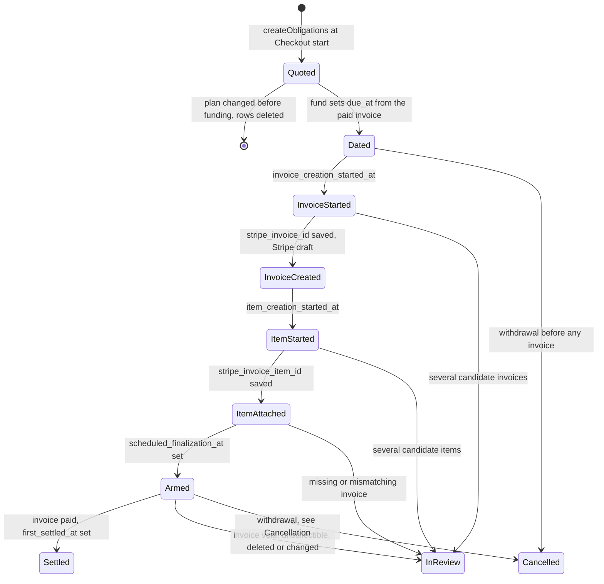
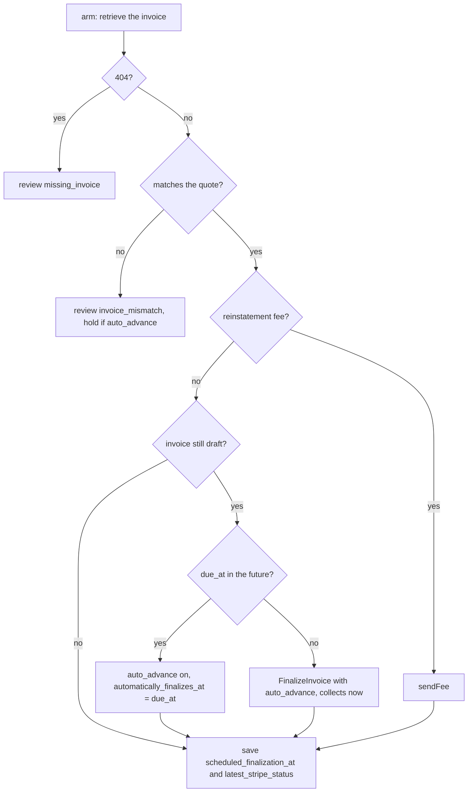
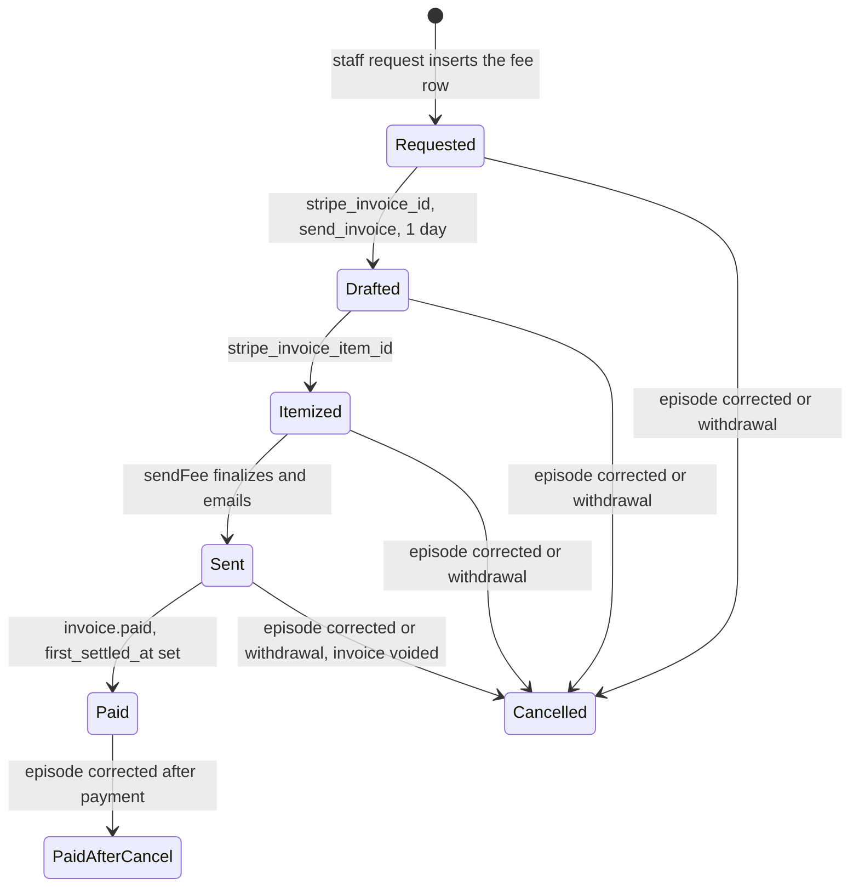

# Invoices and Obligations

How a tuition installment or the reinstatement fee becomes a Stripe invoice: the obligation's states, the crash-safe creation stages, arming, the card gate, cancellation and the display status staff see. The loop that runs all of it is in [Billing worker](worker.md); the funding model is in [Billing overview](overview.md); what a fee does to a student is in [Suspension](suspension.md); what a withdrawal stops is in [Withdrawal](withdrawal.md); flags raised here are listed in [Reviews](reviews.md).

An obligation (`billing_obligations`) is one amount the student owes. The app never charges a card: it creates and arms invoices and Stripe collects.

| Kind | `number` | Collected by | Created by |
|---|---|---|---|
| tuition #1 | 1 | The Stripe-generated invoice of the hosted Checkout | Quoted when Checkout starts; the row adopts the paid invoice at funding (`fund`) |
| later tuition #2 ... #N | greater than 1 | One-off invoice, `charge_automatically`, armed to finalize on the due date | `scheduleInvoices` in the worker |
| reinstatement fee | none | One-off invoice, `send_invoice`, paid by the student on Stripe's hosted page | Staff request (`RequestReinstatement` calling `requestFee`) |

Plans have 1, 3 or 6 installments, so a funded contract ends with exactly zero, two or five scheduled invoices. Plan amounts and due-date rules: [Billing overview](overview.md).

## Later tuition lifecycle

- **Quoted**: `due_at` is NULL, `amount_remaining_cents` equals the amount. Changing plan before funding deletes the unfunded rows.
- **Dated**: at funding, `due_at` becomes the Puerto Rico midnight dates of `Plan.Schedule(paid_at)` and the remaining amount is restored. Tuition #1 instead gets the Checkout invoice's ID, status `paid`, remaining 0 and `first_settled_at = paid_at`.
- **InReview**: `review_reason` is set; `scheduleInvoices` skips reviewed obligations. See [Reviews](reviews.md) for when the flag clears.
- **Cancelled**: a withdrawal sets `collection_disposition = cancel` on every unsettled stage; whatever reached Stripe is deleted or voided ([Cancellation](#cancellation)).
- Any step can be retried after a crash: each persisted stage is the resume point.

### Creation stages and why there are two steps

`scheduleOne` runs three persisted stages under the contract lease, calling `renew` before each Stripe call. Every stage first writes a marker, then calls Stripe, then writes the resulting ID.

| Stage | Marker | Stripe object | ID column | Idempotency key |
|---|---|---|---|---|
| 1 `createInvoice` | `invoice_creation_started_at` | Draft invoice: USD, `charge_automatically`, `auto_advance` off, `pending_invoice_items_behavior` exclude, card only, metadata `tuition_contract` and `tuition_obligation` | `stripe_invoice_id` | `tuition:<ref>:inv` |
| 2 `createItem` | `item_creation_started_at` | Invoice item attached to that draft: the quoted Price, quantity 1, description "Pago N de M — plan name" | `stripe_invoice_item_id` | `tuition:<ref>:item` |
| 3 `arm` | `scheduled_finalization_at` | Update or finalize, below | same column | `:arm` or `:finalize` |

A retry that finds a marker already set does not just replay the create: it first lists the Customer's invoices (or the draft's items) and matches the metadata `tuition_obligation`. One match is adopted (`adopt`); several set the obligation review `unresolved_provider_create`; none replays the create under the same key. Reason: Stripe keeps idempotency keys for about 24 hours `[EXTERNAL]`, so a crash followed by a late retry could otherwise create a second invoice or item. The Checkout side uses the same idea with a 23 h window ([Checkout](checkout.md)).

Invoices are card-only (Apple Pay and Google Pay ride on card). Klarna is offered only for the single payment, so the account's invoice defaults never add it.

### Arming

`invoiceMatches` is the quote check: USD, no starting-balance debit, no discounts or taxes, exactly one line with the quoted amount. A past-due date keeps its original `due_at` and the invoice is finalized immediately, so Stripe then collects `[EXTERNAL]`; no new Checkout or fee is ever created for overdue tuition, the original invoices stay collectible. This happens when the card gate or an outage delayed creation past the due date; staff Reconcile runs the same step.

`holdInvoice` runs only after the review is persisted: a non-matching draft or open invoice with `auto_advance` on is switched to off so it cannot collect unseen. An invoice held after it was armed is never re-armed by the app; one held before arming is armed again only if its review clears and `scheduleInvoices` picks it up.

## Card gate

`scheduleInvoices` calls `ensureDefaultPaymentMethod` once, and only when at least one later installment is pending. It makes the first payment's card the Customer's invoice default:

1. Customer already has `invoice_settings.default_payment_method`: pass; never overwritten (also what makes crash recovery safe). Clears the contract review.
2. The first Payment's PaymentIntent (earliest `payment_time`) has no payment method: fail.
3. The PaymentMethod is not a `card` or is attached to another Customer: fail.
4. Otherwise set it as the Customer default (key `tuition:<contract>:default_pm`), clear the review, pass.

On failure the contract gets review `unsupported_payment_method` and **no later invoice is created**, not merely left unarmed. The failure is not an error, so the sync completes. Any later pass that reaches the gate retries it: a `customer.updated` event, the next scheduled sync or staff Reconcile. Meanwhile the unpaid installments still count toward the 14-day rule, so such a student can be suspended and then refused reinstatement with `ErrNeedsReview` ([Suspension](suspension.md)). The fee skips the gate: it is not charged to a card.

## `latest_stripe_status` and settlement fields

`latest_stripe_status` follows Stripe; `invoiceStateOf` maps each status onto the obligation.

| Value | Meaning | Obligation effect |
|---|---|---|
| NULL | No invoice yet | |
| `draft` | Stripe draft | Paid 0, other 0, remaining = quoted amount |
| `open` | Finalized | Remaining = invoice's remaining; `failure_or_action_required` = Stripe `attempted` |
| `paid` | Settled | `first_settled_at` = invoice `paid_at`, set once and never moved earlier |
| `void`, `uncollectible` | Written off by Stripe | Signed tuition is never forgiven: remaining = amount - paid - other, review `invoice_mismatch` |
| `deleted` | Synthetic, not a Stripe status: Stripe answered 404 or a deleted invoice, or `cancelObligation` deleted a draft | Review `missing_invoice`; the app never replaces a vanished invoice |

For an obligation with `collection_disposition = cancel`, `void` and `deleted` are the intended end state: remaining 0 and no review. `deleted` also feeds `invoiceReady` and `cancelPending`, which is why it is stored.

| Column | Meaning |
|---|---|
| `amount_paid_cents` | Stripe cash paid on the invoice |
| `other_settlement_cents` | Credits and off-Stripe settlement, kept apart from cash |
| `failure_or_action_required` | Open invoice with a payment attempt made |
| `collection_disposition` | `collect`, or `cancel` for a fee of a corrected episode |
| `deadline_episode_id` | Episode this installment's missed deadline is attributed to |

## Reinstatement fee

The worker never creates the fee; a staff request does, and only the staff request resumes an interrupted creation. The worker only mirrors it and cancels it.

1. `requestFee` inserts one row per episode: kind `reinstatement`, 2500 cents (`reinstatementFeeCents`), the catalog Price `asvab_reinstatement_usd`, `suspension_id` = the open episode, `collect`, no `due_at`, remaining 2500. A repeated request finds it by `suspension_id`.
2. It runs the same `scheduleOne` stages with differences: `collection_method` `send_invoice` with `days_until_due` 1 (the student pays on Stripe's hosted page by the next day, never from a saved card), item description "Reinstalación", and the invoice total must equal 2500 exactly.
3. `sendFee` finalizes with `auto_advance` (key `reinstatement:<ref>:finalize`), then calls `SendInvoice` (key `...:send`), and stores `scheduled_finalization_at = now` and status `open`. Past the keys' retention a retried send could email again; the fee is never duplicated.
4. `invoice.paid` reaches `syncInvoice`; reactivation conditions are in [Suspension](suspension.md). Staff open the hosted page through `InvoiceURL`, fetched on demand and never stored (`ErrInvoiceNotReady` while there is none); the button needs `invoiceReady`.
5. When the episode is corrected, `correctEpisode` persists `collection_disposition = cancel` first; `cancelFees` then deletes a draft (`deleted`), voids an open or uncollectible invoice (`void`) and sets remaining 0. A fee already paid is left alone and `syncInvoice` sets the obligation review `payment_review`, which nothing clears.

A fee has no `due_at`, so it is rechecked every 15 minutes while money remains ([Worker](worker.md)).

## Cancellation

An obligation whose `collection_disposition` is `cancel` must never collect. Two writers set it, always before any Stripe call: `correctEpisode` on the fee of a corrected episode ([Suspension](suspension.md)), and `withdraw` on every obligation of a withdrawn contract with no `first_settled_at`, tuition and fees alike ([Withdrawal](withdrawal.md)). Every sync then runs `cancelObligations`: it loads the contract's `cancel` rows by `id`, keeps those still `cancelPending` (an invoice ID is saved or its creation started, and the status is not `void`, `deleted` or `paid`) and runs `cancelObligation` on each, renewing the lease first.

| Invoice | `cancelObligation` | Stored |
|---|---|---|
| Creation started, no ID saved | Lists the Customer's invoices by the obligation's metadata (`invoicesOf`): one is adopted and cancelled as below; several set review `unresolved_provider_create` and none is cancelled; none is listed again on the next sync (`ponytail` note) | The adopted `stripe_invoice_id` |
| Draft | Deleted | `deleted`, remaining 0 |
| Open or uncollectible | Voided | `void`, remaining 0 |
| 404 or already deleted | Nothing | `deleted`, remaining 0 |
| Paid or already void | Left alone; `syncInvoice` reports what remains | |

An obligation that never started an invoice is not `cancelPending`: nothing exists at Stripe, and it keeps its remaining amount, which the summary and the dashboard ignore for a cancelled installment ([Invoice display status](#invoice-display-status), [Dashboard](../management/dashboard.md)). Nothing is ever recharged, and an uncertain create is only located so it can be cancelled, never finished or sent.

A cancelled invoice that was paid anyway is judged by `invoiceStateOf(o, inv, withdrawn)`; `syncInvoice` loads the contract and passes whether it is withdrawn. On a contract that is not withdrawn it gets the obligation review `payment_review` and the money stays a staff matter ([Reviews](reviews.md)); on a withdrawn contract it gets no review, because the withdrawal refunds it.

## Invoice display status

Staff and customer views derive a per-installment status from the stored columns (`summarize`); first match wins.

| Order | Status | Condition |
|---|---|---|
| 1 | `cancelled` | `collection_disposition = cancel` and no `first_settled_at`: a withdrawal stopped it. Never counted as remaining or overdue |
| 2 | `paid` | `first_settled_at` set, or remaining 0 |
| 3 | `action_required` | `failure_or_action_required` |
| 4 | `overdue` | `due_at` is before now |
| 5 | `scheduled` | otherwise |

`invoiceReady` is true when an invoice ID exists and the status is not empty, `draft` or `deleted`: only then can staff open the hosted invoice. Where these appear: [Staff students](../management/students.md).

## Deliberate choices

| Choice | Why |
|---|---|
| Draft stays `auto_advance` off until armed | Stripe never finalizes an invoice the app has not validated |
| Marker written before the Stripe call | A crash between call and response leaves evidence to adopt |
| Reviewed obligations are not re-armed because a stage is incomplete | A hold stays a hold until the invoice matches again |
| A vanished invoice is reviewed, never replaced | Replacing could double-bill tuition |
| `deleted` stored as a status | `invoiceReady` and `cancelPending` need it |
| Cancel intent persisted before any Stripe call | Every retry only continues cancelling |

## Source

- `internal/billing/invoices.go`: `scheduleInvoices`, `scheduleOne`, `createInvoice`, `createItem`, `invoicesOf`, `adopt`, `arm`, `sendFee`, `reviewObligation`, `ensureDefaultPaymentMethod`, `invoiceMatches`, `invoiceStateOf`, `reviewFor`, `syncInvoice`, `holdInvoice`, `store`, `cancelPending`, `cancelObligations`, `cancelObligation`
- `internal/billing/checkout.go`: `fund`, `createObligations`
- `internal/billing/suspension.go`: `requestFee`, `correctEpisode`
- `internal/billing/withdraw.go`: `withdraw`
- `internal/billing/summary.go`: `summarize`, `invoiceReady`
- `internal/billing/billing.go`: `InvoiceURL`, `ErrInvoiceNotReady`
- `internal/billing/stripe.go`: `reinstatementFeeCents`
- `internal/billing/models.go`: `Obligation`
