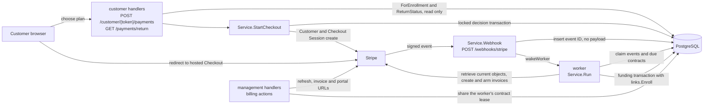

# Billing Overview

How tuition money is modeled and moved: one hosted Checkout for the first payment, one-off Stripe invoices for later installments, and a leased worker that mirrors Stripe state into the database. Details live in [Checkout](checkout.md), [Webhooks](webhooks.md), [Worker](worker.md), [Invoices](invoices.md), [Suspension](suspension.md) and [Reviews](reviews.md). Stripe account setup is in [Stripe setup](../operations/stripe-setup.md); the person-level story is in [Lifecycle](../domain/lifecycle.md).

## Funding model

- **No Stripe subscription.** The first installment is paid through a hosted Checkout Session in `payment` mode ([Checkout](checkout.md)). Each later installment is a one-off Stripe invoice created as a draft right after funding, then armed with `auto_advance` and `automatically_finalizes_at` set to the installment's stored due date, which is Puerto Rico midnight ([Invoices](invoices.md)). Stripe promises no exact second for finalization. A due date already in the past is finalized immediately.
- **Funding is the moment a student exists.** `Service.fund` runs one transaction that sets `billing_contracts.funded_at` (anchored to the Stripe invoice's `paid_at`, never a local clock), sets the due dates, records the first `billing_payments` row, moves the attempt to `paid`, and calls `links.Enroll`, which creates the Student, sets `enrollments.paid_at` and moves the PIN. See [Lifecycle](../domain/lifecycle.md) for the vocabulary.
- **Funding comes only from verified Stripe state.** `fund` works from objects just retrieved from Stripe: the Session with its PaymentIntent, its generated invoice and that invoice's payments. It does not fund unless the invoice is `paid` with a paid-at time, the amount paid equals the attempt's first amount, the invoice matches the quoted one-line USD invoice, and a paid invoice payment belongs to the Session's PaymentIntent. Until then the sync fails retryably (the attempt moves to `processing` where Stripe's data lags) and a mismatch also sets a review ([Reviews](reviews.md)). Webhook bodies are never applied ([Webhooks](webhooks.md)); the return page only reads the stored attempt and never funds.
- **The app never charges a card.** Stripe collects each armed invoice from the card saved at the first payment. The reinstatement fee is the exception in kind: a `send_invoice` invoice the payer settles on Stripe's hosted page ([Suspension](suspension.md)).

### Who can reach `fund`

| Entry point | Path | Notes |
|---|---|---|
| Worker, webhook event | `handleEvent` -> `syncAttempt` -> `fund` | Event wakes the worker; see [Worker](worker.md) |
| Worker, due contract | `syncContract` -> `reconcileContract` -> `syncAttempt` -> `fund` | New contracts are due 1 minute after creation |
| Staff Reconcile | `ReconcileStudent` -> `reconcileContract` | Same sync pass, under the staff lease |
| Staff Reinstatement | `RequestReinstatement` -> `reconcileContract` -> `requestFee` | Same sync pass first, then the fee |

The two staff paths run the full contract sync, so they can create or arm invoices (a past-due one is finalized at once, so Stripe then collects), replay a Checkout create, and evaluate deadlines and reactivation. In production they locate the contract through the `students` row (`contractFor`), and a Student exists only after `fund` committed. They therefore only ever re-sync an already funded contract, for example to finish invoice scheduling after a crash. Tests seed a Student before funding to reach those entry points (`setupTestEnvironment`).

## Components

`main.go` builds the service (`billing.New`), mounts `POST /webhooks/stripe` outside staff auth, and starts `Service.Run` in one goroutine; startup and shutdown order are in [Startup and shutdown](../operations/startup-shutdown.md), the route table in [Architecture](../architecture.md).

## Plans

Plans are defined in `internal/payments/plans.go`. A contract stores its plan name, installment count, total and each obligation's amount when Checkout first quotes it. The plan can be switched until funding ([Checkout](checkout.md)); once funded, nothing changes it, and later registry edits do not reach it.

| Plan ID | Name | Installments | Amounts | Total |
|---|---|---|---|---|
| `full` | Pago Único | 1 | $600.00 | $600.00 |
| `three` | Plan de 3 Pagos Mensuales | 3 | $208.34, $208.33, $208.33 | $625.00 |
| `six` | Plan de 6 Pagos Mensuales | 6 | $108.35, then five of $108.33 | $650.00 |

Amounts are integer cents; the Stripe price behind each amount is in [Stripe setup](../operations/stripe-setup.md).

### Due dates

`Plan.Schedule(anchor)` returns one local-midnight date per installment in `payments.PuertoRico` (UTC-4, no daylight saving):

1. The anchor day is the Puerto Rico calendar day of the anchor instant, so `2026-10-01T03:59:59Z` is September 30 and `2026-10-01T04:00:00Z` is October 1.
2. Installment *i* (from 0) falls in the anchor's month plus *i*, on the anchor's day, clamped to that month's last day.
3. The clamp does not carry forward: every date derives from the original anchor day.

| Anchor day (Puerto Rico) | Plan | Dates |
|---|---|---|
| 2026-01-31 | `three` | 2026-01-31, 2026-02-28, 2026-03-31 |
| 2028-01-31 | `three` | 2028-01-31, 2028-02-29, 2028-03-31 |
| 2026-01-30 | `three` | 2026-01-30, 2026-02-28, 2026-03-30 |
| 2026-10-31 | `six` | 2026-10-31, 2026-11-30, 2026-12-31, 2027-01-31, 2027-02-28, 2027-03-31 |

The customer's payments page previews `Plan.Schedule` anchored to today ([Customer flow](../domain/customer-flow.md)). The real dates are computed once inside the funding transaction, anchored to `fundedAt`, from the contract's persisted amounts. Installment 1 is dated the funding day and is already settled by that payment.

## File map

Everything lives in `internal/billing` unless stated.

| File | Owns |
|---|---|
| `billing.go` | Package comment, `Service` and `New`, `providerBudget`, review-reason constants, the exported error block, shared helpers (`forUpdate`, `persistCtx`, `outcomeUnknown`, `firstRow`, `require`), result and summary types, staff actions `InvoiceURL`, `PortalURL`, `ReconcileStudent` |
| `checkout.go` | `StartCheckout`, the locked decision transaction, Session creation and expiry, attempt state writes ([Checkout](checkout.md)) |
| `contact.go` | `TouchContract`, `UpdateContact`, `ContactEditable` and the in-flight attempt states that lock contact edits |
| `suspension.go` | 14-day deadline evaluation, episodes, correction, fee cancellation, reactivation, `RequestReinstatement` ([Suspension](suspension.md)) |
| `summary.go` | Read models: `ForEnrollment`, `ForStudent`, and `ReturnStatus` for the token-free return page |
| `overview.go` | Dashboard figures ([Dashboard](../management/dashboard.md)) |
| `webhook.go` | Webhook HTTP intake and the event allowlist ([Webhooks](webhooks.md)) |
| `worker.go` | Worker loop and queues, event routing, leases, attempts and funding, payments, invoice sync, invoice creation, contract reconciliation, `markSynced`, `nextSyncAt` ([Worker](worker.md)) |
| `stripe.go` | `Config` and its validation, `LoadConfigFromEnv`, price `Catalog` and `LoadCatalog`, `NewStripeClient`, `stripeLocale`, `ReinstatementFeeCents` |
| `models.go` | The six tables `billing_contracts`, `billing_obligations`, `billing_checkout_attempts`, `billing_payments`, `billing_suspensions`, `billing_webhook_events`; constraints are tabulated in [Data model](../data-model.md) |
| `export_test.go` | `DrainForTest`, one deterministic worker pass for integration tests |
| `billingtest/billingtest.go` | `billingtest.New`: a service over a fake Stripe HTTP handler, a valid sandbox `Config` and a full `Catalog`, used by billing, customer, management and main wiring integration tests (logging tests use its `Config`, `Catalog` and `Client` components) |

## Glossary

| Term | Meaning |
|---|---|
| Contract | `billing_contracts` row, one per Enrollment (`enrollment_id` is unique). Exists from the first Checkout start; the Student exists only once it is funded |
| Obligation | `billing_obligations` row: a numbered `tuition` installment or a `reinstatement` fee |
| Attempt | `billing_checkout_attempts` row: one hosted Checkout creation and payment ([Checkout](checkout.md)) |
| Review reason | `Contract.ReviewReason` and `Obligation.ReviewReason` draw from one set of reasons (the `review*` constants in `billing.go`). `Summary.ReviewReasons` merges both without duplicates. Which workflow sets and clears each reason is in [Reviews](reviews.md) |
| Episode | A `billing_suspensions` row, one continuous suspension. `Obligation.SuspensionID` is set on a fee obligation and points to the episode the fee belongs to. `Obligation.DeadlineEpisodeID` is set on a tuition obligation and points to the episode its missed 14-day deadline opened or joined. `Suspension.TriggeringTuitionInstallmentNumber` is the installment that opened it |
| Lease | `lease_token` and `lease_expires_at` on a contract, held while one workflow talks to Stripe ([Worker](worker.md)) |

"Schedule" has four unrelated senses:

| Name | Where | Meaning |
|---|---|---|
| `Plan.Schedule` | `internal/payments/plans.go` | Installment due dates for a plan |
| `scheduleInvoices` | `worker.go` | Creates and arms the later invoices ([Invoices](invoices.md)) |
| `nextSyncAt` and `next_sync_at` | `worker.go`, `billing_contracts` | When the contract is next re-synced |
| `scheduled_finalization_at` | `billing_obligations` | The due date an invoice was armed with (or `time.Now()` for the reinstatement fee); its presence marks arming as done |

## Deliberate choices

- **`billing.New` validates `Config` again** although `LoadConfigFromEnv` already did. `New` is the public constructor that tests call directly (`billingtest.New`), so validation belongs at that boundary.
- **Stored webhook events carry no payload.** The worker always re-reads the current Stripe object, so storing bodies would add personal data and staleness for no benefit ([Webhooks](webhooks.md)).
- **Staff actions share the worker's contract lease** through `withStaffContract`. A contract a worker holds is mid-provider-work, so staff get `ErrPaymentPending` and retry instead of racing it.
- **`ContactEditable` and `UpdateContact` share one predicate.** `ContactEditable` is a lock-free pre-check that only shows or hides the edit link; `UpdateContact` is the authoritative locked check ([Checkout](checkout.md) lists the locking states).
- **`ReturnStatus` is keyed only by `session_id`.** It is token-free by design and exposes only a status and the first amount.
- **Billing-safe cancellation delegates to `billing.Service.CancelEnrollment`.** Staff cancellation of enrollments locks the contract and active checkout attempts, expires any open Stripe Checkout session (never canceling an in-flight `processing`/`creating`/`uncertain`/`expiring` attempt, returning `ErrCancelBlocked`), and calls `links.CancelEnrollmentTx` to cancel `InProgress`/`AwaitingPayment` enrollments or clear an `Expired` submission's PIN.

## Source

- `internal/billing/billing.go`: `Service`, `New`, `providerBudget`, `ErrPaymentPending`, `ErrContactLocked`, `ErrCancelBlocked`, `forUpdate`, `persistCtx`, `outcomeUnknown`, `firstRow`, `require`, `Summary`, `contractFor`, `withStaffContract`, `InvoiceURL`, `PortalURL`, `ReconcileStudent`
- `internal/billing/cancel.go`: `CancelEnrollment`
- `internal/billing/checkout.go`: `StartCheckout`
- `internal/billing/contact.go`: `TouchContract`, `UpdateContact`, `ContactEditable`, `inFlightAttemptStates`
- `internal/billing/summary.go`: `ForEnrollment`, `ForStudent`, `ReturnStatus`, `addReason`
- `internal/billing/overview.go`: `Overview`
- `internal/billing/webhook.go`: `Webhook`, `webhookEvents`
- `internal/billing/worker.go`: `fund`, `syncAttempt`, `syncContract`, `reconcileContract`, `handleEvent`, `scheduleInvoices`, `arm`, `markSynced`, `nextSyncAt`, `leased`
- `internal/billing/stripe.go`: `Config`, `LoadConfigFromEnv`, `Catalog`, `LoadCatalog`, `NewStripeClient`, `stripeLocale`, `ReinstatementFeeCents`
- `internal/billing/models.go`: `Contract`, `Obligation`, `CheckoutAttempt`, `Payment`, `Suspension`, `WebhookEvent`, `ScheduledFinalizationAt`, `DeadlineEpisodeID`, `SuspensionID`, `ReviewReason`
- `internal/billing/export_test.go`: `DrainForTest`
- `internal/billing/checkout_test.go`: `setupTestEnvironment`
- `internal/billing/billingtest/billingtest.go`: `New`, `Config`, `Catalog`
- `internal/payments/plans.go`: `Plans`, `Schedule`, `PuertoRico`, `TotalCents`
- `internal/payments/plans_test.go`: `TestPlanSchedule`
- `internal/links/links.go`: `Enroll`
- `main.go`: `newServer`, `LoadConfigFromEnv`
