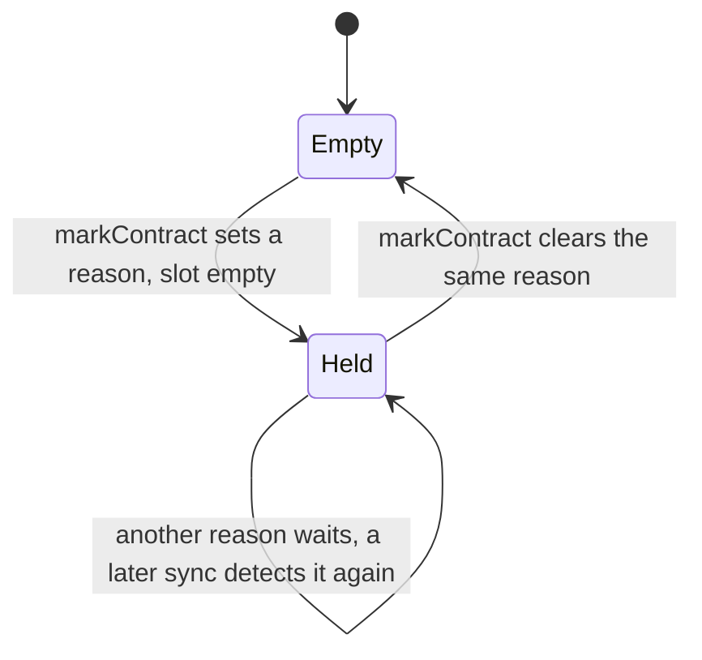
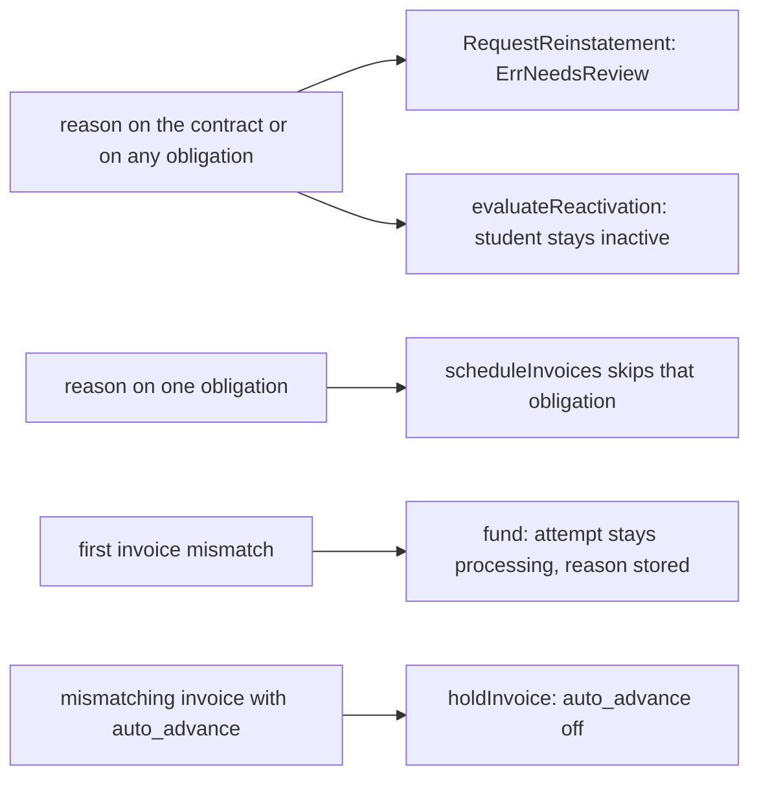

# Billing Reviews

A review is a bounded reason string the worker stores when it cannot prove that Stripe's state matches the quote, so it stops the actions that could make things worse and shows the reason to staff. This page lists every reason, who sets and clears it, and what it blocks. Where the flags come from: [Billing worker](worker.md), [Invoices](invoices.md); the student-facing consequence: [Suspension](suspension.md).

## Two levels, one vocabulary

| Level | Column | Slots |
|---|---|---|
| Contract | `billing_contracts.review_reason` | One reason at a time |
| Obligation | `billing_obligations.review_reason` | One reason per obligation |

Both hold values from the same six `review*` constants in `billing.go`. They are not two vocabularies: `summarize` merges the contract's reason and every obligation's into one deduplicated list, `Summary.ReviewReasons`, which staff see as "Needs review:" with the codes in the student's billing block ([Staff students](../management/students.md)). The dashboard figure `ContractsInReview` counts contracts with a reason at either level, funded or not ([Dashboard](../management/dashboard.md)).

Do not confuse reasons with related values: payment-level states `dispute_open`, `dispute_lost` and `fraud_warning` (`billing_payments.dispute_or_fraud_review_state`) are inputs to the contract reason `payment_review`; an `uncertain` Checkout attempt is an attempt state ([Checkout](checkout.md)); a Payment without `balance_transaction_id` only schedules 15-minute rechecks ([Worker](worker.md)).

## Single contract slot

`markContract` sets a reason only while the slot is empty and clears it only when the slot holds exactly that reason. A second reason is not queued: it is simply detected again by a later sync once the first one clears. This is deliberate: the reasons come from independent workflows, each of which re-runs its own check every sync.

Obligations use `reviewObligation`, which writes unconditionally, and `reviewFor`, which lets invoice-derived reasons recompute: a stored `invoice_mismatch`, `missing_invoice` or `payment_review` follows the freshly computed value; any other stored reason is kept. An obligation's `payment_review` counts as invoice-derived because only `invoiceStateOf` sets it, so a withdrawal can clear it.

## Reasons

| Reason | Level | Set by | Cleared by |
|---|---|---|---|
| `unsupported_payment_method` | Contract | `ensureDefaultPaymentMethod`: the Customer has no default payment method and the first payment's method is missing, is not a card, or belongs to another Customer. No later invoice is created meanwhile | The same function passing on a later pass: a default method exists, or the first card was set as default. The pass is any that reaches the gate: a `customer.updated` event, the next sync, staff Reconcile |
| `configuration_mismatch` | Contract | `syncAttempt`: a Checkout Session recovered for an attempt that never recorded its Session ID does not exactly match (USD, payment mode, same Customer, quoted amount) | The funding transaction (`fund`) |
| `invoice_mismatch` | Contract | `fund`: the Checkout invoice, or its payment, does not match the quote. Funding is blocked and the attempt stays `processing` | The funding transaction, once funding succeeds |
| `unresolved_provider_create` | Contract | `resumeCreate`: more than one Checkout Session carries the attempt's `client_reference_id` | Never |
| `payment_review` | Contract | `store`: any Payment has a dispute or fraud state, or, on a contract that is not withdrawn, refunded cents above zero | Recomputed on every `store`. Refunded amounts never decrease and any fraud warning stays, so on a contract that is not withdrawn only disputes that end won, warning-closed or prevented clear it. On a withdrawn contract refunds no longer count, so the withdrawal's own refunds never set it and earlier ones stop holding it ([Withdrawal](withdrawal.md)) |
| `invoice_mismatch` | Obligation | `arm`: the invoice is not the exact quote (or a fee's total is not 2500); `invoiceStateOf`: the same mismatch, or an invoice that is `void` or `uncollectible` without a cancel disposition | `reviewFor` on a later sync, once the invoice matches again and is neither void nor uncollectible |
| `missing_invoice` | Obligation | `arm`: Stripe answers 404; `syncInvoice`: the invoice is 404 or deleted (unless its collection was cancelled, so it was meant to vanish) | Recomputed like the above; a deleted invoice stays missing, so effectively never |
| `unresolved_provider_create` | Obligation | `adopt`: several invoices or invoice items carry the obligation's metadata, during creation or during a cancellation lookup | Never |
| `payment_review` | Obligation | `syncInvoice`: an obligation with `collection_disposition = cancel` (in practice a fee whose episode was corrected) was paid anyway, on a contract that is not withdrawn | `reviewFor` once `invoiceStateOf` stops computing it, which happens only when the contract is withdrawn: the withdrawal refunds the payment instead. Otherwise never; refunding is a staff matter in the Stripe Dashboard |

Pre-funding reasons (`configuration_mismatch`, `invoice_mismatch`) are cleared when `fund` succeeds. If `unresolved_provider_create` was set and a webhook later matches and funds the attempt by `client_reference_id`, it survives into the funded contract and shows on the student's page. Reasons are logged at WARN as `billing_review_required` with opaque references, and a visible change announces a live update ([Observability](../operations/observability.md)).

## What a review blocks

| Blocked | By | Effect |
|---|---|---|
| A reinstatement request | `reinstatable` through `hasReview` (contract slot or any obligation) | `ErrNeedsReview`, answered 409 "This student's billing needs review before this can continue." |
| Automatic reactivation | `evaluateReactivation` through `hasReview` | The episode stays open and the student stays inactive, even with the fee paid |
| Creating or arming the reviewed obligation | `scheduleInvoices` selects only obligations with no reason | The obligation waits; it resumes if the review clears |
| Funding | `fund` on an invoice/payment amount or line mismatch | The attempt stays `processing`; no Student is created, and `invoice_mismatch` is recorded on the contract |
| An unexpected invoice collecting | `holdInvoice` after the review is persisted | Stripe auto-advance is switched off for that invoice |

Not blocked: syncing, payment mirroring, the 14-day rule and a staff withdrawal keep running. A student can therefore be suspended while a review is held and then be unable to be reinstated until it clears. Review state is not part of any customer-facing page.

## No staff release

No code path outside the table above writes `review_reason`. Management only displays it (and the dashboard only counts it); there is no staff button, route or setting that clears or acknowledges a review. The one staff action that changes a reason is a withdrawal, and only indirectly: from then on the sync stops computing `payment_review` from refunds and from a paid cancelled obligation, so those clear; a dispute or fraud warning keeps the contract's, and every other reason stays ([Withdrawal](withdrawal.md)). Reasons marked "Never" leave reinstatement refused for that contract permanently, and the ones that clear on their own depend on Stripe's state changing. This gap is tracked in [Go-live](../go-live.md).

## Deliberate choices

| Choice | Why |
|---|---|
| One contract slot, no queue | Every workflow re-detects its own condition each sync, so nothing is lost and no priority rules are needed |
| Review persisted before any provider action | A crash cannot leave an unexpected invoice collecting with no record |
| Reasons that mean "which Stripe object is right?" never self-clear | The app must not guess between candidate invoices, Sessions or a collected cancelled fee (until a withdrawal refunds it) |
| `payment_review` never refunds or rebills by itself | Money moves back only on a staff decision: a withdrawal refunds in full, any other refund is made in the Stripe Dashboard |

## Source

- `internal/billing/billing.go`: `reviewUnresolvedProviderCreate`, `reviewInvoiceMismatch`, `reviewMissingInvoice`, `reviewPaymentReview`, `reviewUnsupportedPaymentMethod`, `reviewConfigurationMismatch`, `ErrNeedsReview`
- `internal/billing/worker.go`: `markContract`, `mark`
- `internal/billing/invoices.go`: `reviewFor`, `invoiceStateOf`, `syncInvoice`, `holdInvoice`, `store`, `reviewObligation`, `adopt`, `arm`, `scheduleInvoices`, `ensureDefaultPaymentMethod`
- `internal/billing/checkout.go`: `syncAttempt`, `resumeCreate`, `fund`, `reviewState`
- `internal/billing/suspension.go`: `hasReview`, `reinstatable`, `evaluateReactivation`
- `internal/billing/summary.go`: `summarize`, `Summary`
- `internal/billing/overview.go`: `ContractsInReview`
- `internal/billing/models.go`: `Contract`, `Obligation`, `WithdrawnAt`
- `internal/billing/withdraw.go`: `withdraw`, `refundPayments`
- `internal/management/students.go`: `billingRefusals`
