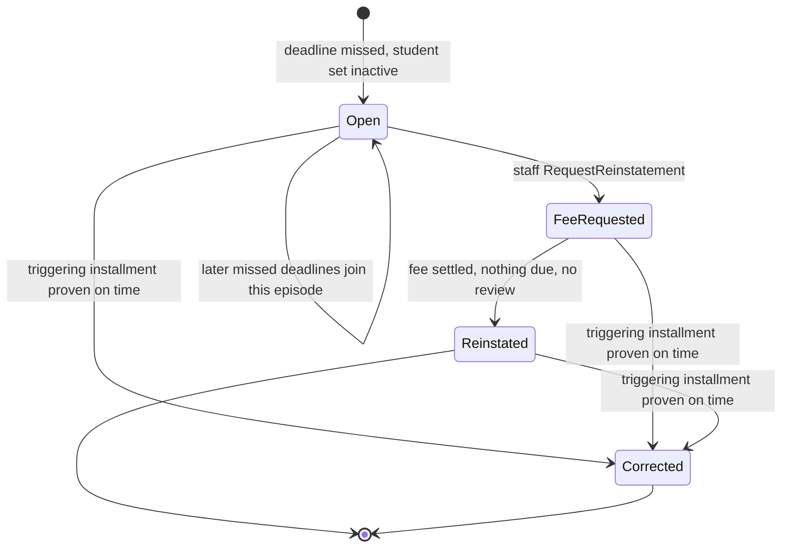
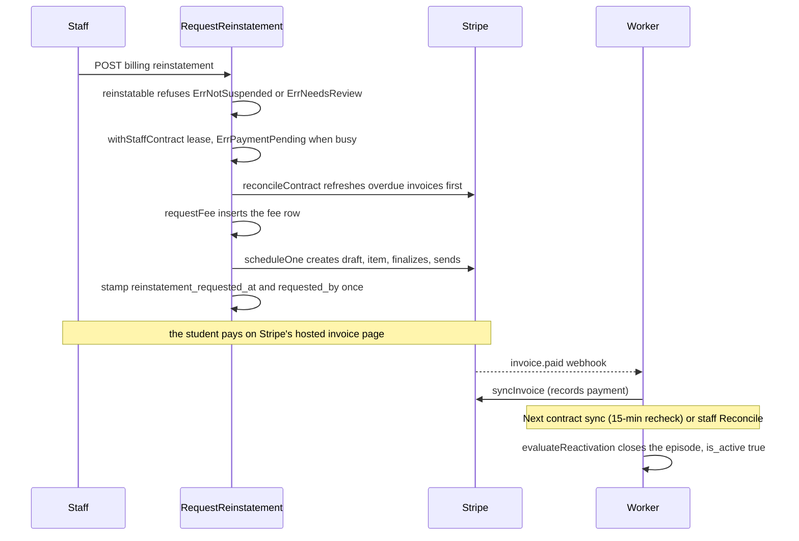

# Suspension and Reinstatement

The 14-day rule, suspension episodes, the staff-requested reinstatement fee, automatic correction and automatic reactivation. All of it runs inside the worker's sync ([Billing worker](worker.md)) on freshly mirrored invoice state; the fee's invoice mechanics are in [Invoices](invoices.md) and the review flags that block it are in [Reviews](reviews.md). Staff buttons: [Staff students](../management/students.md).

Suspension changes one thing: `students.is_active`. The only readers of that flag in this repository are the staff student list (badge and status filter, counts) and the billing summary. Whatever grants classroom access (the PIN is Socrative's credential) is outside the app.

## Terms

| Term | Meaning |
|---|---|
| Episode | One `billing_suspensions` row. At most one is open per contract (`idx_active_suspension`: unique where `closed_at IS NULL`) |
| Triggering installment | `TriggeringTuitionInstallmentNumber`: the installment whose missed deadline opened the episode |
| Attribution | `billing_obligations.deadline_episode_id`: the episode a missed installment was assigned to |
| `started_at` | The missed deadline itself, not the moment of detection |
| `close_reason` | `reinstated` or `corrected`; NULL while open |
| Fee | The episode's single reinstatement obligation, `reinstatementFeeCents` = 2500 ($25), created only by the staff request |

## The 14-day rule

`const deadlineWindow = 14 * 24 * time.Hour`. For every tuition obligation with a `due_at`, the deadline is `due_at` plus 14 days. A deadline is handled once it is no longer in the future, the installment has no `deadline_episode_id` yet, and `missedDeadline` is true:

- the installment still has money remaining (unpaid), or
- its `first_settled_at` is later than the deadline (paid late).

Consequences:

- An unpaid installment 14 days past due suspends the student.
- Settling after the deadline also suspends, retroactively: the detection happens on the next sync even though the money is in.
- Installments without a Stripe invoice count too (for example when the card gate withheld them, see [Invoices](invoices.md)).
- Several missed installments share one episode and one fee: each deadline is attributed to the episode whose `[started_at, closed_at]` covers it, else to the open episode, and only when neither exists is a new episode created.
- Unfunded contracts have no due dates and are never evaluated.

## Episode lifecycle

| State | Stored as | Student `is_active` |
|---|---|---|
| Open | `closed_at` NULL, `reinstatement_requested_at` NULL | false |
| FeeRequested | `closed_at` NULL, `reinstatement_requested_at` and `requested_by` set | false |
| Reinstated | `closed_at` set, `close_reason = reinstated` | true |
| Corrected | `close_reason = corrected`, `closed_at` set if it was open | true unless another episode is open |

`is_active` goes true to false when an episode is created and the student is active. It returns to true when an episode is reinstated, or when an open episode is corrected and no other open episode remains.

## Detection and correction

`evaluateDeadlines` makes one decision in one transaction under `leasedStudent`'s Enrollment, Contract and Student locks, after the invoices were refreshed:

1. Load tuition with a due date and every episode not yet corrected (including reinstated ones).
2. **Correct** each episode whose triggering installment is authoritatively settled on time (`falseEpisode`: `first_settled_at` set and not missed). This is what happens when a payment made before the deadline was recorded late. `correctEpisode` closes it as `corrected`, releases its attributions and sets its fee's `collection_disposition` to `cancel`, all before any Stripe call.
3. **Attribute** every missed deadline; open a new episode with `started_at` = the deadline when none covers it. Installments released in step 2 that truly missed are attributed again here.
4. **Flip the student**: if an episode was created or an open one corrected, set `is_active` to "no open episode remains".

`cancelFees` then finishes the Stripe side of cancelled fees: a draft invoice is deleted, an open or uncollectible one is voided, remaining goes to 0. A fee that was already paid is left alone and gets the obligation review `payment_review` ([Invoices](invoices.md)). Nothing is refunded or recharged.

## Reinstatement

Only staff can request it, and only for a student with an open episode: `POST /management/students/{id}/billing/reinstatement` calls `RequestReinstatement(ctx, id, staff(ctx))`, which refuses a blank staff identity. `requested_by` is that identity ([Staff authentication](../staff-auth.md)).

| Refusal | Error | Staff sees (409 unless noted) |
|---|---|---|
| No open episode | `ErrNotSuspended` | "This student is not suspended for billing." |
| Any review on the contract or any obligation | `ErrNeedsReview` | "This student's billing needs review before this can continue." |
| Contract lease held by the worker | `ErrPaymentPending` | "A payment is still pending. Try again shortly." |
| Unknown student, or no Stripe Customer | `ErrUnavailable` | 404 "Student or billing record not found." |

- The first refusal is checked before any provider work and again after the refresh, because the sync may close the episode or raise a review. A fee whose creation hits a review also answers `ErrNeedsReview`.
- Overdue installments are refreshed first and never moved onto the fee; their original invoices stay collectible.
- The whole request has the 8 s `providerBudget`.
- The request is resumable and idempotent: the fee row is found by `suspension_id`, and the stamp is written last and only while `reinstatement_requested_at` is NULL, so a repeat never changes who requested it or when. An interrupted request leaves the episode unrequested and can simply be repeated.
- The fee is paid on Stripe's hosted page, not charged to a saved card: no card needs to be on file.

### Reactivation

`evaluateReactivation` is step 9 of every sync, so it runs on the sync after `invoice.paid`. It reinstates exactly once, when all hold:

1. An open episode has `reinstatement_requested_at` set (staff asked).
2. That episode's fee is `collect`, remaining 0 and `first_settled_at` set.
3. No tuition installment whose due date has arrived still has money remaining. The fee alone is not enough.
4. No review is unresolved (`hasReview`: contract or any obligation).

Then, in one transaction: `closed_at = now`, `close_reason = reinstated`, `students.is_active = true`.

## Deliberate choices

| Choice | Why |
|---|---|
| `started_at` is the deadline | The timeline matches the rule, not the worker's lag |
| Reinstated episodes stay eligible for correction | Late-recorded on-time payment evidence can arrive after reinstatement |
| A review blocks both the request and reactivation | A financial anomaly must not be skipped past by an automatic status change |
| Reactivation needs the staff request | A student cannot be reactivated by paying the arrears alone |
| Correction persists the cancel intent before touching Stripe | Retries only continue cancelling |
| No release action for reviews | Not built; a held student stays held. See [Go-live](../go-live.md) |

## Source

- `internal/billing/suspension.go`: `deadlineWindow`, `reinstatable`, `RequestReinstatement`, `requestFee`, `missedDeadline`, `hasReview`, `episodeFor`, `falseEpisode`, `correctEpisode`, `evaluateDeadlines`, `evaluateReactivation`
- `internal/billing/invoices.go`: `cancelFees`, `cancelFee`, `syncInvoice`
- `internal/billing/models.go`: `Suspension`, `Obligation`
- `internal/billing/stripe.go`: `reinstatementFeeCents`
- `internal/billing/billing.go`: `ErrNotSuspended`, `ErrNeedsReview`, `ErrPaymentPending`, `ErrUnavailable`, `errStaffRequired`, `providerBudget`, `withStaffContract`
- `internal/billing/worker.go`: `reconcileContract`, `leasedStudent`
- `internal/management/students.go`: `billingRefusals`
