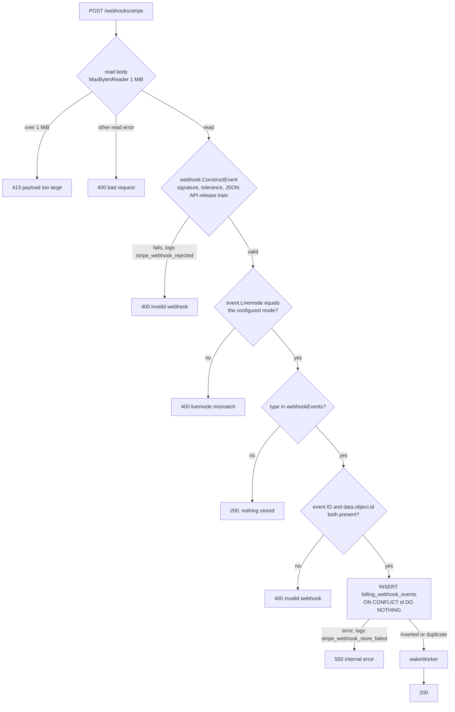

# Webhooks

How `POST /webhooks/stripe` turns a signed Stripe event into a stored wake signal for the billing worker. What the worker does with stored events is in [Worker](worker.md); the Stripe-side endpoint settings are in [Stripe setup](../operations/stripe-setup.md); the model overall is in [Billing overview](overview.md).

The handler is `Service.Webhook`. It is mounted by `main.go` directly on the top-level mux, outside staff `auth.Require` and owned by billing; the route table and middleware chain are in [Architecture](../architecture.md). Stripe's POST carries no browser origin headers, so `http.CrossOriginProtection`, which wraps every route, lets it through; an unsigned POST is answered 400 by the handler itself.

## Intake order

The mode check runs before the allowlist check, so a wrong-mode event of an ignored type also gets 400.

## Outcomes

| Status | Body | When | Logged |
|---|---|---|---|
| 200 | empty | Event stored; duplicate delivery of a stored event; type not in the allowlist | none |
| 400 | `bad request` | The body could not be read for a reason other than size | none |
| 400 | `invalid webhook` | `ConstructEvent` fails: missing or wrong signature, timestamp outside the 300 s tolerance, body not JSON, a thin event notification, or an event API version outside the SDK's release train. Also an allowlisted event with an empty event ID or `data.object.id` | `stripe_webhook_rejected` for `ConstructEvent` failures only, at most once a minute |
| 400 | `livemode mismatch` | `event.Livemode` differs from `STRIPE_MODE` | none |
| 413 | `payload too large` | Body over 1 MiB (`maxWebhookBody`) | none |
| 500 | `internal error` | The insert failed | `stripe_webhook_store_failed`, with the event ID |

Event body, signature header and secret are never logged. The handler answers 200 only after the insert or a confirmed duplicate, so a failed insert is answered 500 and Stripe redelivers the event (Stripe's retry schedule is `[EXTERNAL]`). A redelivery conflicts on the event ID, inserts nothing and returns 200.

## Signature and API version

- `webhook.ConstructEvent` verifies the `Stripe-Signature` header against `STRIPE_WEBHOOK_SECRET` with the SDK's default 300 s tolerance. Which secret to use locally and when deployed is in [Configuration](../operations/configuration.md).
- The expected API version is `stripe.APIVersion`, `2026-09-30.endive`, the constant shipped with stripe-go v87.0.0 in `go.mod`; the app does not pin it itself. The SDK compares release trains, not dates: an event whose version has the same train (`endive`) after the dot is accepted, and one without a train is rejected. Upgrading the SDK can therefore change the train the registered endpoint must use `[EXTERNAL]`.
- The raw body is read up to 1 MiB before verification, because the signature covers the exact bytes.

## Allowlist

`webhookEvents` holds exactly the 22 types the worker acts on. The filter is by type only: an allowlisted event about an object this app does not own is stored and later processed as a no-op.

| Group | Types | `resource_id` holds |
|---|---|---|
| Checkout Session (4) | `checkout.session.completed`, `checkout.session.async_payment_succeeded`, `checkout.session.async_payment_failed`, `checkout.session.expired` | Session ID |
| Invoice (10) | `invoice.created`, `invoice.finalized`, `invoice.finalization_failed`, `invoice.paid`, `invoice.payment_failed`, `invoice.payment_action_required`, `invoice.updated`, `invoice.voided`, `invoice.marked_uncollectible`, `invoice.deleted` | Invoice ID |
| Charge and refund (3) | `charge.updated`, `charge.refunded`, `refund.updated` | Charge or refund ID |
| Dispute (3) | `charge.dispute.created`, `charge.dispute.updated`, `charge.dispute.closed` | Dispute ID |
| Fraud warning (1) | `radar.early_fraud_warning.created` | Warning ID |
| Customer (1) | `customer.updated` | Customer ID |

How the worker routes each group to a contract is in [Worker](worker.md).

## Stored row

The handler writes three columns of `billing_webhook_events`; the rest belong to the worker.

| Column | Written by | Meaning |
|---|---|---|
| `id` (primary key) | webhook | Stripe event ID, the deduplication key |
| `event_type` | webhook | One of the 22 types |
| `resource_id` | webhook | `data.object.id` of the event's object |
| `processed_at`, `retry_at`, `retry_count`, `lease_token`, `lease_expires_at` | worker | Claim, retry and completion state ([Worker](worker.md)) |
| `created_at`, `updated_at` | database default | Row timestamps |

No payload is stored. The event is only a wake signal: `wakeWorker` makes a non-blocking send on a one-slot channel, so concurrent webhooks coalesce into one early pass, and the worker also ticks on its own. The worker then retrieves the current Stripe object, so a replayed or out-of-order event converges on the same state. The webhook, on its own, never changes a contract, attempt or student.

## Deliberate choices

- **No payload is stored.** The worker always re-reads the Stripe object, so keeping the body would add personal data and staleness for no benefit.
- **200 only after durability.** The insert or a confirmed duplicate precedes the 200, so Stripe retries anything that might have been lost; `ON CONFLICT (id) DO NOTHING` makes a redelivery a success instead of an error.
- **The allowlist is exactly the set of types the worker acts on.** Everything else is acknowledged with 200 and no row, so unused event traffic never reaches the table.

## Source

- `internal/billing/webhook.go`: `Webhook`, `webhookEvents`, `maxWebhookBody`
- `internal/billing/billing.go`: `wakeWorker`, `Service`
- `internal/billing/models.go`: `WebhookEvent`
- `internal/billing/worker.go`: `handleEvent`, `paymentIntentOf`, `processEvent`
- `internal/billing/webhook_test.go`: `TestWebhookAuthenticityAndReplay`
- `main.go`: `newServer`, `Webhook`
- `main_wiring_integration_test.go`: `/webhooks/stripe`
- `go.mod`: `stripe-go/v87`
