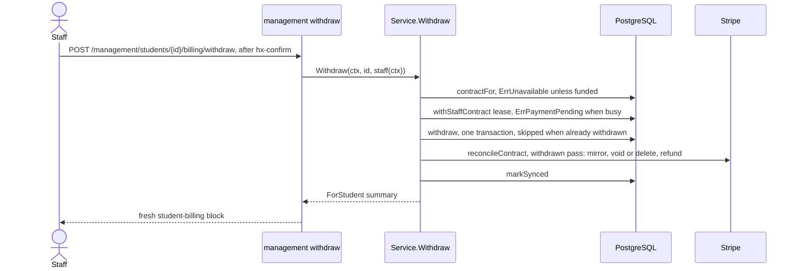

# Withdrawal and Refund

Staff end a funded contract with one action, **Withdraw and refund**: every undisputed cent the payer has paid so far is refunded (tuition and reinstatement fees alike), every unpaid or scheduled invoice is stopped, and the student becomes Withdrawn, inactive for good. Nothing undoes it; the person re-enrolls through a new link. The button and its refusals are in [Staff students](../management/students.md); the sync it runs is in [Billing worker](worker.md); invoice cancellation is in [Invoices](invoices.md#cancellation); review effects are in [Reviews](reviews.md).

## Flow

1. A blank staff identity is refused (`errStaffRequired`).
2. The whole call has the 8 s `providerBudget`. `contractFor` finds the contract through the Student row; a missing or unfunded contract answers `ErrUnavailable`.
3. Under the contract lease, `withdraw` records the intent, `reconcileContract` runs the withdrawn sync and `markSynced` schedules the next one: the same shape as `RequestReinstatement` ([Suspension](suspension.md#reinstatement)).
4. The answer is `ForStudent`, the fresh billing block.

Reviews do not block a withdrawal: it never calls `hasReview`.

## Recording the withdrawal

`withdraw` writes everything in one `leasedStudent` transaction (locks Enrollment, Contract, Student):

| Rows | Write |
|---|---|
| `billing_contracts`, this contract | `withdrawn_at = now`, `withdrawn_by = staff`, `next_sync_at = now` |
| `billing_obligations` with `first_settled_at` NULL, tuition and fees | `collection_disposition = cancel`, `next_retry_at = NULL` |
| `billing_suspensions` with `closed_at` NULL | `closed_at = now`; `close_reason` stays NULL |
| `students`, this student | `is_active = false`, `withdrawn_at = now` |

- A contract whose `withdrawn_at` is already set is left untouched, so a repeat keeps the first withdrawer and time. The sync that follows still resumes unfinished cancels and refunds.
- `next_sync_at = now`: if the staff request dies after this commit (budget spent, Stripe error), the worker picks the contract up on its next pass.
- The contract's `withdrawn_at` explains the episode's NULL `close_reason`. With no open episode, `IsSuspended` is false, `reinstatable` answers `ErrNotSuspended` and the dashboard stops counting the student as suspended, with no special case.
- After commit: a live update and INFO `student_withdrawn` with `contract` ([Observability](../operations/observability.md)).

## The withdrawn sync

From then on every contract sync (the worker's, staff Reconcile, or a repeated withdrawal) runs the withdrawn variant of `reconcileContract` ([Worker](worker.md#per-contract-sync)): it mirrors tuition and fee invoices with their payments, runs `cancelObligations`, then `refundPayments`. Nothing is scheduled, retried, judged against the 14-day rule or reactivated. Webhook events still refresh single invoices and payments; a `customer.updated` event still reaches `scheduleInvoices`, which finds nothing to create because every unsettled obligation is `cancel`.

- **Cancelling**: every cancelled obligation whose invoice could still collect has its draft deleted or its open invoice voided ([Invoices](invoices.md#cancellation)). An obligation that never got an invoice needs no Stripe call. An invoice paid between its sync and its void is mirrored as paid, gets no review, and is refunded with the rest.
- **Refunding**: below.
- **Next sync**: every 15 minutes while a cancel is pending, a payment has refundable cents or a payment lacks its balance transaction; otherwise the daily audit ([Worker](worker.md#when-the-next-sync-runs)).

## Refunds

`refundPayments` loads the contract's payments oldest first (`payment_time`, then `id`) and asks Stripe for one refund per payment with refundable cents:

| Field | Value |
|---|---|
| Amount | `Payment.refundableCents`: gross received minus gross refunded, or 0 while the payment's state is `dispute_open` or `dispute_lost`. A `fraud_warning` payment is refunded |
| Call | Refunds create on the PaymentIntent (`payment_intent`, `amount`) |
| `reason` | `requested_by_customer` |
| Metadata | `contract` (contract reference), `withdrawn_by` (the withdrawing staff username) |
| Idempotency key | `withdrawal:<contract reference>:<PaymentIntent ID>:<gross refunded so far>` |

- The lease is renewed before each call. A created refund logs INFO `withdrawal_refund` with `contract` and `amount_cents`.
- A refusal with `charge_already_refunded` or `charge_disputed` (`refundRefused`) means nothing is left to give back, so the payment is skipped. Any other error fails the sync, which retries ([Worker](worker.md#retry-rules)).
- After each call `syncPayment` re-reads the payment, so `gross_refunded_cents` mirrors Stripe's new total.
- No double refund: the sync re-reads every invoice's payments right before `refundPayments`, the key changes only when the refunded total does, and Stripe refuses any amount above what is left `[EXTERNAL]`.
- A refund that fails at the bank while its key is still kept reuses that key, so it is re-sent only once Stripe drops the key, about 24 h later `[EXTERNAL]` (`ponytail` note on `refundPayments`).

Open or lost disputes are never refunded by the app: the dispute moves that money, and the contract keeps `payment_review`. A dispute that ends won, warning-closed or prevented clears the payment's state, so the next sync tries its refund; if Stripe still refuses it with `charge_disputed`, the amount stays refundable on paper, with 15-minute rechecks and the "Refund pending" line.

The app only makes full withdrawal refunds. Staff make any other refund in the Stripe Dashboard through the Payments table's "Open in Stripe" link ([Staff students](../management/students.md#billing-block)); on a contract that is not withdrawn such a refund sets `payment_review`.

## Reviews on a withdrawn contract

A withdrawn contract's refunds are its own: they never set the contract's `payment_review`, while disputes and fraud warnings still do. A cancelled invoice paid anyway gets no obligation `payment_review`, and one stored before the withdrawal is recomputed away. Every other reason is unaffected. Rules: [Reviews](reviews.md).

## What changes for whom

| Who | Sees |
|---|---|
| Staff, billing block | Status "Withdrawn" with time and staff name, cancelled installments, refunds in the Payments table, "Refund pending" while refunds remain, and neither Withdraw and refund nor Request Reinstatement ([Staff students](../management/students.md#billing-block)) |
| Staff, roster and dashboard | Withdrawn badge and filter; counted under Withdrawn, never under Suspended or Total enrolled ([Staff students](../management/students.md#roster-and-filters), [Dashboard](../management/dashboard.md)) |
| Customer, payments page | A notice that the enrollment was withdrawn, nothing more will be charged and the refund goes to the paying card, instead of the collection promise; no paid/remaining card; cancelled installments as "Cancelado" ([Customer flow](../domain/customer-flow.md#payments-page)) |
| Payer, at Stripe | The refund on the paying card; the invoices keep reading paid, and the refund shows on the payment `[EXTERNAL]` |

The Student row and its PIN are kept; the PIN stays held ([Students](../domain/students.md#student-record)).

## Deliberate choices

| Choice | Why |
|---|---|
| Intent committed before any Stripe call | Every retry, staff or worker, only continues cancelling and refunding |
| Irreversible, no undo route | Refunded money cannot be taken back; re-enrolling starts a new link, enrollment and contract |
| Refunds API on the PaymentIntent, not credit notes | One call per payment covers tuition and fee cash alike |
| Disputed money never refunded by the app | The dispute already moves it; refunding too would pay twice |
| Episode closed with NULL `close_reason` | No new close reason, so the `suspension_close_reason` check stays as it is and every reader of "open episode" is right without a special case |
| Full refunds only | Partial refunds are judgement calls, made in the Stripe Dashboard |

## Source

- `internal/billing/withdraw.go`: `Withdraw`, `withdraw`, `refundPayments`, `refundRefused`, `student_withdrawn`, `withdrawal_refund`
- `internal/billing/models.go`: `Contract`, `WithdrawnAt`, `WithdrawnBy`, `Payment`, `refundableCents`
- `internal/billing/worker.go`: `reconcileContract`, `nextSyncAt`, `leasedStudent`, `markSynced`, `renew`
- `internal/billing/invoices.go`: `cancelPending`, `cancelObligations`, `cancelObligation`, `invoiceStateOf`, `reviewFor`, `store`
- `internal/billing/checkout.go`: `syncPayment`, `reviewState`
- `internal/billing/billing.go`: `contractFor`, `withStaffContract`, `providerBudget`, `errStaffRequired`, `ErrUnavailable`, `ErrPaymentPending`
- `internal/billing/suspension.go`: `reinstatable`, `RequestReinstatement`
- `internal/billing/summary.go`: `Summary`, `SummaryPayment`, `summarize`, `dashboardURL`
- `internal/students/students.go`: `Student`, `WithdrawnAt`
- `internal/management/management.go`: `RegisterRoutes`
- `internal/management/students.go`: `withdraw`, `act`
- `internal/management/templates/students.html`: `student-billing`
- `internal/customer/templates/payments.html`: `payments`
- `internal/billing/worker_test.go`: `TestWithdrawalRefundsAndStopsCollection`
