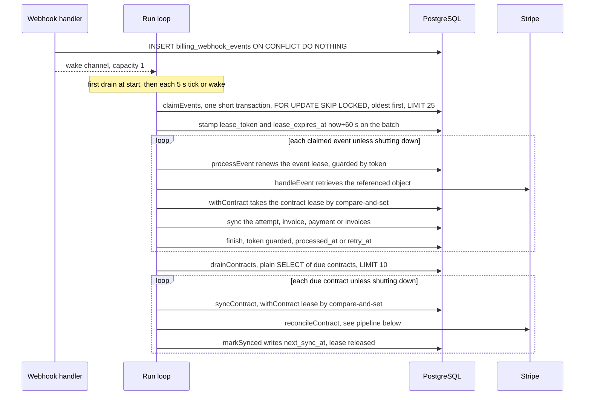
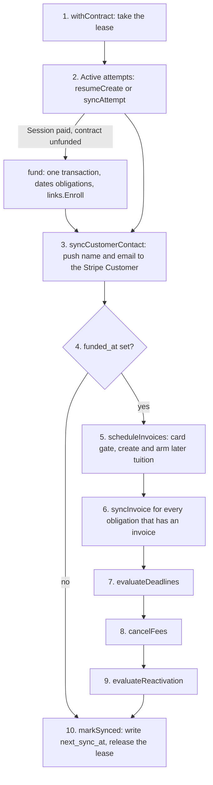

# Billing Worker

The leased background loop in `internal/billing` that turns stored Stripe webhook events and a timer into per-contract syncs. Intake is in [Webhooks](webhooks.md), money model in [Billing overview](overview.md); invoice creation, suspension policy and review flags have their own pages: [Invoices](invoices.md), [Suspension](suspension.md), [Reviews](reviews.md).

The worker never applies an event body. A stored event holds only `id`, `event_type` and `resource_id`; handling it means "re-read that object from Stripe and converge", so replays and out-of-order delivery are harmless. The app never charges a card itself: it creates and arms invoices and Stripe collects.

## Tick

`Service.Run` drains once at start, then again on every 5 s tick or as soon as it is woken. A pass is one bounded batch of events followed by one bounded batch of contracts; it does not loop until the queues are empty.

Wake sources: a stored webhook (`Webhook`), a customer contact edit (`UpdateContact`) and a staff field edit (`TouchContract`). A wake also resets the ticker. The channel holds one signal, so a burst of webhooks produces one extra pass.

| Constant | Value | Meaning |
|---|---|---|
| `workerTick` | 5 s | Pass interval |
| `eventBatch` | 25 | Events claimed per pass |
| `contractBatch` | 10 | Contracts synced per pass |
| `leaseSQL` | 60 s | Lease length for events and contracts |
| `retryMin` / `retryMax` | 5 s / 15 min | Event backoff start and cap |
| `contractRetry` | 1 min | Fixed delay after a failed contract sync |
| `activeSyncEvery` | 15 min | Recheck while something is in flight or owed |
| `auditEvery` | 24 h | Longest gap between syncs of any contract |
| `deadlineWindow` (`suspension.go`) | 14 days | See [Suspension](suspension.md) |

## Leases

| | Webhook events | Contracts |
|---|---|---|
| Claim | One transaction selects due rows (`processed_at IS NULL`, retry time due, lease expired) with `FOR UPDATE SKIP LOCKED`, then stamps one random `lease_token` on the batch | Plain `SELECT` of due rows (`next_sync_at` null or due, lease expired), `next_sync_at ASC NULLS FIRST`, no row lock |
| Lease taken | At claim | Per contract by `withContract`: `UPDATE ... WHERE lease_expires_at IS NULL OR lease_expires_at <= now()`; zero rows means `errContractBusy` |
| Renewed | Once, at the start of `processEvent` (events late in a batch may already be near expiry) | `renew` before every Stripe stage; fails with `errLeaseLost` when expired or the token changed |
| Fencing | `processEvent` writes its outcome only `WHERE id = ? AND lease_token = ?` | Most writes go through `leased`: a transaction that locks the Link row, then the Contract row, checks token and expiry, and for policy code the Student row (`markSynced`, `contractRetry` and `release` update the contract directly `WHERE id = ? AND lease_token = ?`) |
| Released | The finishing update clears token and expiry | `release` in a `defer`, on a 5 s detached context |

Only event claims use `SKIP LOCKED`. The contract lease is a compare-and-set, so a second claimer simply gets zero rows. Lock order is Link, then Contract, then Student, the same order checkout and contact edits take.

Staff actions share the contract lease. `ReconcileStudent` and `RequestReinstatement` go through `withStaffContract`, which turns `errContractBusy` into `ErrPaymentPending` (management answers 409 "A payment is still pending. Try again shortly."). Staff find the contract through the Student row, which exists only after funding, so in production they sync funded contracts; the pipeline they run is the worker's own.

## Retry rules

| Outcome | Event row | Contract row |
|---|---|---|
| Success | `processed_at = now()`, lease cleared | `last_synced_at = now`, `next_sync_at = nextSyncAt(...)` |
| Error | `retry_count + 1`, `retry_at = now + backoff` (5 s doubling: 5 s, 10 s, 20 s ... capped at 15 min), logged | `next_sync_at = now + 1 min`, only if the worker's token still holds the lease; logged |
| `errContractBusy` | `retry_at = now + 5 s`, count unchanged, not logged | Nothing written; the contract stays due and the next pass retries |
| Shutdown (`ctx` cancelled) | Handed back unchanged: lease cleared, no count, no log | Nothing written |

Retries never stop and there is no dead-letter queue. Processed events are never deleted; nothing in the app removes `billing_webhook_events` rows. A missing local row or an initial Stripe 404 during session or payment-intent lookup counts as success (`ignoreMissing`), so unrelated objects never retry; other 404s deeper in handlers retry with backoff.

Failures are logged as `billing_reconcile_failed` with `stage` and `ref`: `event_claim`, `contract_claim`, `event_lease`, `event_finish`, `lease_release`, `contract_retry`, `contract_sync`, or the event type for a failed handler. Review flags log `billing_review_required`. Catalogue: [Observability](../operations/observability.md).

## Event routing

`handleEvent` maps the stored `resource_id` to a local row and runs the matching refresh under the contract lease.

| Event type | Local lookup | Action |
|---|---|---|
| `checkout.session.*` | Attempt by `stripe_session_id`, or an unbound attempt by `reference = client_reference_id` | `syncAttempt` |
| `invoice.*` | Obligation by `stripe_invoice_id = resource_id` | `syncInvoice` |
| `customer.updated` | Contract by `stripe_customer_id` | `scheduleInvoices` (resumes invoice creation once a default card exists) |
| `charge.*`, `refund.updated`, `charge.dispute.*`, `radar.early_fraud_warning.created` | `paymentIntentOf` fetches the refund, dispute, fraud warning or charge to find its PaymentIntent, then the `billing_payments` row | `syncPayment` |

An event whose Payment row does not exist yet is dropped as processed: the invoice that pays it records current charge facts when it syncs. The 22 allowlisted types are listed in [Webhooks](webhooks.md).

## Per-contract sync

`reconcileContract` is the single orchestrator. The worker (`syncContract`), staff Reconcile (`ReconcileStudent`) and staff reinstatement (`RequestReinstatement`) all call it. Every contract syncs, funded or not. Any error aborts the pass; every step is idempotent, so the retry resumes where it stopped.

| Step | Function | What it does |
|---|---|---|
| 2 | `resumeCreate`, `syncAttempt` | For each active attempt (`creating`, `open`, `processing`, `expiring`, `uncertain`). Without a Session ID: a `creating` attempt younger than 15 s is left to its web request; otherwise list the Customer's Sessions and match `client_reference_id` (one: adopt and sync; several: contract review `unresolved_provider_create`; none and younger than 23 h: replay the create under the same idempotency key; none and older: `failed`). With a Session: move the attempt, adopt a payable URL, or `fund`. States and sessions: [Checkout](checkout.md) |
| 2 | `fund` | After every Stripe read, one transaction under the lease: dates the obligations from the paid invoice's `paid_at` (`Plan.Schedule`), records tuition #1 as paid, stores the Payment, marks the attempt `paid`, clears the funding-blocking reviews, calls `links.Enroll` (the only Student creation, which also sets `links.paid_at` and clears `links.pin`), sets `funded_at` and `next_sync_at = NULL`. Then it runs `scheduleInvoices`. A mismatching first invoice blocks funding and keeps the attempt `processing` |
| 3 | `syncCustomerContact` | When name or email differ from the `synced_customer_*` stamp, update the Stripe Customer, then the stamp. The source is the Link before funding (`contactOf`), the Student after |
| 5 | `scheduleInvoices` | Later tuition (`number > 1`, `collect`, dated, no review) with any creation stage still missing (`stripe_invoice_id IS NULL OR stripe_invoice_item_id IS NULL OR scheduled_finalization_at IS NULL`); runs `ensureDefaultPaymentMethod` first. Detail: [Invoices](invoices.md) |
| 6 | `syncInvoice` | Fetch the invoice, record each paid InvoicePayment's PaymentIntent as a Payment, map the invoice onto the obligation (`invoiceStateOf`), save through `store`, which also recomputes the contract's `payment_review` flag. A non-matching invoice that could still collect is held (`auto_advance` off) after its review is persisted |
| 7-9 | `evaluateDeadlines`, `cancelFees`, `evaluateReactivation` | School policy on the freshly refreshed state: [Suspension](suspension.md) |

Staff Reconcile is therefore not charge-free: it can create and arm invoices (a past-due invoice is finalized at once, so Stripe then collects) and suspend or reactivate a student. The attempt and funding steps are the same code, but staff reach only funded contracts (the Student exists only after funding), so in production funding itself happens in the worker path. Staff reinstatement runs the same pass first, then creates the fee.

## When the next sync runs

`markSynced` stores `next_sync_at = nextSyncAt(...)`, the earliest of:

| Rule | Instant |
|---|---|
| Every contract, funded or not | now + 24 h |
| A Checkout attempt is active | now + 15 min |
| Unfunded contract | stop here (only the two rules above apply) |
| Obligation with money remaining and no due date, or a due date already passed (including an open reinstatement fee) | now + 15 min |
| Obligation with money remaining and a future due date | that due date |
| Obligation with a due date, money remaining and no `deadline_episode_id` | `due_at + 14 days` while still in the future |
| A Payment without `balance_transaction_id` (fee and net not yet known) | now + 15 min |

Other writers move the schedule: funding sets `next_sync_at = NULL` (due at once), `touch` sets it to now (contact edits, `TouchContract`), a failed sync sets now + 1 min. The 15-minute rechecks and the daily audit are how Stripe changes are found when no webhook arrives.

## Graceful stop

The worker context derives from the process signal context, so the worker stops at the signal, in parallel with the HTTP drain; only the wait for it happens after `serve` returns (order: [Startup and shutdown](../operations/startup-shutdown.md)). `drainEvents` and `drainContracts` check the context between items; an in-flight event is handed back untouched. Writes that follow a Stripe result use `persistCtx` (5 s, detached from cancellation), so an outcome already obtained is still recorded. Failures during shutdown are not logged.

## File map

| File | Contents |
|---|---|
| `worker.go`, top | Timing constants, due predicates, lease SQL, sentinel errors, `lease` |
| `worker.go`, `worker loop and queues` | `Run`, `drain`, `claimEvents`, `drainEvents`, `drainContracts`, `processEvent`, `backoff`, `logFailure` |
| `worker.go`, `webhook event routing` | `handleEvent`, `paymentIntentOf` |
| `worker.go`, `leases` | `withContract`, `release`, `renew`, `leased`, `leasedStudent`, `markContract`, `mark` |
| `worker.go`, `checkout attempts and funding` | `syncAttempt`, `resumeCreate`, `moveAttempt`, `fund` |
| `worker.go`, `payments` | `paymentFrom`, `reviewState`, `savePayment`, `syncPayment` |
| `worker.go`, `invoices` | `invoiceStateOf`, `syncInvoice`, `holdInvoice`, `store` |
| `worker.go`, `invoice creation (later tuition, reinstatement fee)` | `scheduleInvoices`, `scheduleOne`, `createInvoice`, `createItem`, `adopt`, `arm`, `sendFee`, `ensureDefaultPaymentMethod` |
| `worker.go`, `contract reconciliation` | `syncContract`, `reconcileContract`, `syncCustomerContact`, `markSynced`, `nextSyncAt` |
| `suspension.go` | `deadlineWindow`, deadline policy, `RequestReinstatement`, `cancelFees`, `evaluateReactivation` |
| `contact.go` | `UpdateContact` (customer edit) and `TouchContract` (staff edit) set `next_sync_at` to now and wake the worker; `ContactEditable` is the lock-free pre-check for showing the edit link |

The package has four jobs in pipeline order: queue and lease mechanics, mirroring Stripe state and creating invoices in Stripe (all three in `worker.go`), and the school's policy (`suspension.go`). `suspension.go` reuses the invoice pipeline (`scheduleOne`, `invoicesOf`, `adopt`) for the reinstatement fee; `contact.go` feeds step 3. Whole package: [Billing overview](overview.md).

## Deliberate choices

| Choice | Why |
|---|---|
| Event lease renewed before handling, outcome guarded by `lease_token` | A late event in a 25-event batch may be past 60 s; a slow handler can be reclaimed and the stale finish must write nothing |
| `errContractBusy` retries after 5 s without raising the count | Staff or another caller holding the lease must not inflate the backoff |
| Contracts use a plain select plus compare-and-set, not `SKIP LOCKED` | The lease update is the fence; a lost race costs one idle update |
| Contract retry is a fixed minute | No retry counter column exists (`ponytail` note on `contractRetry`) |
| Every sync re-reads all of the contract's invoices | At most six per contract; narrowing is deferred (`ponytail` note on `reconcileContract`) |
| `persistCtx` in `leased`, `release` and the event finish | Records Stripe outcomes after a shutdown or request timeout |
| Link lock taken in `leased` | Same order as checkout and contact edits; funding writes the Link |
| `reflect.DeepEqual` in `savePayment` | `paymentFacts` holds pointers, so `==` would compare addresses; it also avoids no-op live events |
| 15-minute rechecks and the daily audit | Catch Stripe changes that arrive without a webhook |

## Source

- `internal/billing/worker.go`: `Run`, `drain`, `claimEvents`, `drainEvents`, `drainContracts`, `processEvent`, `backoff`, `logFailure`, `handleEvent`, `paymentIntentOf`, `withContract`, `release`, `renew`, `leased`, `leasedStudent`, `markContract`, `mark`, `syncAttempt`, `resumeCreate`, `moveAttempt`, `fund`, `savePayment`, `syncPayment`, `syncInvoice`, `holdInvoice`, `store`, `syncContract`, `reconcileContract`, `syncCustomerContact`, `markSynced`, `nextSyncAt`, `workerTick`, `eventBatch`, `contractBatch`, `retryMin`, `retryMax`, `contractRetry`, `activeSyncEvery`, `auditEvery`, `leaseSQL`, `skipLocked`, `errContractBusy`, `errLeaseLost`, `ignoreMissing`
- `internal/billing/billing.go`: `withStaffContract`, `ReconcileStudent`, `ErrPaymentPending`, `persistCtx`, `wakeWorker`
- `internal/billing/suspension.go`: `deadlineWindow`, `RequestReinstatement`, `evaluateDeadlines`, `cancelFees`, `evaluateReactivation`
- `internal/billing/contact.go`: `TouchContract`, `UpdateContact`, `ContactEditable`, `touch`
- `internal/billing/webhook.go`: `Webhook`, `webhookEvents`
- `internal/billing/models.go`: `WebhookEvent`, `Contract`
- `main.go`: `run`
