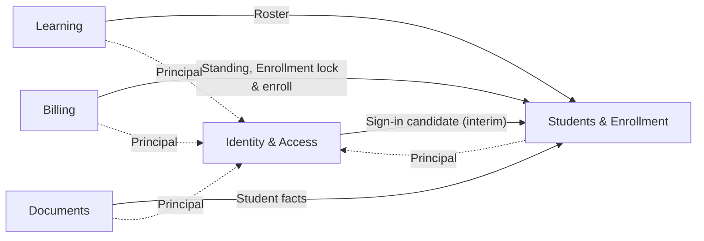

# Context map

Apollo merges ProjectHephaestus into this app as five bounded contexts. This page is the one home for their boundaries: what each context owns, the seams between them, how a transaction crosses them, the Go shape of a context, and which context owns each table. `architecture_test.go` enforces the parts a test can see ([Architecture tests](#architecture-tests)). The table schemas themselves are in [Data model](data-model.md); the package graph is in [Architecture](architecture.md).

Learning and Documents arrive with the Hephaestus merge, and several aggregates below are marked as arriving later. Everything not so marked exists today.



## Contexts today

| Context | End-state root | Today's packages |
|---|---|---|
| Identity & Access | `internal/identity` | `internal/auth` |
| Students & Enrollment | `internal/students` | `internal/students`, `internal/links`, `internal/customer`, `internal/settings`; the student, link and settings pages in `internal/management` |
| Billing | `internal/billing` | `internal/billing` (with `billingtest`), `internal/payments`; the billing fragments and dashboard in `internal/management` |
| Learning | `internal/learning` | none yet (Hephaestus games) |
| Documents | `internal/documents` | none yet (Hephaestus forms and letters) |

**Platform, not a context:** `main.go` (wiring), `internal/logging`, `internal/live`, `internal/puertorico`, `internal/testdb`, and later `internal/db` (pool, migrations, unit of work) and `internal/ui` (shared layouts). `internal/management` is the staff UI for two contexts until phase F splits it into `studentsweb` and `billingweb`. Platform packages and `internal/management` own no table.

## Identity & Access

- **Aggregates and invariants:**
  - *StaffAccount.* Username is 1–64 characters of `A-Za-z0-9._-`, validated before lowercasing. The password is stored as an Argon2id hash. `auth_version` is random and rotates on `passwd` and `revoke`. There are no roles today. The target has one staff role, `admin`, because the admins are the teachers; a separate `teacher` role waits until a teacher who must not see billing joins.
  - *Session.* Holds one principal with its auth version. A principal is a staff account (a `users` row) or a student; students are a principal kind, never `users` rows. Lifetime is a fixed 14 days, re-validated on every request and never extended. Student principals arrive with student sign-in.
  - *StudentLogin* (arrives with the Socrative retirement). One per student. The PIN (4–6 digits) is stored only as an Argon2id hash. `auth_version` rotates when the PIN or email changes.
- **Glossary:** principal, staff account, role, student login, PIN, session, auth version, sign-in limiter.
- **Reached through:** the `Require*` middleware and the principal accessors (today `auth.Manager.Require` and `auth.Staff`). No other context reads `users` or `sessions`.

## Students & Enrollment

- **Aggregates and invariants:**
  - *Student*, the one record. Contact fields pass the field registry (`internal/students/fields.go`). Group is `Básico` or `Regular`. Cohort is the month of the program start date. Standing is active, suspended or withdrawn, and withdrawn is terminal. One student per enrollment. The PIN stays globally unique while Socrative lives.
  - *Link.* The token is 43 characters. Usable means not canceled and before its access deadline. At most `MaxLinkEnrollments` starts.
  - *Enrollment.* Moves draft → submitted → accepted → paid, or to canceled. The PIN is reserved only at submit. The agreement snapshot is frozen at accept. An enrollment is paid exactly once and creates exactly one Student.
  - *Program calendar.* The single `settings` row: link lifetime (2–14 days), next program start date, bootcamp date.
- **Glossary:** customer (the payer on a link), link, enrollment, draft, submit, agreement, enroll, student, group, cohort, program start date, standing, roster import, program calendar.
- **Reached through:** `students.Service`, with the ID type `students.ID`. Other contexts read through `Profile`, `Roster`, `ByEmail`, `Calendar` and `FillProfile`; Billing calls `LockEnrollment`, `Enroll`, `UpdateContact`, `CancelEnrollment`, `LinkToken` and `SetStanding` inside its own transaction. None of these exist yet: phase F builds them and empties the [allowlist](#architecture-tests).

## Billing

- **Aggregates and invariants:**
  - *Contract.* One per enrollment. Total > 0 and installments > 0. Funded once. Withdrawal is terminal.
  - *Obligation*, inside a Contract. Tuition numbers are unique per contract. Amount > 0. Disposition is `collect` or `cancel`.
  - *CheckoutAttempt.* An eight-state machine with at most one active attempt per contract.
  - *Payment.* Keyed by the Stripe PaymentIntent. Gross amounts are ≥ 0.
  - *Suspension episode.* At most one open per contract.
  - *WebhookEvent.* Idempotent by Stripe event ID.
- **Glossary:** plan, installment, contract, obligation, tuition, reinstatement fee, checkout attempt, funding, due date, suspension, reinstatement, withdrawal, review hold, lease.
- **Reached through:** `billing.Service` and the webhook route. Billing pushes the one fact others need, a student's standing, into Students. Nobody else reads `billing_*`.

## Learning

Arrives in phase E.

- **Aggregates and invariants:**
  - *Attempt, with its Responses.* One sitting: a game, practice set, exam or live session. The deal is fixed when the attempt starts. Responses are appended in `seq` order, only by the attempt's own student. The server sets `correct` and `score`; the browser never reports a score. The attempt finishes once.
  - *Access.* A suspended student (unpaid tuition) gets no learning access, as today. Learning reads the standing through Roster; Billing sets it through Standing.
  - *WordCard schedule.* One row per student and word. Each answer moves the stage once. One streak day per answered day.
  - *Item*, from the question-bank feature onward. The answer key must be valid for the item's kind. Retired items stay referenced. Until then words and sentences stay embedded files and responses carry `item_key`.
- **Glossary** (student screens in Spanish, English words inside the games): learner, item, deal (with the reason each item was picked), attempt, response, judge, score, knowledge state (new, learning, known), review, streak, leaderboard week, game.
- **Reached through:** `learning.Service` (`Results`, `Knowledge`) for staff views. `learning` never imports `billing`.

## Documents

Arrives in phase D.

- **Aggregates and invariants:**
  - *EmployerDetails*, per student: schedule, employer, position (from the list, or "Otro" plus free text) and workplace. The last four SSN digits are never stored.
  - *ISTAttempt.* Health data: visible to the student and admins only. Measurements are validated. Age and sex are snapshots the server takes from the student record at submit. Grading happens on read.
  - Letters and sheets are rendered on demand and never stored.
- **Glossary** (Spanish UI): certificado de asistencia, carta de bootcamp, IST / evaluación física, intento, hoja IST, patrono, puesto, horario.
- **Reached through:** nothing yet; staff views will use `documents.Service`.

## Seams

A seam is a narrow interface the consumer declares (or, for calls inside a transaction, a provider method), satisfied by the provider's service. Its method set is the whole contract: nothing else crosses.

| Seam | Consumer → provider | What crosses | Shape | Today |
|---|---|---|---|---|
| **Roster** | Learning → Students | learner ID, display name, group, cohort, standing | `learning.Roster`, satisfied by `*students.Service` | Hephaestus reads `students` and `enrollments` directly |
| **Standing** | Billing → Students | suspended, reinstated, withdrawn | `students.Service.SetStanding` inside Billing's transaction | Billing writes `students.is_active` and `withdrawn_at` |
| **Enrollment lock & enroll** | Billing → Students | lock the enrollment row, enroll at funding, cancel, contact edit, link token | `LockEnrollment`, `Enroll`, `CancelEnrollment`, `UpdateContact`, `LinkToken`, inside Billing's transaction where they write | Billing locks and reads `enrollments`, `links` and `students` rows and calls `links.Enroll` and `links.CancelEnrollmentTx` with its own `*gorm.DB` |
| **Student facts** | Documents → Students | name, gender, date of birth, group, program start date, bootcamp date; fills a missing date of birth or gender once | `documents.Students`, satisfied by `*students.Service` | Hephaestus keeps its own overrides and reads `settings.bootcamp_date` directly |
| **Principal** | every context → Identity | the signed-in staff member (username, and role once it exists) or student ID | context accessors set by `Require*` | `auth.Manager.Require`; `auth.Staff` reaches `internal/management` as a `func(context.Context) string` |
| **Sign-in candidate** (interim) | Identity → Students | an email and PIN match, plus active standing | `students.Service.SignInCandidate`, until the Socrative retirement moves PINs into `student_logins` | Hephaestus matches credentials against `students` |

**Known gaps in the Enrollment lock & enroll seam.** Billing needs two things the seam does not offer yet:

- **Gap: the Student row lock.** Billing's lease locks the Enrollment, then the Contract, then the Student (`leasedStudent`), and the seam has no Student lock to keep that order. Resolved in F9, beside `SetStanding`.
- **Gap: the Profile path from a student to its enrollment.** Billing finds a student's contract and contact by reading `students` (`contractFor`, `ForStudent`, `syncCustomerContact`). Resolved in F6, through `students.Service.Profile`.

Billing facts never reach Learning directly: Billing turns money events into a standing through Standing, and Learning reads that standing through Roster.

## Transactions across contexts

One unit of work is carried in `context.Context`: `db.InTx(ctx, fn)` opens it, and every adapter runs on that transaction when the context holds one. Provider APIs stay plain method calls, so Billing's funding transaction calls `students.Service.Enroll` and keeps today's lock order: the Enrollment row, then the Contract, then the Student. Foreign keys across contexts stay, because they only reference IDs; queries and writes are owner-only.

Today the transaction crosses as an explicit `*gorm.DB`: Billing opens it and passes it to `links.Enroll` and `links.CancelEnrollmentTx`, and takes the Enrollment lock itself.

## Go shape

```
internal/<context>/              domain types, invariants, the application service (the context's API);
                                 declares the store interface its service consumes
internal/<context>/<context>db/  sqlc adapter: queries.sql, generated code, row ↔ domain mapping
internal/<context>/<context>web/ thin handlers (parse → call service → render) and .templ views
```

- **The root holds no SQL and no HTTP.** It depends on no `net/http`, templ, pgx, GORM or `<context>db` package, transitively. `TestContextRootsImportNoAdapters` enforces this for every root in `reshapedRoots`.
- **Roots log through a `*slog.Logger` passed in**, stdlib `log/slog` only, never `internal/logging`: it imports `net/http` and the GORM logger, so the root check would fail. `internal/logging` splits when A2 reshapes it.
- **The consumer declares the store interface.** One per service, with methods named by use case (`ContractForUpdate`, `AppendResponses`); no `Repository[T]`. It exists to keep the root free of SQL: the root says what it needs, `<context>db` satisfies it, `main.go` wires them. A context with no domain logic in a read (the Program calendar, for example) has its handlers call the adapter directly, with no pass-through service.
- **No in-memory fakes.** Domain invariants are tested with plain Go tests on domain types. Services and seams are tested against real PostgreSQL through `internal/testdb`, with the real adapter and the real provider service behind every seam. Only external systems are faked, at their HTTP boundary (Stripe through `billingtest`, [Testing](testing.md)).
- **At most three packages per context**, with no further layers. Subdomains that are pure logic (`documents/ist`, `learning/words`) may sit beside them.
- **sqlc has one `sql:` block per context.** All blocks read the one migrations directory and each writes into `<context>db` with `omit_unused_structs: true`, so a context gets only its own row types.

## Table ownership

Only the owner queries or writes a table. `tableOwners` in `architecture_test.go` holds the same map and changes with this table.

| Table | Owner | Today's package | Note |
|---|---|---|---|
| `users` | Identity & Access | `internal/auth` | |
| `sessions` | Identity & Access | `internal/auth` | written by the SCS Postgres store |
| `student_logins` | Identity & Access | | arrives with the Socrative retirement |
| `students` | Students & Enrollment | `internal/students`, `internal/links` | `links.Enroll` inserts the row at funding |
| `enrollments` | Students & Enrollment | `internal/links` | |
| `links` | Students & Enrollment | `internal/links` | |
| `settings` | Students & Enrollment | `internal/settings` | Hephaestus reads `bootcamp_date` until its cutover |
| `billing_contracts`, `billing_obligations`, `billing_checkout_attempts`, `billing_payments`, `billing_suspensions`, `billing_webhook_events` | Billing | `internal/billing` | |
| `attempts`, `responses`, `word_cards`, `word_card_days` | Learning | | arrive in phase E |
| `student_employers`, `ist_attempts` | Documents | | arrive in phase D |

The `hephaestus_*` tables in the shared production database belong to ProjectHephaestus. This app never reads them; the cutover copies their data and drops them.

## Architecture tests

`architecture_test.go` runs with the unit tests and needs the `go` command, not a database. Its doc comment states what each matcher cannot see.

- **`TestContextRootsImportNoAdapters`** runs `go list -deps` on each root in `reshapedRoots` and fails on any forbidden dependency, naming the root, the package and where it belongs. No root is reshaped yet, so the list is empty and the test skips with a message saying what it would check. Each reshape step adds its root in one line.
- **`TestContextsTouchOnlyOwnedTables`** type-checks every production package and charges each table it finds to the package's context (`contextOf`). It fails on a table with no owner, and on a table outside the context's ownership, naming the file, line, declaration, table and owning context. It finds tables in SQL string literals and in GORM calls given a model from `models()`.
- **The allowlist only shrinks.** `crossContextAllowlist` holds today's Billing → Students reaches, keyed by file, declaration and table, each commented with the seam that replaces it. An entry that no longer matches fails the test until it is deleted. Phase F moves each reach behind its seam and F9 leaves the list empty.

## Source

- `architecture_test.go`: `TestContextRootsImportNoAdapters`, `TestContextsTouchOnlyOwnedTables`, `reshapedRoots`, `rootForbidden`, `contextOf`, `tableOwners`, `crossContextAllowlist`
- `main.go`: `models`
- `internal/auth/auth.go`: `User`, `Session`, `usernamePattern`
- `internal/auth/http.go`: `Manager.Require`, `Staff`
- `internal/links/links.go`: `MaxLinkEnrollments`, `Usable`, `Enroll`, `CancelEnrollmentTx`
- `internal/students/fields.go`: `groups`
- `internal/settings/settings.go`: `MinLinkLifetimeDays`, `MaxLinkLifetimeDays`
- `internal/billing/models.go`: `Contract`, `Obligation`, `CheckoutAttempt`, `Payment`, `Suspension`, `WebhookEvent`
- `internal/billing/worker.go`: `leased`, `leasedStudent`
- `internal/billing/billingtest/billingtest.go`: `Client`
