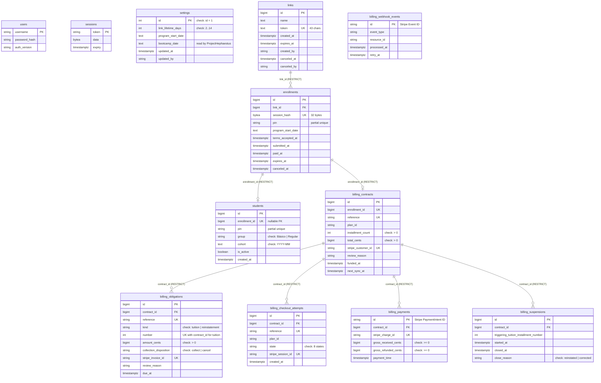

# Data model

The application persists all state in a single PostgreSQL database across 12 tables. This page documents the entity-relationship structure, ownership, and database-enforced constraints. For business flows and vocabulary, see [Lifecycle](domain/lifecycle.md); for application architecture and packages, see [Architecture](architecture.md).

## Table inventory and database-enforced rules

All foreign keys use `ON UPDATE RESTRICT, ON DELETE RESTRICT`. The `sessions` table has no foreign key to `users` because it is owned by the SCS library; user identity is decoded from session payload data.

| Table | Owner package | Written by | DB-enforced rules |
|---|---|---|---|
| `users` | `internal/auth` | CLI commands (`user add`, `passwd`, `revoke`, `remove`) | Primary key `username`. Non-null `password_hash`, `auth_version`. |
| `sessions` | `internal/auth` | SCS Postgres store via HTTP middleware | Primary key `token`. Index `sessions_expiry_idx` on `expiry`. |
| `settings` | `internal/settings` | Staff via `POST /management/settings`, `POST /management/program-start-date` and `POST /management/bootcamp-date` | Check `settings_single_row (id = 1)`. Check `link_lifetime_days_range (link_lifetime_days BETWEEN 2 AND 14)`. Primary key `id`. `bootcamp_date` (YYYY-MM-DD or empty) is read by ProjectHephaestus for its bootcamp employer letter: keep the column name. |
| `links` | `internal/links` | Staff link create and cancel | Primary key `id`. Unique index on `token` (`token_length` check: 43 chars). Non-null `name`, `created_by`, `expires_at`. |
| `enrollments` | `internal/links` | Customer start (`StartEnrollment`), drafts, autosave, submit, accept; staff cancel (`CancelEnrollment`); `links.Enroll`; `billing.UpdateContact` | Primary key `id`. Foreign key `link_id` -> `links(id)`. Unique index `session_hash` and check `session_hash_size (octet_length(session_hash) = 32)`. Partial unique index `idx_enrollment_pin (pin WHERE pin <> '')`. Non-null contact defaults. |
| `students` | `internal/students` | Billing worker/funding transaction (`links.Enroll`); staff edits; staff import (`Add`); billing worker and staff reinstatement (`is_active`) | Primary key `id`. Unique index and nullable foreign key `enrollment_id` -> `enrollments(id)`. Partial unique index `idx_student_pin (pin WHERE pin <> '')`. Check `student_group_valid ("group" IN ('Básico', 'Regular'))`. Check `student_cohort_valid (cohort = '' OR cohort ~ '^[0-9]{4}-(0[1-9]\|1[0-2])$')`. |
| `billing_contracts` | `internal/billing` | Customer checkout start (`StartCheckout`); billing worker; staff edits (`TouchContract`); customer edits (`UpdateContact`/`touch`) | Primary key `id`. Unique index and foreign key `enrollment_id` -> `enrollments(id)`. Unique index `reference`. Unique index `stripe_customer_id`. Checks `contract_installment_count (installment_count > 0)`, `contract_total_cents (total_cents > 0)`. |
| `billing_obligations` | `internal/billing` | Customer checkout start (`createObligations`); billing worker (`scheduleInvoices`, `syncInvoice`, `requestFee`) | Primary key `id`. Foreign key `contract_id` -> `billing_contracts(id)`. Unique index `reference`. Partial unique index `idx_tuition_contract_number (contract_id, number WHERE kind = 'tuition')`. Check `obligation_kind (kind IN ('tuition', 'reinstatement'))`. Check `obligation_amount_cents (amount_cents > 0)`. Check `obligation_disposition (collection_disposition IN ('collect', 'cancel'))`. Checks on `amount_paid_cents >= 0`, `amount_remaining_cents >= 0`, `other_settlement_cents >= 0`. Unique indexes on `suspension_id`, `stripe_invoice_id`, `stripe_invoice_item_id`. |
| `billing_checkout_attempts` | `internal/billing` | Customer checkout start (`StartCheckout`); billing worker | Primary key `id`. Foreign key `contract_id` -> `billing_contracts(id)`. Unique index `reference`. Partial unique index `idx_active_checkout_attempt (contract_id WHERE state IN ('creating', 'open', 'processing', 'expiring', 'uncertain'))`. Unique index `stripe_session_id`. Check `attempt_first_amount_cents (first_amount_cents > 0)`. Check `attempt_state (state IN ('creating', 'open', 'processing', 'expiring', 'uncertain', 'expired', 'failed', 'paid'))`. |
| `billing_payments` | `internal/billing` | Billing worker (`savePayment`) | Primary key `id` (Stripe PaymentIntent ID). Foreign key `contract_id` -> `billing_contracts(id)`. Unique index `stripe_charge_id`. Checks `payment_gross_received (gross_received_cents >= 0)`, `payment_gross_refunded (gross_refunded_cents >= 0)`. |
| `billing_suspensions` | `internal/billing` | Billing worker (`evaluateDeadlines`, `evaluateReactivation`, `correctEpisode`); staff reinstatement (`requestFee`) | Primary key `id`. Foreign key `contract_id` -> `billing_contracts(id)`. Partial unique index `idx_active_suspension (contract_id WHERE closed_at IS NULL)`. Check `suspension_close_reason (close_reason IS NULL OR close_reason IN ('reinstated', 'corrected'))`. |
| `billing_webhook_events` | `internal/billing` | Webhook HTTP handler (`/webhooks/stripe`); billing worker | Primary key `id` (Stripe Event ID). Index on `retry_at`. Non-null `event_type`, `resource_id`. |

## Cross-table PIN constraint

The customer selects a 4-to-6 digit PIN at final submission. The system enforces PIN uniqueness across both active enrollments and enrolled students:
1. `idx_enrollment_pin` on `enrollments.pin` prevents two uncompleted enrollments from reserving the same PIN.
2. `idx_student_pin` on `students.pin` prevents two enrolled students from sharing a PIN.
3. Because PostgreSQL does not support cross-table declarative uniqueness constraints without triggers or materialized views, `links.Store.Submit` executes an explicit guarded check:
   `AND NOT EXISTS (SELECT 1 FROM students WHERE pin = ? AND pin <> '')`
   When a customer pays, `links.Enroll` inside billing's funding transaction inserts the student with the PIN and clears `enrollments.pin`, transferring index ownership from `idx_enrollment_pin` to `idx_student_pin`.
4. In staff edits, `students.Store.UpdateField` checks `pinHeld` and relies on `idx_student_pin` to reject collisions.

A concurrent race between `Submit` and `Enroll` can still see the PIN free under READ COMMITTED; if this happens, funding rolls back on `idx_student_pin` and the worker retries (see [Go-live](go-live.md)).

## Source

- `internal/auth/auth.go`: `User`, `Session`
- `internal/settings/settings.go`: `Settings`
- `internal/links/links.go`: `Link`, `Enrollment`, `Enroll`, `Store.Submit`
- `internal/students/students.go`: `Student`, `Details`
- `internal/billing/models.go`: `Contract`, `Obligation`, `CheckoutAttempt`, `Payment`, `Suspension`, `WebhookEvent`
- `main.go`: `models`, `migrate`
