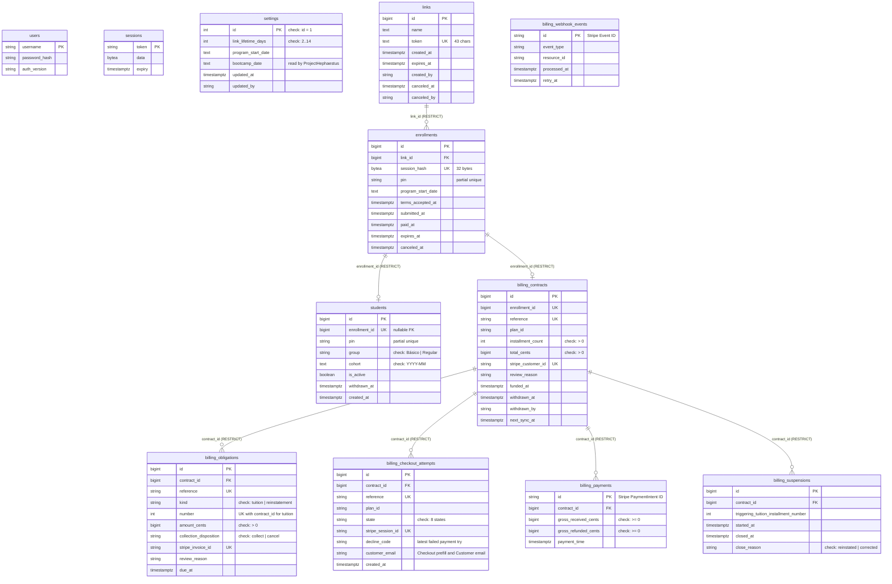

# Data model

The application persists all state in a single PostgreSQL database across 12 tables, created and changed only by goose [migrations](#migrations). This page documents the entity-relationship structure, ownership, database-enforced constraints and how the schema changes. For business flows and vocabulary, see [Lifecycle](domain/lifecycle.md); for application architecture and packages, see [Architecture](architecture.md).

## Table inventory and database-enforced rules

All foreign keys use `ON UPDATE RESTRICT, ON DELETE RESTRICT`. The `sessions` table has no foreign key to `users` because it is owned by the SCS library; user identity is decoded from session payload data.

Numeric primary keys are `BIGINT`, which Go holds as `uint64`. The range is checked once, where an ID enters from a request: management parses path and query IDs with `strconv.ParseUint(v, 10, 63)` and requires at least 1, so a number PostgreSQL cannot hold answers as not found. Stores take any `uint64` and never re-check it.

Which context owns each table is in [Context map](context-map.md#table-ownership); "Owner package" below is today's package.

| Table | Owner package | Written by | DB-enforced rules |
|---|---|---|---|
| `users` | `internal/auth` | CLI commands (`user add`, `passwd`, `revoke`, `remove`) | Primary key `username`. Non-null `password_hash`, `auth_version`. |
| `sessions` | `internal/auth` | SCS Postgres store via HTTP middleware | Primary key `token`. Index `sessions_expiry_idx` on `expiry`. |
| `settings` | `internal/settings` | Staff via `POST /management/settings`, `POST /management/program-start-date` and `POST /management/bootcamp-date` | Check `settings_single_row (id = 1)`. Check `link_lifetime_days_range (link_lifetime_days BETWEEN 2 AND 14)`. Primary key `id`. `bootcamp_date` (YYYY-MM-DD or empty) is read by ProjectHephaestus for its bootcamp employer letter: keep the column name. |
| `links` | `internal/links` | Staff link create, rename and cancel; customer start (`enrollment_count`) | Primary key `id`. Unique index on `token` (`link_token_length` check: 43 chars). Non-null `name`, `created_by`, `expires_at`, `enrollment_count` (enrollments ever started; `StartEnrollment` increments it in the statement that inserts the enrollment, and caps it at `MaxLinkEnrollments`). |
| `enrollments` | `internal/links` | Customer start (`StartEnrollment`), drafts, autosave, submit, accept; staff cancel (`billing.Service.CancelEnrollment` through `links.CancelEnrollmentTx`); `links.Enroll`; `billing.UpdateContact` | Primary key `id`. Foreign key `link_id` -> `links(id)`. Unique index `session_hash` and check `session_hash_size (octet_length(session_hash) = 32)`. Partial unique index `idx_enrollment_pin (pin WHERE pin <> '')`. Non-null contact defaults. |
| `students` | `internal/students` | Billing worker/funding transaction (`links.Enroll`); staff edits; staff import (`Add`); billing worker and staff reinstatement (`is_active`); staff withdrawal (`is_active`, `withdrawn_at`) | Primary key `id`. Unique index and nullable foreign key `enrollment_id` -> `enrollments(id)`. Partial unique index `idx_student_pin (pin WHERE pin <> '')`. Check `student_group_valid ("group" IN ('Básico', 'Regular'))`. Check `student_cohort_valid (cohort = '' OR cohort ~ '^[0-9]{4}-(0[1-9]\|1[0-2])$')`. Nullable `withdrawn_at`, no check. |
| `billing_contracts` | `internal/billing` | Customer checkout start (`StartCheckout`); billing worker (`fund` sets `stripe_customer_id`); staff edits (`TouchContract`); staff withdrawal (`withdraw`) | Primary key `id`. Unique index and foreign key `enrollment_id` -> `enrollments(id)`. Unique index `reference`. Unique index `stripe_customer_id`. Checks `contract_installment_count (installment_count > 0)`, `contract_total_cents (total_cents > 0)`. Nullable `withdrawn_at` and `withdrawn_by` (staff username), no check. |
| `billing_obligations` | `internal/billing` | Customer checkout start (`createObligations`); billing worker (`scheduleInvoices`, `syncInvoice`, `requestFee`, `cancelObligation`); staff withdrawal (`withdraw`) | Primary key `id`. Foreign key `contract_id` -> `billing_contracts(id)`. Unique index `reference`. Partial unique index `idx_tuition_contract_number (contract_id, number WHERE kind = 'tuition')`. Check `obligation_kind (kind IN ('tuition', 'reinstatement'))`. Check `obligation_amount_cents (amount_cents > 0)`. Check `obligation_disposition (collection_disposition IN ('collect', 'cancel'))`. Checks on `amount_paid_cents >= 0`, `amount_remaining_cents >= 0`, `other_settlement_cents >= 0`. Unique indexes on `suspension_id`, `stripe_invoice_id`, `stripe_invoice_item_id`. |
| `billing_checkout_attempts` | `internal/billing` | Customer checkout start (`StartCheckout`); billing worker (`recordDecline`) | Primary key `id`. Foreign key `contract_id` -> `billing_contracts(id)`. Unique index `reference`. Partial unique index `idx_active_checkout_attempt (contract_id WHERE state IN ('creating', 'open', 'processing', 'expiring', 'uncertain'))`. Unique index `stripe_session_id`. Check `attempt_first_amount_cents (first_amount_cents > 0)`. Check `attempt_state (state IN ('creating', 'open', 'processing', 'expiring', 'uncertain', 'expired', 'failed', 'paid'))`. Non-null `customer_email`: the Enrollment's email when the attempt was inserted, which Checkout prefills and gives the Customer it creates. Nullable `decline_code`: the Stripe code of the latest failed payment try. |
| `billing_payments` | `internal/billing` | Billing worker (`savePayment`) | Primary key `id` (Stripe PaymentIntent ID). Foreign key `contract_id` -> `billing_contracts(id)`. Checks `payment_gross_received (gross_received_cents >= 0)`, `payment_gross_refunded (gross_refunded_cents >= 0)`. |
| `billing_suspensions` | `internal/billing` | Billing worker (`evaluateDeadlines`, `evaluateReactivation`, `correctEpisode`); staff reinstatement (`requestFee`); staff withdrawal (`withdraw` closes the open episode, leaving `close_reason` NULL) | Primary key `id`. Foreign key `contract_id` -> `billing_contracts(id)`. Partial unique index `idx_active_suspension (contract_id WHERE closed_at IS NULL)`. Check `suspension_close_reason (close_reason IS NULL OR close_reason IN ('reinstated', 'corrected'))`. |
| `billing_webhook_events` | `internal/billing` | Webhook HTTP handler (`/webhooks/stripe`); billing worker | Primary key `id` (Stripe Event ID). Partial index `idx_pending_events (created_at WHERE processed_at IS NULL)`: the worker's claim order. Non-null `event_type`, `resource_id`. |

## Cross-table PIN constraint

The customer selects a 4-to-6 digit PIN at final submission. The system enforces PIN uniqueness across both active enrollments and enrolled students:
1. `idx_enrollment_pin` on `enrollments.pin` prevents two uncompleted enrollments from reserving the same PIN.
2. `idx_student_pin` on `students.pin` prevents two enrolled students from sharing a PIN.
3. Because PostgreSQL does not support cross-table declarative uniqueness constraints without triggers or materialized views, `links.Store.Submit` executes an explicit guarded check:
   `AND NOT EXISTS (SELECT 1 FROM students WHERE pin = ? AND pin <> '')`
   When a customer pays, `links.Enroll` inside billing's funding transaction inserts the student with the PIN and clears `enrollments.pin`, transferring index ownership from `idx_enrollment_pin` to `idx_student_pin`.
4. In staff edits, `students.Store.UpdateField` checks `heldPins` and relies on `idx_student_pin` to reject collisions.

A concurrent race between `Submit` and `Enroll` can still see the PIN free under READ COMMITTED; if this happens, funding rolls back on `idx_student_pin` and the worker retries (see [Go-live](go-live.md)).

## Migrations

goose (`github.com/pressly/goose/v3`, used as a library; production has no goose CLI) owns the schema. The numbered SQL files in `internal/db/migrations/` are embedded in the binary, and `db.Migrate` applies the pending ones at server startup ([Startup and shutdown](operations/startup-shutdown.md)): each in its own transaction, under a session advisory lock keyed by the current schema, recording each version in that schema's `goose_db_version`. goose creates `goose_db_version` before it takes the lock, so the first start of two replicas at once logs harmless errors in Postgres, which goose retries: `duplicate key value violates unique constraint "pg_type_typname_nsp_index"` (or `"pg_class_relname_nsp_index"`), sometimes `relation "goose_db_version" already exists`. There is no down step: rollback is redeploying the previous binary, so a migration only adds what that binary can ignore, and a drop waits one release.

**Version 1 is the baseline.** `00001_baseline.sql` is the schema GORM `AutoMigrate` built before goose: `pg_dump --schema-only --no-owner --no-privileges` of a fresh database, without `SET` lines, comments or the `public.` qualifier, so it creates in the current schema. A Go migration in `migrate.go` runs it instead of goose's SQL runner so that it can adopt a database `AutoMigrate` already built. It checks the twelve baseline tables in the current schema:

| Baseline tables present | Version 1 |
|---|---|
| all | Adopted: recorded with no DDL. `database_migrated` says `adopted: true` |
| none | Applied: the baseline creates them |
| some | Refused before goose creates `goose_db_version`: no DDL, and startup fails with stage `database_baseline` |

Other tables, such as ProjectHephaestus's `hephaestus_*` in the shared production database, do not count.

### Adding a migration

1. Add `internal/db/migrations/<next number, five digits>_<what>.sql` starting with `-- +goose Up`. Never edit a migration that has shipped: goose skips versions it has recorded.
2. It runs inside the 10 s startup budget it shares with the ping and the lock wait; a slower migration needs its own budget first, or every deploy fails with `database_migrate`.
3. A GORM model field ships with its migration or after it, never before: integration tests run on the migrated schema (`testdb`), so a field without its column fails CI.
4. A new table, or a table renamed with `ALTER TABLE … RENAME TO`, gets its owner in `tableOwners` and [Context map](context-map.md); `TestMigrationTablesHaveOwners` fails on a created or renamed-to table without one. A new GORM model joins `gormModels()` in `architecture_test.go`, or the ownership test cannot see its GORM calls.
5. Update the diagram and the table inventory above.

## Source

- `internal/auth/auth.go`: `User`, `Session`
- `internal/settings/settings.go`: `Settings`
- `internal/links/links.go`: `Link`, `Enrollment`, `Enroll`, `Store.Submit`
- `internal/students/students.go`: `Student`, `Details`, `WithdrawnAt`
- `internal/billing/models.go`: `Contract`, `Obligation`, `CheckoutAttempt`, `Payment`, `Suspension`, `WebhookEvent`, `WithdrawnAt`, `WithdrawnBy`
- `internal/billing/withdraw.go`: `withdraw`
- `internal/db/migrate.go`: `Migrate`, `baselinePresent`, `baselineTables`, `ErrPartialSchema`
- `architecture_test.go`: `tableOwners`, `gormModels`, `TestMigrationTablesHaveOwners`
- `internal/db/migrations/00001_baseline.sql`
