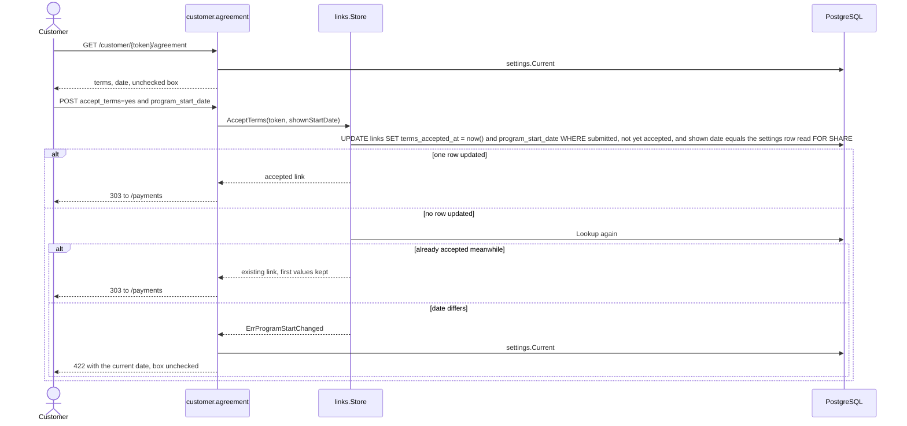
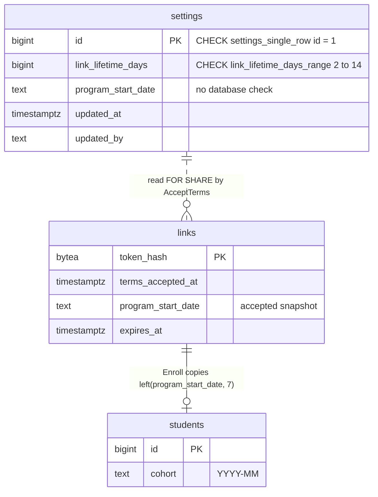
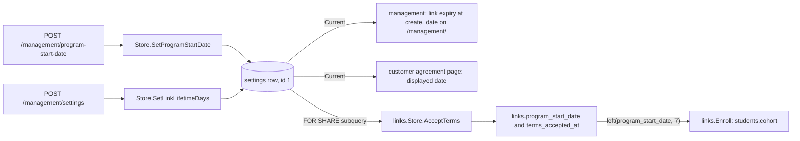

# Agreement and settings

This page covers how a customer accepts the agreement against the program start date they saw, and the one `settings` row that supplies that date and the link lifetime. It links to [Links](links.md) for expiry, [Customer flow](customer-flow.md) for the routes around it, and [Students](students.md) for the cohort that the accepted date becomes.

## Acceptance

`GET /customer/{token}/agreement` shows the static terms and the date from `settings.Current`. The date travels in a hidden `program_start_date` input; the checkbox `accept_terms` is never rendered checked. `POST` calls `links.Store.AcceptTerms`.

| Case | Result |
|---|---|
| Link not submitted | `GET` and `POST` redirect to `/forms`; `AcceptTerms` itself returns nothing for an unsubmitted link |
| `POST` on an already accepted link | Redirect to `/payments` before the body is parsed |
| Body unreadable or oversized | 400 or 413 with a generic message ([Customer flow](customer-flow.md)) |
| `accept_terms` repeated, or `program_start_date` not sent exactly once | 400 |
| `accept_terms` not `yes` | 422 on `accept_terms`; the store is not called |
| Shown date no longer matches settings | 422 "La fecha de inicio cambió. Revisa el acuerdo y acepta los términos de nuevo."; the page re-renders with the current date and an unchecked box, so consent is given again for the new date |
| No start date configured | The page says the agreement is unavailable and shows no form. A shown date that is empty or malformed makes `AcceptTerms` fail the same way, so nothing is acceptable. |
| Replay after acceptance | Keeps the first `terms_accepted_at` and date; later settings changes never alter an accepted agreement |

Acceptance time is the database clock (`now()`). The agreement text is static in `agreement.html`; the database stores only `terms_accepted_at` and the date, so there is no text version. `StartCheckout` requires `terms_accepted_at`, so no payment can start before this step ([Checkout](../billing/checkout.md)).

## links and settings share raw SQL

`AcceptTerms` reads `settings` by table name: `(SELECT program_start_date FROM settings WHERE id = 1 FOR SHARE)`, and reuses `settings.ParseProgramStartDate`. The table and column names are therefore a contract between the two packages. The `FOR SHARE` lock serializes acceptance against a staff date change, so a customer cannot accept a date that was replaced a moment earlier. Renaming either name means editing both packages.

## Start date to cohort

| Step | Value |
|---|---|
| Staff save a date | `settings.program_start_date`, `YYYY-MM-DD` |
| Customer accepts | `links.program_start_date` is the snapshot ([Links](links.md)) |
| Funding runs `links.Enroll` | `students.cohort = left(links.program_start_date, 7)`, for example `2026-11` |

The cohort comes from the Link's snapshot, never the live settings row. Because acceptance requires a valid date, every Student gets a valid cohort.

## The settings row

The `settings` to `links` line is logical, not a foreign key. The whole-database picture is in [Data model](../data-model.md).

| Rule | Detail |
|---|---|
| One row | `id` is always 1 (`settings_single_row`). `Current` returns defaults without writing when the row is missing. |
| Lifetime | `link_lifetime_days` between 2 and 14 (`MinLinkLifetimeDays`, `MaxLinkLifetimeDays`), default 7 (`DefaultLinkLifetimeDays`). The `link_lifetime_days_range` check repeats the constants, so even a bypass of the store cannot violate it. |
| Applies to | New links only, at creation, on the application clock. Issued links keep their own expiry, and submit resets it to 168 hours ([Links](links.md)). |
| Start date format | `ParseProgramStartDate`: trimmed, valid `YYYY-MM-DD`, nonzero year, re-formatting must reproduce the input. Only Go validates it; the column has no check. |
| Replace, never clear | An empty date is rejected, so once saved it can only be replaced. Before the first save no agreement can be accepted. |
| Independent writers | Each setter upserts only its own column plus `updated_at` and `updated_by`; the first save of either creates the row with the other column's default. Concurrent edits to different settings do not overwrite each other. |
| Audit | `updated_by` and `updated_at` are row-level: the last writer of either setting. The settings page shows "Last changed by" and may show a start-date change. Both setters refuse an empty staff name. |
| No live event | `settings.Store` takes no change callback, so a settings write refreshes no open page. |

## Where staff edit them

| Setting | Form | Route | Limits |
|---|---|---|---|
| Program start date | the links page, `/management/` | `POST /management/program-start-date` | 1 KiB body; invalid or repeated value is 422 on the links page; success redirects to `/management/?program-start-date-saved` |
| Link lifetime | `/management/settings` | `POST /management/settings` | 1 KiB body; a non-integer counts as out of range; 422 "Choose between 2 and 14 days."; success redirects to `/management/settings?saved` |

Page structure and fragments are in [Management overview](../management/overview.md).

## Deliberate choices

- The raw-SQL read of `settings` inside `links` is intentional: the `FOR SHARE` lock closes the acceptance race, which a separate read through `settings.Store` could not.
- `ProgramStartDate` has no database check, so the format guarantee comes only from `ParseProgramStartDate`; every writer and `AcceptTerms` must call it.

## Source

- `internal/links/links.go`: `Store.AcceptTerms`, `ErrProgramStartChanged`, `Enroll`, `Store.Lookup`
- `internal/settings/settings.go`: `Settings`, `Store.Current`, `Store.SetLinkLifetimeDays`, `Store.SetProgramStartDate`, `ParseProgramStartDate`, `MinLinkLifetimeDays`, `MaxLinkLifetimeDays`, `DefaultLinkLifetimeDays`, `ErrProgramStartDate`, `ErrLinkLifetimeRange`
- `internal/customer/agreement.go`: `agreement`
- `internal/customer/templates/agreement.html`: `accept_terms`, `program_start_date`
- `internal/management/management.go`: `RegisterRoutes`
- `internal/management/templates/index.html`: `program-start-date`
- `internal/management/templates/settings.html`: `lifetime`
- `internal/billing/checkout.go`: `StartCheckout`
