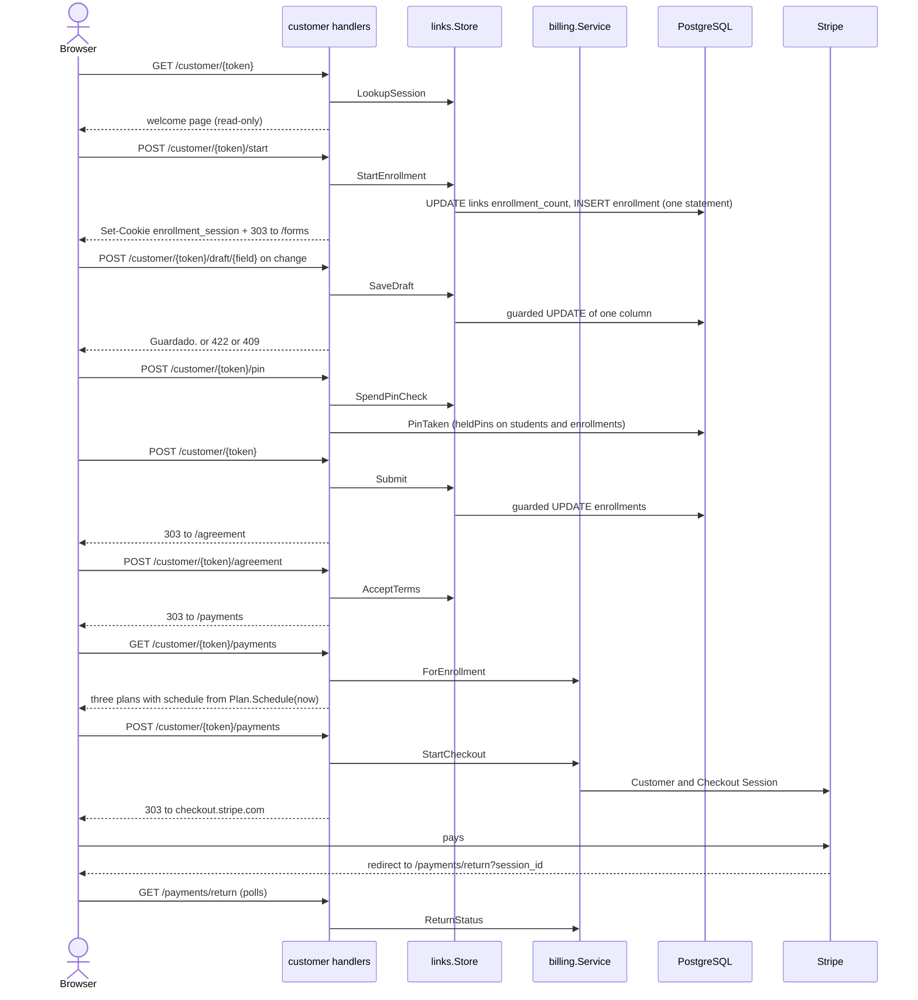
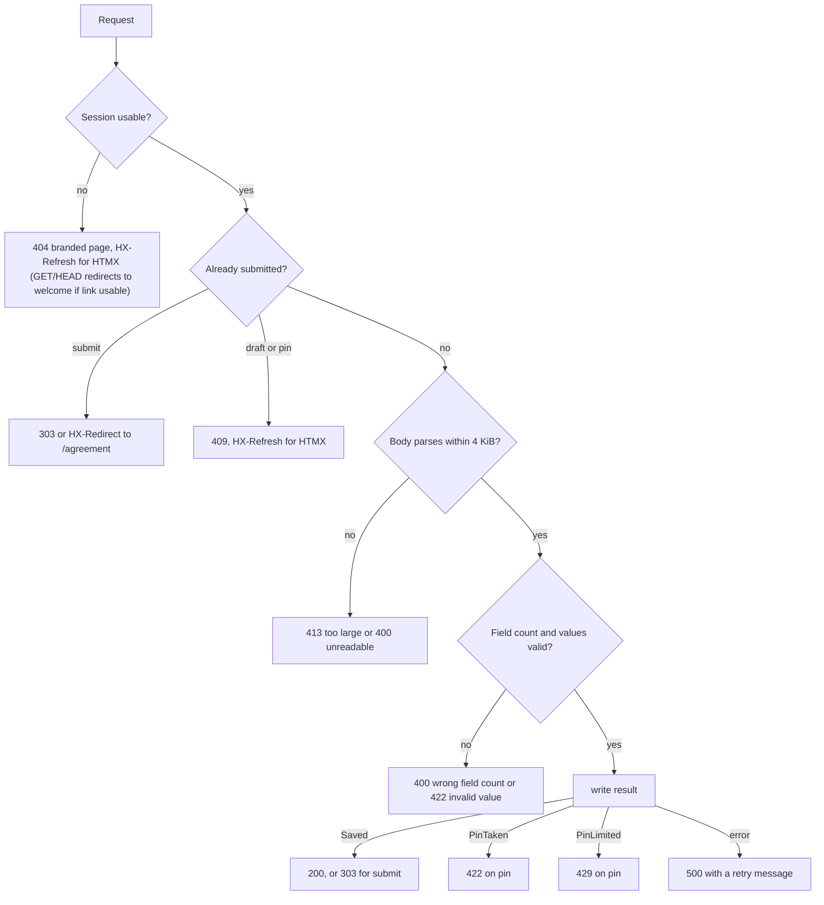

# Customer flow

This page covers what the customer's browser can do at `/customer/{token}` and `/payments/return`: routes, check precedence, contact edit, plan choice, the return page, headers and limits. The state behind it is in [Links](links.md), [Students](students.md) and [Agreement](agreement.md); the Stripe side is in [Checkout](../billing/checkout.md); script and style behavior is in [Frontend](../frontend.md).

The `customer` package holds handlers only. Every write goes through `links.Store` or `billing.Service`. Customer pages are Spanish; all customer text below is quoted as in code.

## Routes

The link token in the path and the path-scoped `enrollment_session` cookie identify the browser's enrollment. There is no sign-in.

| Method | Path | Behavior |
|---|---|---|
| GET | `/customer/{token}` | Read-only welcome page (`welcome`). Creates no rows. Resumes `Awaiting payment` to `/agreement`, shows "Tu matrícula ya fue completada." (+ "Comenzar nueva matrícula" if the link is still usable) for `Finished`, "Continuar" to `/forms` for `In progress`, or "Comenzar" (`POST /start`) for new visitors. |
| POST | `/customer/{token}/start` | Calls `StartEnrollment` (one statement for a new enrollment), sets the `enrollment_session` cookie (`HttpOnly`, `SameSite=Lax`, `Path: "/customer/{token}"`) if a new enrollment started, and redirects 303 (or `HX-Redirect`) to `/forms` (or `/agreement` if already submitted). |
| GET | `/customer/{token}/forms` | Resolves session (`resolveSession`, one `LookupSession` read). Without a usable session, GET and HEAD redirect 303 to `/customer/{token}` while the link takes new enrollments (usable and under the cap); otherwise 404. Renders the contact form with drafts prefilled and autosave wired. |
| POST | `/customer/{token}` | Final submit: six contact fields, `email_confirm` and PIN. Success: 303 to `/agreement`. A spent PIN budget is 429. |
| POST | `/customer/{token}/draft/{field}` | Autosave one registry field. Answers only a status fragment ("Guardado.") and never redraws the form. |
| POST | `/customer/{token}/pin` | Advisory PIN check, saves nothing ("PIN disponible."). A POST keeps the PIN out of URLs and access logs. Each answer, and each valid final submit, spends one of `links.MaxPinChecks` (30) per enrollment; past that the answer is 429. |
| GET, POST | `/customer/{token}/edit` | Reopens the contact form of a submitted enrollment before payment. |
| GET, POST | `/customer/{token}/agreement` | Terms and acceptance ([Agreement](agreement.md)). |
| GET, POST | `/customer/{token}/payments` | Plan choice and Checkout start; after funding, the persisted plan and schedule. |
| GET | `/payments/return` | Token-free outcome of a hosted Checkout. |

Every GET route also answers `HEAD`: same checks, no body, and never writes a row. On an `Awaiting payment` session `HEAD /customer/{token}` returns 200 where GET redirects. Route registration and the surrounding middleware are in [Architecture](../architecture.md).
Step order is enforced by redirect, not by state flags:

| Page | Not submitted | Terms not accepted |
|---|---|---|
| `/agreement` | 303 to `/forms` | page shows the form |
| `/payments` | 303 to `/forms` | 303 to `/agreement` |
| `/edit` | 303 to `/forms` | allowed |

## Request sequence

Funding happens afterwards in the worker, not in any customer request ([Lifecycle](lifecycle.md)).

## Check precedence

Submit, draft and PIN answer the same questions in the same order:

Implementation notes that keep this order observable:

- An unknown `{field}` in `/draft/{field}` is refused with 404 before the body is read or the database is touched.
- With valid input, `Submit` and `SaveDraft` run the guarded UPDATE first, so a successful write is one statement. On zero rows they re-read with one `formState` query to separate unusable (404) from submitted (advance or 409); Submit first spends its PIN check alone, which tells a held PIN (422) from a spent budget (429). A rejected draft asks `Store.FormState`, the same rule. A rejected submit looks the session up itself (`resolveSession`) and applies the same order.
- `/pin` reads the body, then `ParsePin`. A valid PIN spends its check with no prior lookup (`SpendPinCheck`), then `PinTaken` answers (422 "Este PIN ya está en uso. Elige otro."). An unreadable body, an invalid PIN or a refused check asks `Store.FormState`, so 404 and 409 still precede 400, 413, 422 and 429.
- A 422 on submit redraws the attempted values; any other rejection shows what is stored.
- A submitted enrollment that gets a draft or PIN POST is a stale page, so HTMX reloads it.

## Contact edit

`/edit` rewrites the Enrollment's contact columns through `billing.UpdateContact`, because no Student exists before payment ([Students](students.md)). After funding, edits are refused and the Student becomes canonical.

| Step | Behavior |
|---|---|
| Link unusable | 404 |
| Link not submitted | Redirect to `/forms` |
| `ContactEditable` false | Redirect to `/payments`, for `GET` and `POST` |
| GET | Form without autosave and without PIN; the page loads no htmx |
| POST unreadable or invalid | 413, 400 or 422, the same parsers as submit |
| POST unchanged | Redirect to `/agreement`; no write, no refresh, no provider sync |
| POST changed | `UpdateContact`, then redirect to `/agreement`. Submission time, expiry and accepted terms never change. |

`ContactEditable` is a lock-free pre-check, also used to show or hide "Editar información del estudiante" on the agreement. Before the terms are accepted it answers editable without a query: checkout requires accepted terms, so no contract can exist yet. The authority is `UpdateContact`, one transaction: it locks the usable, submitted Enrollment row, runs the same contact-lock query, then marks the contract due and writes. It returns `ErrContactLocked` (redirect to `/payments`) when the contract is funded or an attempt is `processing`, `uncertain` or `expiring`. Attempts in `creating` or `open` still allow edits. An unusable enrollment returns `ErrUnavailable` (404). A change marks the contract due for sync, which has effect only once a Stripe customer exists, and publishes a live event.

## Payments page

`GET` calls `ForEnrollment` and, until funded, lists the three plans with `Plan.Schedule(now)` (dates anchored to today in Puerto Rico; real dates are fixed at funding, see [Billing overview](../billing/overview.md)). A funded contract shows its persisted plan, paid amount and installments instead of a way to pay again. Once staff withdrew the student (`Summary.WithdrawnAt` set), the intro reads "Tu matrícula fue retirada. No se cobrarán más pagos; el reembolso se envía a la tarjeta con la que pagaste.", the paid and remaining card is hidden, and installments a withdrawal cancelled read "Cancelado" while paid ones still read "Pagado" ([Withdrawal](../billing/withdrawal.md)).

`POST /payments` outcomes:

| Condition | Response |
|---|---|
| Body unreadable or oversized | 413 or 400, "No pudimos leer tu selección." |
| `payment_plan` repeated | 400 "Selecciona una sola opción de pago." |
| missing or unknown plan | 422 "Selecciona una de las tres opciones de pago." |
| `StartCheckout` returns a URL | 303 (or `HX-Redirect`) to `checkout.stripe.com` |
| already funded with the same plan | redirect to `/payments` |
| funded with a different plan (`ErrPlanLocked`) | 409 "Tu plan de pago ya está confirmado y no se puede cambiar." |
| attempt in flight (`CheckoutResult{Pending: true}`: `creating`, `processing`, `expiring`, `uncertain`, or open without URL) | 202 with the "Estamos preparando tu pago seguro" notice |
| `ErrUnavailable` | 404 |
| other error | 500 "No pudimos iniciar el pago seguro. Intenta de nuevo." |

Before funding the customer may switch plans; [Checkout](../billing/checkout.md) owns the rules.

An unfunded contract whose newest attempt ended its latest try in a decline shows a "Tu último intento de pago fue rechazado" callout above the plans (`Summary.Decline`). Pressing the same plan again returns the stored open Session, where Checkout accepts another card; another plan expires it first ([Checkout](../billing/checkout.md)).

## Payment return

`GET /payments/return` needs no token. It reads one persisted attempt through `ReturnStatus` (Checkout's `success_url`) or `CancelStatus` (its back link) and exposes only status, amount and a decline reason group, never identity, contact or payment history. Visiting it never changes financial state.

| Input | Result |
|---|---|
| `?session_id=` known | `paid`, `pending`, `declined` or `not_completed` ([Checkout](../billing/checkout.md) maps attempt states) |
| `?session_id=` unknown | 404; HTMX reloads the page |
| `?attempt=` known (the back link) | `paid`, `pending`, `declined` or `not_completed`; never polls |
| `?attempt=` unknown | 404 |
| neither | 404 |

`declined` renders "Pago rechazado" with a reason sentence per group (`decline-reason` template: funds, card details, authentication, generic), says nothing was charged and points the customer to reopen the enrollment link.

While `pending`, the status block polls itself with `hx-trigger="every 1.5s"` at `ReturnPollURL`, which carries the next `polls` count (a negative or malformed count reads as 0). At 80 (`maxReturnPolls`), about two minutes, `ReturnPollURL` is empty: the block stops and asks the customer to refresh. A failed poll swaps in a retry block that keeps polling until the cap. Without JavaScript a `<noscript>` meta refresh reloads every 3 seconds with the same counter. The back link (`?attempt=`) never polls.

## Headers and CSP

`withHeaders` sets these before the handler runs, so 404, 422 and 500 carry them too: `Cache-Control: no-store`, `Referrer-Policy: no-referrer`, `Vary: HX-Request` and `Content-Type: text/html; charset=utf-8`. The Content-Security-Policy, HSTS and `nosniff` come from the server-wide `secureHeaders` middleware ([Frontend](../frontend.md)): scripts only from `'self'` and the pinned htmx file, no inline script or style, `frame-ancestors 'none'`. A `htmx-config` meta tag sets `includeIndicatorStyles` to false, so htmx injects no inline indicator style. `form-action` allows the hosted Checkout redirect and nothing else from Stripe: no Stripe.js, no framing.

Redirects carry no contact data: targets are paths only, plus Stripe's URL. An HTMX `POST` gets 200 with `HX-Redirect` instead of 303.

## Limits and timeouts

| Limit | Value |
|---|---|
| Request body | 4 KiB (`http.MaxBytesReader`) on every customer POST; larger is 413, unparsable is 400 |
| Database work per handler | 5 s (`dbTimeout`) |
| `StartCheckout` | its own 8 s `providerBudget`, so Stripe calls never inherit the 5 s bound. The summary that follows gets a fresh 5 s. |
| Server `WriteTimeout` | 10 s ([Startup and shutdown](../operations/startup-shutdown.md)) |

## Bearer token and messaging

Anyone holding a link can read the customer's submitted details, edit them while editable, accept terms, choose a plan and start Checkout, for as long as the link is usable (initial lifetime, then 168 hours from submit). The app sends no email or SMS: the customer reaches the pages only through the URL staff pass on. Anything Stripe sends is configured in Stripe `[EXTERNAL]`.

## Deliberate choices

- `withHeaders` wraps every route, not selected ones, so headers apply to every outcome.
- `dbTimeout` and `providerBudget` stay separate: provider work must not be cut at 5 s, and DB work must not wait 8 s.
- `LookupSession` versus `StartEnrollment`: `GET` and `HEAD` never create rows, so link previews cannot spend the 100-enrollment cap.
- One enrollment per browser per link: the `enrollment_session` cookie is scoped to `/customer/{token}` and holds one session. While that enrollment is `In progress` or `Awaiting payment`, `POST /start` resumes it and the welcome page offers no second start. Other browsers on the same link start their own enrollments, up to `MaxLinkEnrollments`. Several enrollments in one browser would need one cookie per enrollment and a chooser on the welcome page.
- The `ContactEditable` pre-check is lock-free for speed; `UpdateContact` rechecks under the Enrollment row lock, so the pre-check can be stale without harm.
- The PIN check is a POST so the PIN never reaches URLs or access logs.

## Source

- `internal/customer/customer.go`: `RegisterRoutes`, `withHeaders`, `dbTimeout`, `pageData.fill`, `site.render`, `site.resolveSession`, `redirectCustomer`, `site.welcome`, `site.start`, `site.forms`, `site.submit`, `site.draft`, `site.edit`, `parseCustomerForm`, `readContact`, `readSubmission`, `readDateOfBirth`, `site.checkPin`, `fieldMessages`, `pinTakenMessage`, `pinLimitMessage`, `readSessionCookie`, `setSessionCookie`, `sessionCookieName`
- `internal/customer/payments.go`: `site.payments`, `site.paymentReturn`, `maxReturnPolls`
- `internal/customer/agreement.go`: `agreement`
- `internal/customer/templates/index.html`: `htmx-config`, `includeIndicatorStyles`, `customer-content`
- `internal/customer/templates/payments.html`: `payments`
- `internal/customer/templates/payment-return.html`: `payment-return-status`, `decline-reason`, `noscript`
- `internal/links/links.go`: `Store.LookupSession`, `Store.StartEnrollment`, `Store.SaveDraft`, `Store.Submit`, `Store.SpendPinCheck`, `Store.FormState`, `formState`
- `internal/billing/contact.go`: `UpdateContact`, `ContactEditable`, `contactEditable`, `inFlightAttemptStates`, `ErrContactLocked`
- `internal/students/students.go`: `Store.PinTaken`
- `internal/billing/checkout.go`: `StartCheckout`
- `internal/billing/summary.go`: `ForEnrollment`, `ReturnStatus`, `CancelStatus`, `WithdrawnAt`
- `internal/billing/billing.go`: `providerBudget`, `ErrPlanLocked`, `ErrUnavailable`
