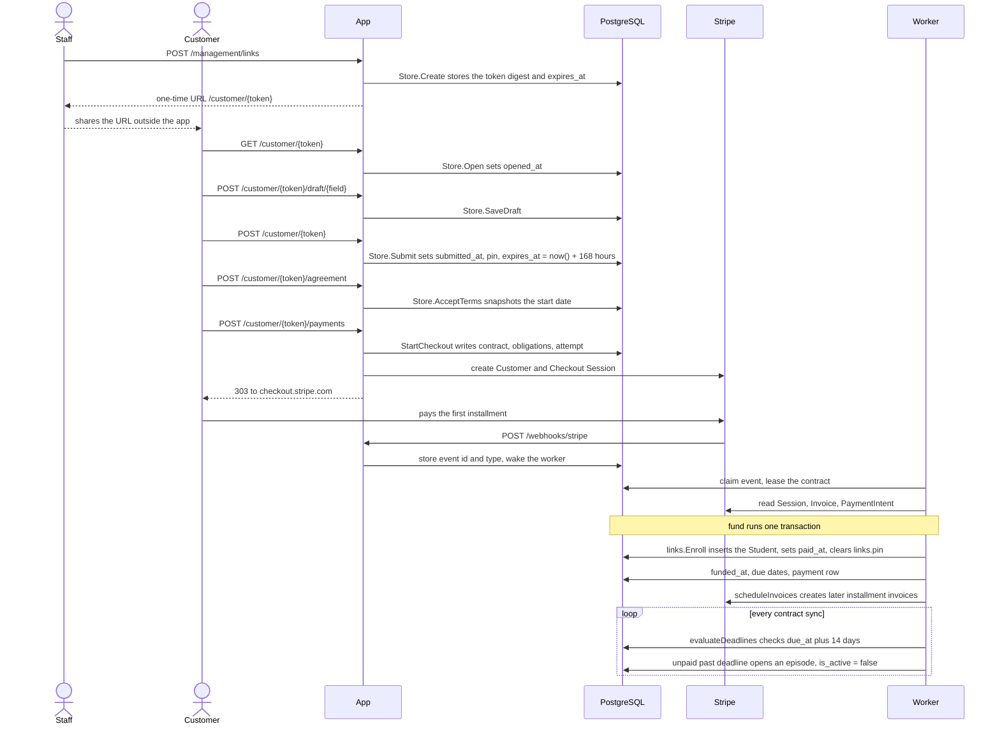
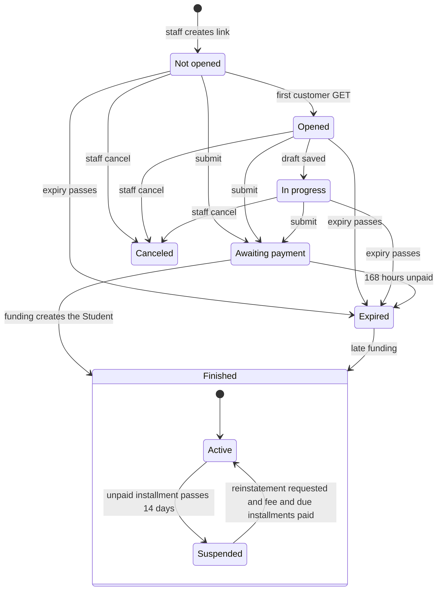

# Lifecycle

This page defines the vocabulary every other page uses and tells the whole story once: from staff issuing a link to the 14-day payment sweep. Each stage links to the page that owns its detail; the index of all pages is [docs/README](../README.md).

The central fact: a Student does not exist until the first payment is confirmed. Submitting the form writes only the Link. The Student is inserted by `links.Enroll` inside billing's funding transaction.

## Vocabulary

| Term | Meaning |
|---|---|
| **submitted** | `links.submitted_at` is set by `links.Store.Submit`. No Student and no money exist yet. |
| **paid / funded** | `links.paid_at` and `billing_contracts.funded_at` are set, to the same instant: the paid time of the first Stripe invoice. Set once, in one transaction. |
| **enrolled** | A `students` row exists. It is created only at funding, by `links.Enroll`. |
| **Finished** | The Link status once it is paid. |
| Link | One private customer URL and its row in `links`: drafts, PIN, agreement snapshot, audit. [Links](links.md) |
| Student | The enrolled person: canonical contact details, PIN, group, cohort, `is_active`. [Students](students.md) |
| Contract | `billing_contracts`: the financial agreement for one Link (1:1 by `source_link_hash`). Created at the first Checkout start, before any Student. [Billing overview](../billing/overview.md) |
| Obligation | `billing_obligations`: one tuition installment, or one reinstatement fee. [Invoices](../billing/invoices.md) |
| Attempt | `billing_checkout_attempts`: one hosted Checkout try for the first payment. [Checkout](../billing/checkout.md) |
| Suspension / episode | `billing_suspensions`: one continuous period of missed-deadline suspension, with one fee. [Suspension](../billing/suspension.md) |
| review reason | A short code on a contract or obligation meaning staff must look at the money state before automation continues. [Reviews](../billing/reviews.md) |
| cohort | `students.cohort`, `YYYY-MM`: the month of the start date the customer accepted. Set at enrollment, never edited. |
| group | `students.group`, `Básico` or `Regular`: the program stage. Starts at `Básico`; staff change it. |

## End to end

| Stage | Detail page |
|---|---|
| Issue link, token, expiry | [Links](links.md) |
| Open, drafts, submit, edit | [Customer flow](customer-flow.md) |
| Field rules, PIN | [Students](students.md) |
| Agreement, start date | [Agreement](agreement.md) |
| Plan choice, Checkout | [Checkout](../billing/checkout.md) |
| Webhook intake | [Webhooks](../billing/webhooks.md) |
| Worker, funding, retries | [Worker](../billing/worker.md) |
| Later installments | [Invoices](../billing/invoices.md) |
| 14-day sweep, reinstatement | [Suspension](../billing/suspension.md) |

Only the worker (event handling or contract sync) first-funds a contract. Staff Reconcile and Reinstatement run the same sync, but they find the contract through the `students` row, which exists only after funding, so in production they re-sync an already funded contract ([Billing overview](../billing/overview.md) lists who can reach `fund`). The app never charges a card itself: Stripe collects the invoices.

## Who owns which state

| State | Where it lives | Written by |
|---|---|---|
| Link row, status, drafts, PIN reservation, agreement snapshot | `links` | `internal/links` ([Links](links.md)) |
| Link contact snapshot edit before payment | `links` contact columns | `billing.UpdateContact`, which locks the Link, then the Contract |
| `paid_at`, Student row | `links.paid_at`, `students` | `links.Enroll`, called by `billing.Service.fund` |
| Student contact, PIN, group | `students` | `students.Store.UpdateField` (staff) |
| `students.is_active` | `students` | `internal/billing` suspension code |
| Plan quote, contract, obligations | `billing_contracts`, `billing_obligations` | `internal/billing` |
| Checkout attempt | `billing_checkout_attempts` | `internal/billing` |
| Received payments | `billing_payments` | `internal/billing` worker |
| Episodes and fees | `billing_suspensions`, fee obligations | `internal/billing` suspension code |
| Review reasons | `review_reason` on contracts and obligations | `internal/billing` |
| Stripe events | `billing_webhook_events` | `internal/billing` webhook intake |
| Start date, link lifetime | `settings` | `internal/settings` ([Agreement](agreement.md)) |
| Staff accounts and sessions | `users`, `sessions` | `internal/auth` ([Staff auth](../staff-auth.md)) |
| Live refresh signal | in memory | `internal/live` ([Live updates](../live-updates.md)) |
| Plans, schedules, money format | code only | `internal/payments` |

Every table with its writer and database rules is in [Data model](../data-model.md).

## A person's journey

Inside Finished the Link status stays Finished while the Student alternates between active and suspended. Reactivation also needs staff to have requested reinstatement; an episode later proven on time is corrected automatically ([Suspension](../billing/suspension.md)).

| State | Page |
|---|---|
| Not opened, Opened, In progress, Expired, Canceled | [Links](links.md) |
| Awaiting payment | [Customer flow](customer-flow.md), [Agreement](agreement.md) |
| Finished, Student active | [Students](students.md) |
| Student suspended | [Suspension](../billing/suspension.md) |

## Reading the rest of the docs

| Area | Pages |
|---|---|
| System | [Architecture](../architecture.md), [Data model](../data-model.md) |
| Domain | [Links](links.md), [Customer flow](customer-flow.md), [Students](students.md), [Agreement](agreement.md) |
| Billing | [Overview](../billing/overview.md), [Checkout](../billing/checkout.md), [Webhooks](../billing/webhooks.md), [Worker](../billing/worker.md), [Invoices](../billing/invoices.md), [Suspension](../billing/suspension.md), [Reviews](../billing/reviews.md) |
| Staff | [Staff auth](../staff-auth.md), [Live updates](../live-updates.md), [Management overview](../management/overview.md), [Management students](../management/students.md), [Dashboard](../management/dashboard.md), [Frontend](../frontend.md) |
| Operations | [Configuration](../operations/configuration.md), [Startup and shutdown](../operations/startup-shutdown.md), [Observability](../operations/observability.md), [Stripe setup](../operations/stripe-setup.md), [Railway](../operations/railway.md), [Local development](../operations/local-development.md) |
| Project | [Testing](../testing.md), [Go-live](../go-live.md) |

## Source

- `internal/links/links.go`: `Enroll`, `Store.Create`, `Store.Open`, `Store.SaveDraft`, `Store.Submit`, `Store.AcceptTerms`, `Entry`
- `internal/students/students.go`: `Student`, `Store.UpdateField`
- `internal/customer/customer.go`: `RegisterRoutes`
- `internal/billing/checkout.go`: `StartCheckout`
- `internal/billing/contact.go`: `UpdateContact`
- `internal/billing/webhook.go`: `Webhook`
- `internal/billing/worker.go`: `fund`, `reconcileContract`, `scheduleInvoices`
- `internal/billing/suspension.go`: `evaluateDeadlines`, `evaluateReactivation`, `deadlineWindow`
- `internal/billing/models.go`: `Contract`, `Obligation`, `CheckoutAttempt`, `Suspension`, `ReviewReason`
- `internal/settings/settings.go`: `Settings`
- `internal/payments/plans.go`: `Plan.Schedule`
