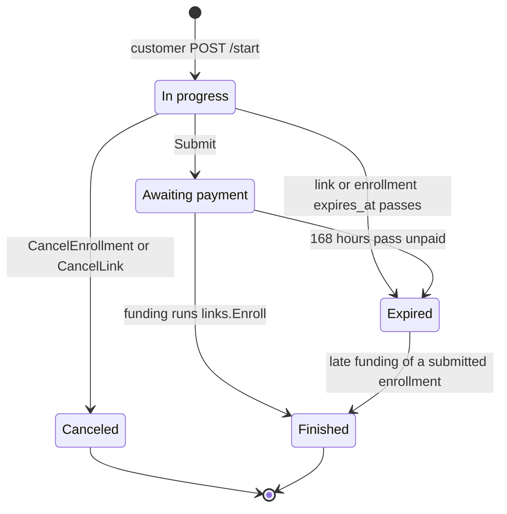

# Links and Enrollments

A `Link` is a reusable, expiring URL staff share with one or more prospective students; each browser that starts on that link gets its own `Enrollment` tied to a path-scoped session cookie. This page covers tokens, link and enrollment statuses, expiry, drafts, cancellation, and how staff see them. The end-to-end story is in [Lifecycle](lifecycle.md); the customer's HTTP behavior is in [Customer flow](customer-flow.md); the Student a paid enrollment becomes is in [Students](students.md).

`links.Store` owns `links` and `enrollments` from creation until payment, though `billing.UpdateContact` also writes an enrollment's contact columns before payment ([Customer flow](customer-flow.md)). Once paid, the enrollment is frozen history and billing only calls `links.Enroll` and `links.Usable` against it (see [Lifecycle](lifecycle.md)).

## Tokens and sessions

| Rule | Detail |
|---|---|
| Link token | 32 bytes from `crypto/rand`, base64url without padding: a 43-character token stored in `links.token` (unique, `token_length` check) so staff can copy the link any time while it remains visible. |
| Session cookie | `StartEnrollment` generates a second 32-byte random token returned once to the browser as the `enrollment_session` cookie (HttpOnly, `SameSite=Lax`, scoped to `/customer/{token}`) and stores only its SHA-256 digest in `enrollments.session_hash` (`session_hash_size` check: 32 bytes). |
| Per-link cap | `MaxLinkEnrollments` (100) bounds how many `enrollments` rows one `Link` can accumulate. Existing live unpaid sessions still resume when the cap is reached; new starts are refused. |
| Wrong length | `validToken` / `tokenDigest` reject any link or cookie token whose length is not 43 before querying or hashing. |
| Unusable link | Unknown, malformed, canceled, expired, or full links (for visitors without a live session) render the same branded 404 (`not-found.html`, "Este enlace ya no es válido"). HTMX requests also get `HX-Refresh: true`. |

## Statuses

### Link status (`LinkStatus`)

`Link.status` derives the reusable link's status on every read:

| # | Status | Condition |
|---|---|---|
| 1 | `Canceled` | `links.canceled_at` set |
| 2 | `Expired` | now at or after `links.expires_at` |
| 3 | `Active` | neither canceled nor expired |

### Enrollment status (`Status`)

`Enrollment.status` derives each child enrollment's progress on every read. The first matching rule wins:

| # | Status | Condition |
|---|---|---|
| 1 | `Canceled` | `enrollments.canceled_at` set |
| 2 | `Finished` | `enrollments.paid_at` set (wins over expiry: an in-flight payment can fund after the enrollment lapses) |
| 3 | `Awaiting payment` | `enrollments.submitted_at` set and now before `enrollments.expires_at` (independent of parent link cancellation/expiry) |
| 4 | `Canceled` | `enrollments.submitted_at` is nil and parent `links.canceled_at` set (inherits `links.canceled_by`) |
| 5 | `Expired` | now at or after `links.expires_at` or `enrollments.expires_at` (submitted-but-unpaid enrollments past 168 h included) |
| 6 | `In progress` | active unsubmitted enrollment |

Overlays computed on `LinkEntry` and `EnrollmentEntry`:

| Overlay | Rule |
|---|---|
| `LinkEntry.Cancelable` | `LinkActive` |
| `LinkEntry.Trashed` | `LinkCanceled` or `LinkExpired` |
| `EnrollmentEntry.Cancelable` | `InProgress`, `AwaitingPayment`, or `Expired` while holding a PIN (`HasPin`) |
| `EnrollmentEntry.Trashed` | `Canceled` or `Expired` |
| `EnrollmentEntry.Archived` | `Finished` and `paid_at` at least 24 hours old |
| Customer access (`Usable`) | `canceled_at IS NULL AND expires_at > now()`. For unsubmitted enrollments, both the enrollment and its parent link must satisfy `Usable`; once submitted, only the enrollment's own `Usable` governs. |

## Expiry

| Moment | `expires_at` | Clock |
|---|---|---|
| `POST /management/links` | `links.expires_at` = now plus configured lifetime, 2 to 14 days, default 7 ([Agreement](agreement.md)) | application clock |
| `Store.StartEnrollment` | `enrollments.expires_at` copies the parent `links.expires_at` | parent link |
| `Store.Submit` | `enrollments.expires_at = now() + interval '168 hours'`, replacing the initial value | database clock |
| Agreement, `/edit`, payment | unchanged | none |
| Customer access check (`Usable`) | `expires_at > now()` | database clock |
| Staff status display | compares against `time.Now()` | application clock |

Already-issued links and started enrollments keep their expiry when the lifetime setting changes.

## Starting a session

`Store.LookupSession` resolves `(linkToken, cookieToken)` read-only without writing any rows (`GET /customer/{token}` and `HEAD` never mutate the database). `Store.StartEnrollment` runs a transaction locking the `Link` row `FOR UPDATE`: if `cookieToken` matches an active unpaid (`InProgress` or `AwaitingPayment`) enrollment on that same link, it returns that existing enrollment without creating a new row or issuing a new cookie; otherwise, provided the link is usable and under `MaxLinkEnrollments`, it creates a new `Enrollment`, returns its fresh cookie token, and publishes a live event.

## Drafts

`Store.SaveDraft` writes one column per call, for the six registry fields only (`students.FindField`). PIN and group are not draftable, so `/draft/pin` is an unknown field. The UPDATE requires an unsubmitted enrollment whose parent link and enrollment are both `Usable`, with `column <> value`: an unchanged value writes nothing and publishes nothing. Empty values are accepted, so a customer can clear a field. Drafts are validated with `required=false`: empty passes, non-empty must be valid ([Students](students.md)).

`Store.SpendPinCheck` adds one to `pin_checks` on a usable, unsubmitted enrollment while it is under `MaxPinChecks` (30) and reports whether it did. The customer PIN check and every valid final submit call it first, so one enrollment can obtain at most 30 PIN availability answers. It publishes nothing.

## Submit

`Store.Submit` is one guarded `UPDATE enrollments ... FROM links`: it writes the six contact columns and the PIN, sets `submitted_at = now()` and `expires_at = now() + 168 hours`. It creates no Student. The guards are: parent link and enrollment both `Usable`, not yet submitted, and no enrolled Student holding the PIN ([Students](students.md) covers the PIN rules). A replay on a submitted enrollment changes nothing, so the deadline never moves. When the UPDATE touches no row, `saveResult` re-reads the enrollment (checking active unsubmitted first, then active submitted regardless of parent link state) to separate "unusable" (404) from "already submitted" from "PIN held".

## Cancellation

- `Store.RenameLink(id, name, staff)` trims whitespace and updates `links.name` when changed, rejecting empty, over-100-rune, or control-character names with `ErrInvalidLinkName`.
- `Store.CancelLink(id, staff)` sets `links.canceled_at` and `links.canceled_by` on an active link. New starts are blocked and unsubmitted child enrollments derive `Canceled`; already-submitted or paid enrollments keep their 168-hour window and independent lifecycle.
- `Store.CancelEnrollment(id, staff)` sets `enrollments.canceled_at` and `enrollments.canceled_by` on a usable, unsubmitted enrollment whose parent link is still usable, leaving the parent link active for other customers. Staff enrollment cancellation goes through `billing.Service.CancelEnrollment`, which expires any open Stripe Checkout session (blocking in-flight payments) and calls `CancelEnrollmentTx(tx, id, staff)` to cancel `InProgress`/`AwaitingPayment` enrollments (clearing their PIN) or clear an `Expired` submission's PIN without changing its `Expired` status.
## Staff list

`Store.ListGroups` returns every `Link` with its child `Enrollment`s (`LinkGroup`), oldest first, unpaginated. Management filters the result per tab:

| Page | Shows |
|---|---|
| `/management/` (main list) | Active links (with their `InProgress`, `AwaitingPayment`, and <24 h `Finished` enrollments), plus canceled/expired links that still have active `AwaitingPayment` or <24 h `Finished` enrollments |
| `/management/trash` | Canceled and expired links and any `Canceled` or `Expired` enrollments |
| neither | Archived `Finished` enrollments (24+ hours past `paid_at`) under trashed links. The Student row on the Students page is the surviving record ([Students](../management/students.md)). |

`EnrollmentEntry` carries ID, LinkID, Name, Phone, `CreatedAt`, `ExpiresAt`, `SubmittedAt`, `PaidAt`, `CanceledAt`, `CanceledBy`, `Status`, and `HasPin`—no email, date of birth, municipality, gender, or raw PIN.

## Audit

`CreateLink`, `RenameLink`, `CancelLink`, `CancelEnrollment`, and `CancelEnrollmentTx` refuse an empty staff name (`errNoStaff`), so no action is anonymous. `created_by` and `canceled_by` record the username supplied by `auth.Staff` ([Staff auth](../staff-auth.md)).

## Deliberate choices

- `LookupSession` and `StartEnrollment` stay separate: `GET /customer/{token}` and `HEAD` never create rows, preventing bots or link previews from consuming the 100-enrollment cap.
- `saveResult` re-reads after zero rows, because the 404-before-409 precedence needs to tell an unusable enrollment from a submitted one, including submitted enrollments whose parent link was later canceled.
- `Usable` is exported because billing applies it under row locks (`StartCheckout`, `UpdateContact`).
- `Enrollment.Student` creates the `RESTRICT` foreign key from `students.enrollment_id`.
- `Enroll` never checks `Usable`: money was collected, so an enrollment that expired before payment still enrolls.

## Source

- `internal/links/links.go`: `Link`, `Enrollment`, `LinkStatus`, `Status`, `LinkEntry`, `EnrollmentEntry`, `LinkGroup`, `Session`, `MaxLinkEnrollments`, `MaxPinChecks`, `ErrInvalidLinkName`, `Store.CreateLink`, `Store.RenameLink`, `Store.ListGroups`, `Store.LookupLink`, `Store.LookupSession`, `Store.StartEnrollment`, `Store.SaveDraft`, `Store.Submit`, `Store.SpendPinCheck`, `Store.AcceptTerms`, `Store.CancelLink`, `Store.CancelEnrollment`, `CancelEnrollmentTx`, `Enroll`, `Usable`, `tokenDigest`, `validToken`, `tokenBytes`, `saveResult`
- `internal/customer/customer.go`: `welcome`, `start`, `resolveSession`, `render`
- `internal/management/management.go`: `RegisterRoutes`
- `internal/settings/settings.go`: `Settings.LinkLifetime`
- `internal/students/fields.go`: `FindField`
