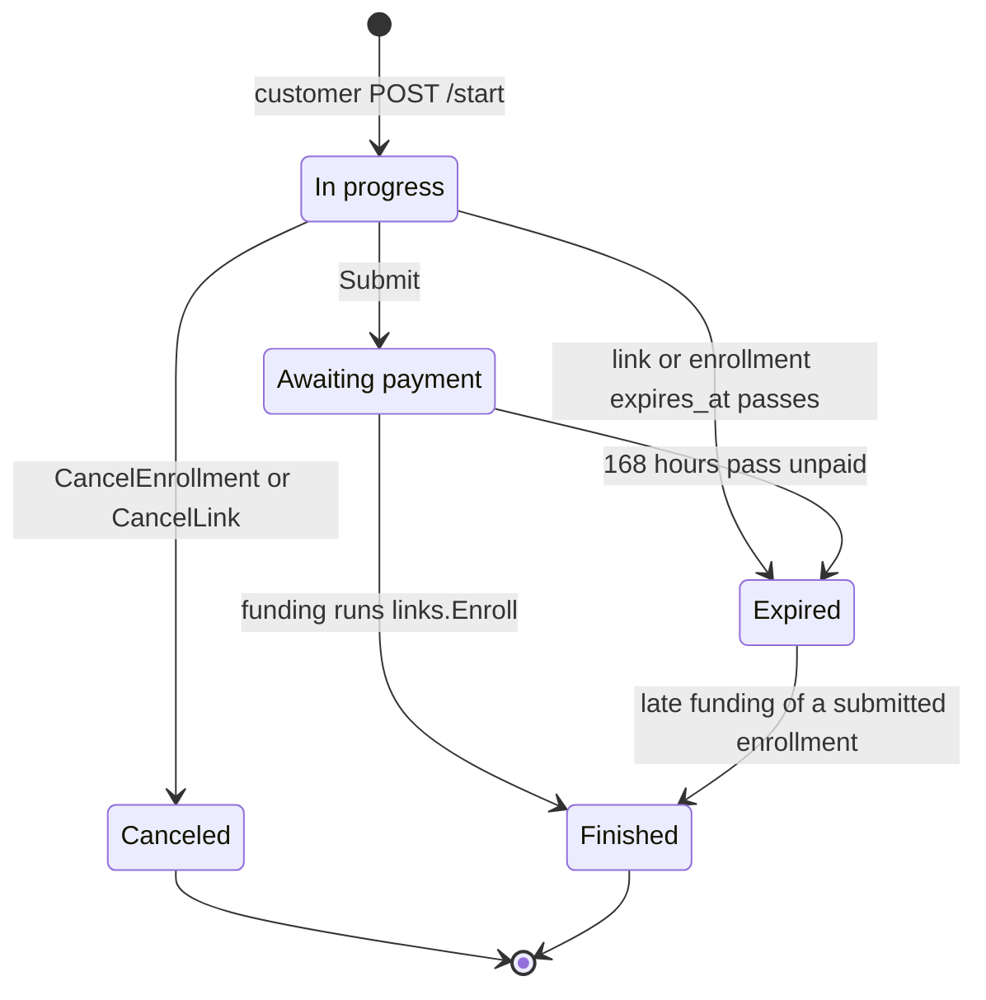

# Links and Enrollments

A `Link` is a reusable, expiring URL staff share with one or more prospective students; each browser that starts on that link gets its own `Enrollment` tied to a path-scoped session cookie. This page covers tokens, link and enrollment statuses, expiry, drafts, cancellation, and how staff see them. The end-to-end story is in [Lifecycle](lifecycle.md); the customer's HTTP behavior is in [Customer flow](customer-flow.md); the Student a paid enrollment becomes is in [Students](students.md).

`links.Store` owns `links` and `enrollments` from creation until payment, though `billing.UpdateContact` also writes an enrollment's contact columns before payment ([Customer flow](customer-flow.md)). Once paid, the enrollment is frozen history and billing only calls `links.Enroll` and `links.Usable` against it (see [Lifecycle](lifecycle.md)).

## Tokens and sessions

| Rule | Detail |
|---|---|
| Link token | 32 bytes from `crypto/rand`, base64url without padding: a 43-character token stored in `links.token` (unique, `link_token_length` check) so staff can copy the link any time while it remains visible. |
| Session cookie | `StartEnrollment` generates a second 32-byte random token returned once to the browser as the `enrollment_session` cookie (HttpOnly, `SameSite=Lax`, scoped to `/customer/{token}`) and stores only its SHA-256 digest in `enrollments.session_hash` (`session_hash_size` check: 32 bytes). |
| Per-link cap | `MaxLinkEnrollments` (100) bounds how many `enrollments` rows one `Link` can accumulate, counted by `links.enrollment_count` (enrollments are never deleted, and `StartEnrollment` is the only INSERT). Existing live unpaid sessions still resume when the cap is reached; new starts are refused. |
| Wrong length | `validToken` / `tokenDigest` reject any link or cookie token whose length is not 43 before querying or hashing. |
| Unusable link | Unknown, malformed, canceled, expired, or full links (for visitors without a live session) render the same branded 404 (`not-found.html`, "Este enlace ya no es válido"). HTMX requests also get `HX-Refresh: true`. |

## Statuses

### Link status (`LinkStatus`)

`Link.status` derives the reusable link's status on every read:

| # | Status | Condition |
|---|---|---|
| 1 | `Canceled` | `links.canceled_at` set |
| 2 | `Expired` | now at or after `links.expires_at` |
| 3 | `Active` | neither canceled nor expired |

### Enrollment status (`Status`)

`Enrollment.status` derives each child enrollment's progress on every read. The first matching rule wins:

| # | Status | Condition |
|---|---|---|
| 1 | `Canceled` | `enrollments.canceled_at` set |
| 2 | `Finished` | `enrollments.paid_at` set (wins over expiry: an in-flight payment can fund after the enrollment lapses) |
| 3 | `Awaiting payment` | `enrollments.submitted_at` set and now before `enrollments.expires_at` (independent of parent link cancellation/expiry) |
| 4 | `Canceled` | `enrollments.submitted_at` is nil and parent `links.canceled_at` set (inherits `links.canceled_by`) |
| 5 | `Expired` | now at or after `links.expires_at` or `enrollments.expires_at` (submitted-but-unpaid enrollments past 168 h included) |
| 6 | `In progress` | active unsubmitted enrollment |

Overlays computed on `LinkEntry` and `EnrollmentEntry`:

| Overlay | Rule |
|---|---|
| `LinkEntry.Cancelable` | `LinkActive` |
| `LinkEntry.Trashed` | `LinkCanceled` or `LinkExpired` |
| `EnrollmentEntry.Cancelable` | `InProgress`, `AwaitingPayment`, or `Expired` while holding a PIN (`HasPin`) |
| `EnrollmentEntry.Trashed` | `Canceled` or `Expired` |
| `EnrollmentEntry.Archived` | `Finished` and `paid_at` at least 24 hours old |
| Customer access (`Usable`) | `canceled_at IS NULL AND expires_at > now()`. For unsubmitted enrollments, both the enrollment and its parent link must satisfy `Usable`; once submitted, only the enrollment's own `Usable` governs, and payment extends its access past `expires_at`. The `usableSession` SQL guard states this rule once for `LookupSession`, `AcceptTerms` and `formState`. |

## Expiry

| Moment | `expires_at` | Clock |
|---|---|---|
| `POST /management/links` | `links.expires_at` = now plus configured lifetime, 2 to 14 days, default 7 ([Agreement](agreement.md)) | application clock |
| `Store.StartEnrollment` | `enrollments.expires_at` copies the parent `links.expires_at` | parent link |
| `Store.Submit` | `enrollments.expires_at = now() + interval '168 hours'`, replacing the initial value | database clock |
| Agreement, `/edit`, payment | unchanged | none |
| Customer access check (`Usable`) | `expires_at > now()` | database clock |
| Staff status display | compares against `time.Now()` | application clock |

Already-issued links and started enrollments keep their expiry when the lifetime setting changes.

## Starting a session

`Store.LookupSession` resolves `(linkToken, cookieToken)` in one read and writes nothing (`GET /customer/{token}` and `HEAD` never mutate the database): it returns the cookie's usable enrollment (nil when there is none) and whether the link takes new enrollments now (usable and under the cap). `Store.StartEnrollment` resumes first: if the cookie names a usable unpaid enrollment on that link, it returns it without a new row or cookie. Otherwise one statement starts a new one: an `UPDATE links` that adds one to `enrollment_count` while the link is usable and under `MaxLinkEnrollments`, feeding an `INSERT INTO enrollments ... RETURNING *`. It returns the fresh cookie token and publishes a live event. A full or unusable link inserts nothing.

Concurrent starts serialize on the link row: under READ COMMITTED each waiting UPDATE rechecks `enrollment_count < 100` on the newest row version, so the cap holds without a transaction or a `count(*)`. The statement commits with `synchronous_commit` off, like drafts: a PostgreSQL crash can lose enrollments started in about the last 600 ms, and those customers start again.

## Drafts

`Store.SaveDraft` writes one column per call, for the six registry fields only (`students.FindField`; [Students](students.md) owns which fields are draftable and how drafts are validated). The UPDATE requires an open form (`openEnrollment`: an unsubmitted enrollment whose parent link and enrollment are both `Usable`), with `column <> value`: an unchanged value writes nothing and publishes nothing. Empty values are accepted, so a customer can clear a field.

The draft UPDATE turns `synchronous_commit` off for its own transaction, in the same statement, so "Guardado." never waits for the WAL flush. If PostgreSQL crashes, autosaves acknowledged in about the last 600 ms can be lost; nothing is corrupted or reordered, and an app restart loses nothing. `Store.Submit` commits synchronously and rewrites all six contact columns.

## Submit

`Store.Submit` is one guarded `UPDATE enrollments ... FROM links`: it writes the six contact columns and the PIN, spends one PIN check (`pin_checks + 1`), sets `submitted_at = now()` and `expires_at = now() + 168 hours`. It creates no Student. The guards are: an open form (`openEnrollment`), `pin_checks < MaxPinChecks` (30), and no enrolled Student holding the PIN ([Students](students.md) covers the PIN rules); `idx_enrollment_pin` refuses a PIN another submitted enrollment holds. A replay on a submitted enrollment changes nothing, so the deadline never moves. When the UPDATE writes nothing, Submit spends the check on its own: success means the form is open with budget left, so the PIN was held (`PinTaken`, which still costs a check). Otherwise one `formState` query separates "unusable" (`Unavailable`, 404) from "already submitted" from a spent budget (`PinLimited`, 429). `Store.FormState` runs the same query without a write and answers `Open`, `AlreadySubmitted` or `Unavailable`.

`Store.SpendPinCheck` adds one to `pin_checks` on an open form while it is under `MaxPinChecks` and reports whether it did. The customer PIN check calls it before answering, and Submit spends its check in its own UPDATE, so one enrollment can obtain at most 30 PIN availability answers. It publishes nothing.

## Cancellation

- `Store.RenameLink(id, name, staff)` trims whitespace and updates `links.name` when changed, rejecting empty, over-100-rune, or control-character names with `ErrInvalidLinkName`.
- `Store.CancelLink(id, staff)` sets `links.canceled_at` and `links.canceled_by` on an active link. New starts are blocked and unsubmitted child enrollments derive `Canceled`; already-submitted or paid enrollments keep their 168-hour window and independent lifecycle.
- Staff enrollment cancellation goes through `billing.Service.CancelEnrollment`, which holds the Enrollment row lock, expires any open Stripe Checkout session (blocking in-flight payments), then calls `CancelEnrollmentTx(tx, id, staff)`. That returns a non-`Cancelable` enrollment unchanged; otherwise one UPDATE cancels an `InProgress` or `AwaitingPayment` enrollment (setting `canceled_at` and `canceled_by`, clearing its PIN) or clears an `Expired` submission's PIN without changing its `Expired` status. The parent link stays active for other customers.

## Staff list

`Store.ListGroups` returns every `Link` with its child `Enrollment`s (`LinkGroup`), oldest first, unpaginated. Management filters the result per tab:

| Page | Shows |
|---|---|
| `/management/` (main list) | Active links (with their `InProgress`, `AwaitingPayment`, and <24 h `Finished` enrollments), plus canceled/expired links that still have active `AwaitingPayment` or <24 h `Finished` enrollments |
| `/management/trash` | Canceled and expired links and any `Canceled` or `Expired` enrollments |
| neither | Archived `Finished` enrollments (24+ hours past `paid_at`) under trashed links. The Student row on the Students page is the surviving record ([Students](../management/students.md)). |

`EnrollmentEntry` carries ID, Name, Phone, `CreatedAt`, `ExpiresAt`, `SubmittedAt`, `PaidAt`, `CanceledBy`, `Status`, and `HasPin`—no email, date of birth, municipality, gender, or raw PIN.

## Audit

`CreateLink`, `RenameLink`, `CancelLink`, and `CancelEnrollmentTx` refuse an empty staff name (`errNoStaff`), so no action is anonymous. `created_by` and `canceled_by` record the username supplied by `auth.Staff` ([Staff auth](../staff-auth.md)).

## Deliberate choices

- `LookupSession` and `StartEnrollment` stay separate: `GET /customer/{token}` and `HEAD` never create rows, preventing bots or link previews from consuming the 100-enrollment cap.
- A write that touched no row re-reads with one `formState` query, because the 404-before-409 precedence needs to tell an unusable enrollment from a submitted one, including submitted enrollments whose parent link was later canceled. It stays a second statement: folded into the UPDATE it would read the pre-lock snapshot and could report a save that lost a race to `Submit`. The happy path never runs it, so every customer write that succeeds is one statement.
- The cap is a counter on the link, not a `count(*)`: a count in the INSERT statement would read a snapshot taken before the link row lock, so two concurrent starts could both see 99.
- `Usable` is exported because billing applies it under row locks (`StartCheckout`, `UpdateContact`).
- `Enrollment.Student` creates the `RESTRICT` foreign key from `students.enrollment_id`.
- `Enroll` never checks `Usable`: money was collected, so an enrollment that expired before payment still enrolls.

## Source

- `internal/links/links.go`: `Link`, `Enrollment`, `LinkStatus`, `Status`, `SaveResult`, `LinkEntry`, `EnrollmentEntry`, `LinkGroup`, `MaxLinkEnrollments`, `MaxPinChecks`, `ErrInvalidLinkName`, `Store.CreateLink`, `Store.RenameLink`, `Store.ListGroups`, `Store.LookupSession`, `sessionRow`, `Store.StartEnrollment`, `Store.SaveDraft`, `Store.Submit`, `Store.SpendPinCheck`, `spendPinCheck`, `Store.FormState`, `Store.AcceptTerms`, `Store.CancelLink`, `CancelEnrollmentTx`, `Enroll`, `Usable`, `openEnrollment`, `usableSession`, `sessionDigest`, `tokenDigest`, `validToken`, `tokenBytes`, `formState`
- `internal/customer/customer.go`: `welcome`, `start`, `resolveSession`, `render`
- `internal/management/management.go`: `RegisterRoutes`
- `internal/settings/settings.go`: `Settings.LinkLifetime`
- `internal/students/fields.go`: `FindField`
