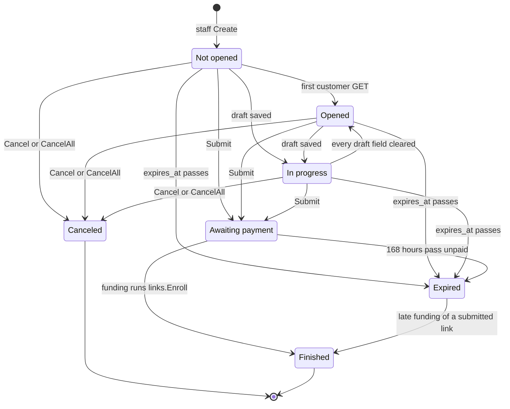

# Links

A Link is the private, expiring URL staff hand to one customer; this page covers its token, its seven statuses, expiry, drafts, cancellation and how staff see it. The end-to-end story is in [Lifecycle](lifecycle.md); the customer's HTTP behavior is in [Customer flow](customer-flow.md); the Student a paid link becomes is in [Students](students.md).

`links.Store` owns the `links` row from staff creation until payment, though `billing.UpdateContact` also writes its contact columns before payment ([Customer flow](customer-flow.md)). From then on the row is frozen history and billing only calls `links.Enroll` and `links.Usable` against it (see [Lifecycle](lifecycle.md)).

## Token

| Rule | Detail |
|---|---|
| Generation | 32 bytes from `crypto/rand`, base64url without padding: a 43-character token. Shown to staff once, in `Entry.Token`, and never stored. |
| Storage | `links.token_hash` (primary key) is the SHA-256 of the 43-character token text: 32 bytes, enforced by the `token_hash_size` check. A database leak yields no usable URL. |
| Staff handle | `Entry.ID` is the lowercase hex of the digest. Staff cancel by ID and cannot recover the token from it. |
| Wrong length | `tokenDigest` rejects any token whose length is not 43 before hashing. The result is the same as an unknown token. |
| Unusable token | Unknown, malformed, canceled and expired tokens all render the same branded 404 (`not-found.html`, "Este enlace ya no es válido"). HTMX requests also get `HX-Refresh: true`. The response never says which case applied. |

## Statuses

`Link.entry` derives the status on every read; it is never stored. The first matching rule wins:

| # | Status | Condition |
|---|---|---|
| 1 | Canceled | `canceled_at` set |
| 2 | Finished | `paid_at` set (wins over expiry: an in-flight payment can fund after the link lapses) |
| 3 | Awaiting payment | `submitted_at` set and now before `expires_at` |
| 4 | Expired | now at or after `expires_at` (submitted-but-unpaid links included) |
| 5 | In progress | any of the six contact columns is non-empty |
| 6 | Opened | `opened_at` set |
| 7 | Not opened | none of the above |

Clearing every draft field returns an In progress link to Opened, or to Not opened if the customer never loaded a page (a direct draft POST can write without a visit).

Overlays computed on `Entry`, not extra statuses:

| Overlay | Rule |
|---|---|
| Cancelable | Not opened, Opened or In progress (`Entry.Cancelable`) |
| Trashed | Canceled or Expired (`Entry.Trashed`) |
| Archived | Finished and `paid_at` at least 24 hours old (`Entry.Archived`) |
| Customer access | `canceled_at IS NULL AND expires_at > now()` (`Usable`). A Finished link still returns the 404 once its 168 hours pass. |

## Expiry

| Moment | `expires_at` | Clock |
|---|---|---|
| `POST /management/links` | now plus the configured lifetime, 2 to 14 days, default 7 ([Agreement](agreement.md)) | application clock |
| `Store.Submit` | `now() + interval '168 hours'`, replacing the initial value | database clock |
| Agreement, `/edit`, payment | unchanged | none |
| Customer access check (`Usable`) | `expires_at > now()` | database clock |
| Staff status display (`Link.entry`) | compares against `time.Now()` | application clock |

A link already issued keeps its own expiry when the lifetime setting changes. A missing expiry fails closed.

## First visit

`Store.Open` sets `opened_at = now()` (guarded by `opened_at IS NULL`) and publishes a live event. Only `GET /customer/{token}` and `GET /customer/{token}/forms` call it. `HEAD` and every other route use `Store.Lookup`, which records nothing. A submitted link is never "opened" again: GET continues to the agreement.

## Drafts

`Store.SaveDraft` writes one column per call, for the six registry fields only (`students.FindField`). PIN and group are not draftable, so `/draft/pin` is an unknown field. The UPDATE requires a usable link with `submitted_at IS NULL` and `column <> value`: an unchanged value writes nothing and publishes nothing. Empty values are accepted, so a customer can clear a field. Drafts are validated with `required=false`: empty passes, non-empty must be valid ([Students](students.md)).

## Submit

`Store.Submit` is one guarded `UPDATE links`: it writes the six contact columns and the PIN, sets `submitted_at = now()` and `expires_at = now() + 168 hours`. It creates no Student. The guards are: usable, not yet submitted, and no enrolled Student holding the PIN ([Students](students.md) covers the PIN rules). A replay on a submitted link changes nothing, so the deadline never moves. When the UPDATE touches no row, `saveResult` re-reads the link to separate "unusable" (404) from "already submitted" from "PIN held".

## Cancellation

`Store.Cancel(id, staff)` and `Store.CancelAll(staff)` set `canceled_at` and `canceled_by`. They match only usable links with `submitted_at IS NULL`, so Awaiting payment, Finished, Expired and already-Canceled links never change and the first cancellation's audit survives. `Cancel` returns the stored entry either way; management reports "Link can no longer be canceled." when the status is not Canceled. Malformed or unknown IDs return nothing. A Canceled link keeps its draft for staff.

## Staff list

`Store.List` returns every link oldest first, unpaginated. Management filters the result:

| Page | Shows |
|---|---|
| `/management/` (main list) | Not opened, Opened, In progress, Awaiting payment, and Finished links less than 24 hours past `paid_at` |
| `/management/trash` | Canceled and Expired links, with their saved data |
| neither | Archived links. The Student row on the Students page is the surviving record ([Students](../management/students.md)). |

A submitted link that lapses unpaid is Expired and moves to Trash. A late payment returns it to Finished, so it reappears on the main list for 24 hours.

`links.Entry` is the staff projection: ID, Name, Phone, `CreatedAt`, `ExpiresAt`, `SubmittedAt`, `PaidAt`, the two audit names and Status. It carries no email, date of birth, municipality, gender or PIN, so the list cannot leak answers. `Token` is set only by `Create`.

## Audit

`Create`, `Cancel` and `CancelAll` refuse an empty staff name, so no action is anonymous. `created_by` and `canceled_by` record the username supplied by `auth.Staff` ([Staff auth](../staff-auth.md)). An empty value means the action has not happened.

## Deliberate choices

- `Lookup` and `Open` stay separate: `HEAD` and every route except the two GET pages must not record a visit.
- `saveResult` re-reads after zero rows, because the 404-before-409 precedence needs to tell an unusable link from a submitted one.
- `Usable` is exported because billing applies it under row locks (`StartCheckout`, `UpdateContact`).
- `Link.Student` looks unused but creates the `RESTRICT` foreign key from `students.source_link_hash` to the link that tests assert.
- `Enroll` never checks `Usable`: money was collected, so a link that expired before payment still enrolls.

## Source

- `internal/links/links.go`: `Link`, `Status`, `NotOpened`, `AwaitingPayment`, `Finished`, `Entry`, `Entry.Cancelable`, `Entry.Archived`, `Entry.Trashed`, `Link.entry`, `Store.Create`, `Store.List`, `Store.Lookup`, `Store.Open`, `Store.SaveDraft`, `Store.Submit`, `Store.Cancel`, `Store.CancelAll`, `Enroll`, `Usable`, `tokenDigest`, `tokenBytes`, `saveResult`
- `internal/customer/customer.go`: `view`, `render`
- `internal/management/management.go`: `RegisterRoutes`
- `internal/settings/settings.go`: `Settings.LinkLifetime`
- `internal/students/fields.go`: `FindField`
