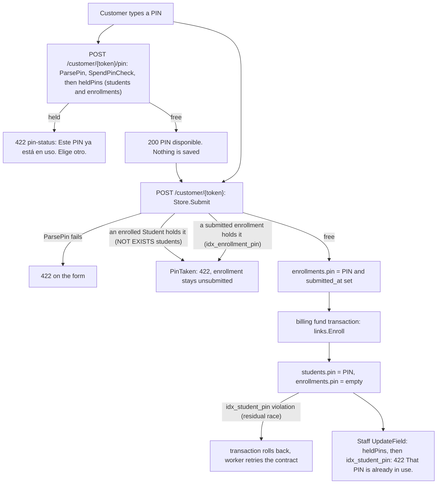

# Students

This page covers the contact-field registry and its parse rules, the PIN's journey across two tables, and the Student record: created at payment for an enrollment, or added directly by staff. It is the home of those rules for every writer: customer drafts, final submit, customer edit, staff edit and staff add. The Link side is in [Links](links.md); the staff screens are in [Management students](../management/students.md); the money side is in [Billing overview](../billing/overview.md).

## Field registry

`internal/students/fields.go` holds one registry. `Fields()` is the six customer contact fields; `StaffFields()` adds PIN and group.

| Key | Label | Input | Options | Draft | Submit | Customer edit | Staff edit | Held by |
|---|---|---|---|---|---|---|---|---|
| `name` | Name | text | none | yes | yes | yes | yes | Link, then Student |
| `email` | Email | email | none | yes | yes | yes | yes | Link, then Student |
| `phone` | Phone | tel | none | yes | yes | yes | yes | Link, then Student |
| `municipality` | Municipality | select | 79 values | yes | yes | yes | yes | Link, then Student |
| `date_of_birth` | Date of birth | date | none | yes | yes | yes | yes | Link, then Student |
| `gender` | Gender | radio | `Male`, `Female` | yes | yes | yes | yes | Link, then Student |
| `pin` | PIN | text | none | never | yes | no | yes | Link from submit until payment, then Student |
| `group` | Group | select | `Básico`, `Regular` | no | no | no | yes | Student |

`email_confirm` is compared at submit and customer edit and never stored. Cohort is not a registry field: nothing edits it after enrollment.

## Parse rules

One `Parse(raw, required)` per field. Drafts call it with `required=false`, so empty passes and a non-empty value must still be valid. Submit, customer edit and staff edit use `required=true`; a staff edit therefore cannot blank a field.

| Field | Rule |
|---|---|
| Name | Valid UTF-8, trimmed. Allowed: letters, combining marks directly after a letter, a single period directly after a letter (a letter right after it starts a new word, so `J.R.` is two words), and Unicode space separators between words. Anything else is rejected: digits, hyphen, apostrophe, two periods in a row, a leading period, an internal tab or newline. Required needs at least two words; drafts allow empty or one word. Space runs collapse to one ASCII space. No length cap. |
| Email | Trimmed, at most 254 bytes, ASCII 33 to 126 only, no `"`. Must parse as one bare address (`net/mail`, no display name). The last `@` sits at byte 1 to 64. The domain contains a dot and every label is 1 to 63 letters, digits or hyphens with no edge hyphen. The domain is lowercased; the local part keeps its case. |
| Phone | Trimmed. Characters: digits, space, `(`, `)`, `-`, `.`, and `+` only first. Parsed with `phonenumbers` using region `PR`. The number's region must be `PR` or `US` and valid for it. Stored as E.164. |
| Date of birth | Trimmed, strict `YYYY-MM-DD` read in Puerto Rico time (`puertorico.Zone`, UTC-4). Must be strictly before today there. Age above 100 is rejected. There is no minimum age. Every refusal carries one message. |
| Municipality | Exact match after trimming against 79 values: 78 municipios plus `Fuera de Puerto Rico`. |
| Gender | Exactly `Male` or `Female` (the form shows "Masculino" and "Femenino"). |
| PIN | 4 to 6 ASCII digits after trimming. Kept as text so leading zeros survive. |
| Group | Exactly `Básico` or `Regular`. The database repeats this as the `student_group_valid` check and the `Básico` default. |

## PIN lifecycle

The customer enters the PIN once, on the final submit. It is never drafted, so abandoned forms never reserve a PIN. Uniqueness spans two tables, and each has only its own partial unique index (`where pin <> ''`).

| Refusal point | What it checks | Authority |
|---|---|---|
| `/pin` | `heldPins`: a Student or any enrollment holds the PIN | advisory; customer-facing warning only |
| `Store.Submit` | `AND NOT EXISTS (SELECT 1 FROM students WHERE pin = ? AND pin <> '')` plus `idx_enrollment_pin` | binding for submitted enrollments and enrolled Students |
| `Store.UpdateField` (staff) | `heldPins`, then a unique violation on `idx_student_pin` | binding; both become the same 422 message |
| `links.Enroll` | `idx_student_pin` at funding | last resort |

A `Submit` racing a concurrent `Enroll` can still see the PIN free under READ COMMITTED; funding then fails on `idx_student_pin` and the contract retries without creating a Student ([Go-live](../go-live.md)). The code marks the upgrade path: one PIN-reservation table or an advisory lock.

## Student record

| Column | Rule |
|---|---|
| `id` | Primary key. `Store.Get` returns nothing for an unknown ID. Handlers parse IDs within `BIGINT` before calling the store ([Data model](../data-model.md)). |
| `enrollment_id` | Nullable unique `RESTRICT` foreign key to `enrollments.id`: one Student per enrollment, and the enrollment cannot be deleted or rekeyed; `NULL` for staff-added students. |
| six contact columns | Copied from the Enrollment at enrollment. After that the Student is canonical and staff edit it; the Enrollment keeps its last pre-payment snapshot. |
| `created_at` | The payment instant: `enrollments.paid_at` and `billing_contracts.funded_at`. |
| `is_active` | Default true. Billing flips it on suspension and reactivation ([Suspension](../billing/suspension.md)) and sets it false for good on withdrawal. Nothing in this package writes it. |
| `withdrawn_at` | NULL until staff withdraw the student; billing then sets it with `is_active = false` ([Withdrawal](../billing/withdrawal.md)). Irreversible: nothing clears it or reactivates the student, and re-enrolling takes a new link. The row is kept, PIN included, and `heldPins` reads every student, so the same person re-enrolling needs another PIN unless staff change this one. Nothing in this package writes it. |
| `pin` | Moved from the Enrollment by `Enroll`. |
| `group` | The column default `Básico`: `Enroll` never sets it. Staff change it afterwards. |
| `cohort` | `left(program_start_date, 7)` of the Enrollment's accepted agreement snapshot, `YYYY-MM`, or `''` for staff-added students. The `student_cohort_valid` check enforces the shape. No edit reaches it, so it stays the start month after a promotion. `CohortLabel` renders it as "November 2026". |

`links.Enroll(tx, enrollmentID, paidAt)` runs inside billing's funding transaction, which already holds the Enrollment row lock. It inserts the Student from the submitted, unpaid enrollment, then sets `enrollments.paid_at` and clears `enrollments.pin`. It fails the transaction if the enrollment is not submitted or is already paid. It ignores `Usable`, so an enrollment that expired before payment still enrolls. The Student outlives the enrollment: `Store.List` returns every retained student regardless of enrollment access. See [Lifecycle](lifecycle.md) for the surrounding sequence.

## Staff field edit

`Store.UpdateField(id, key, raw)` accepts any `StaffFields` key. Order: unknown key returns `ErrUnknownField`; parse (invalid returns a `ValidationError`, shown as 422); an unknown ID returns nothing. Then one transaction:

1. `SELECT ... FOR UPDATE` on the student row, so comparison and write share one version.
2. If the normalized value equals the stored one, return the row without writing or publishing.
3. For the PIN, run `heldPins` and refuse a held PIN.
4. Update the one column; zero rows after the locked read means a trigger suppressed the write and is not reported as saved.

A write publishes a live event. Management then calls `TouchContract` so the contract re-syncs ([Management students](../management/students.md)). Edits are not blocked by funding and carry no staff attribution; that gap is listed in [Go-live](../go-live.md).

## Deliberate choices

- `Fields()` and `StaffFields()` stay separate so PIN and group stay undraftable: `/draft/pin` returns 404 because `FindField` does not know it.
- `heldPins` queries `enrollments` by table name because `links` imports this package; importing `links` back would be a cycle.
- The Puerto Rico zone lives in its own package (`puertorico.Zone`), shared with plan schedules and customer dates, so contact validation does not import plan math.
- `Store.Add` checks every entry's PIN against held PINs and the batch's own earlier PINs with one `heldPins` query, then inserts the valid entries in one transaction; a unique violation at insert (a race) refuses the whole batch with "A PIN was just taken by someone else. Please try again."
- The partial indexes (`where pin <> ''`) let unsubmitted enrollments and PIN-less rows coexist, and let the store accept an empty PIN in tests.

## Source

- `internal/students/students.go`: `Details`, `Student`, `WithdrawnAt`, `CohortLabel`, `Store.List`, `Store.Get`, `Store.PinTaken`, `Store.UpdateField`, `Store.Add`, `heldPins`, `pinIndex`, `IsUniqueViolation`, `ErrUnknownField`
- `internal/students/fields.go`: `Fields`, `StaffFields`, `FindField`, `FindStaffField`, `pinField`, `groupField`, `ParseName`, `ParseEmail`, `ParsePhone`, `ParseDateOfBirth`, `ParseGender`, `ParseGroup`, `ParsePin`, `ValidationError`
- `internal/puertorico/puertorico.go`: `Zone`
- `internal/students/municipalities.go`: `MunicipalityOptions`, `ParseMunicipality`
- `internal/links/links.go`: `Enroll`, `Store.Submit`, `pinIndex`
- `internal/customer/customer.go`: `checkPin`, `readSubmission`, `pinTakenMessage`, `pinLimitMessage`
- `internal/billing/checkout.go`: `fund`
- `internal/billing/suspension.go`: `evaluateDeadlines`
- `internal/billing/withdraw.go`: `withdraw`
