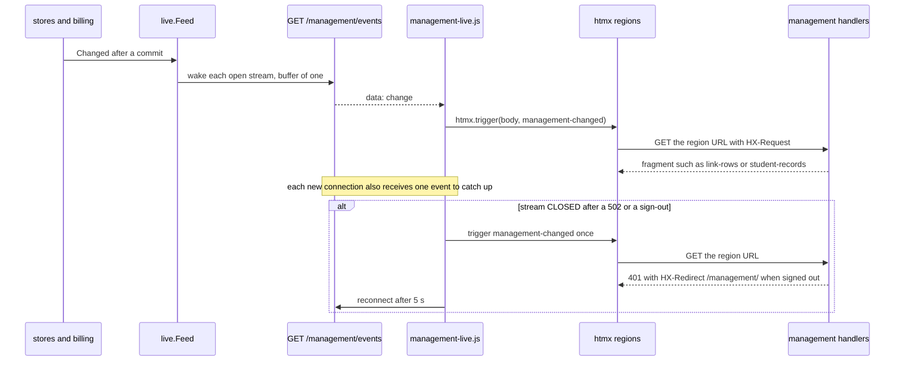
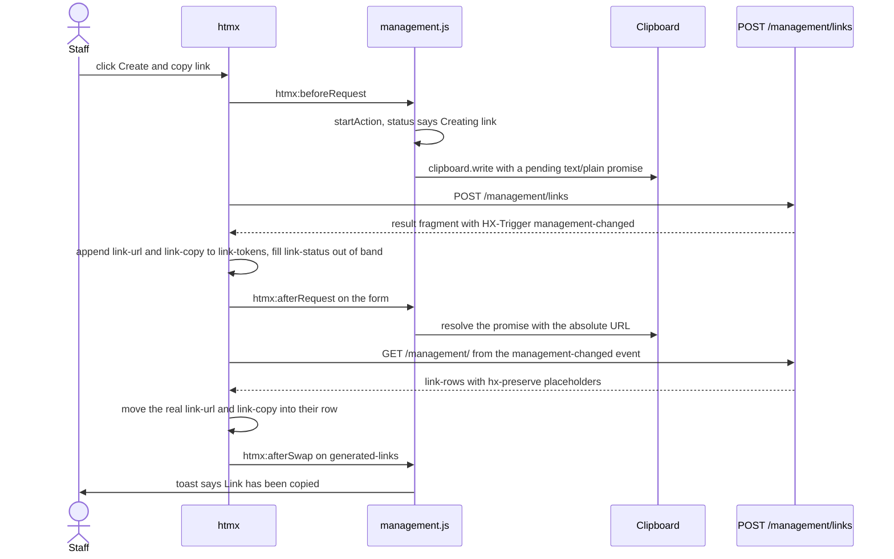

# Frontend

The browser side of the site: server-rendered templates, htmx 2.0.11 and six small scripts, two standalone stylesheets. This page owns scripts, CSS, fonts, the site CSP's effect on markup, accessibility behavior and no-JavaScript fallbacks. Staff routes and fragments are in [Management overview](management/overview.md); customer routes, headers and the CSP value are in [Customer flow](domain/customer-flow.md).

## Assets

`static/` is embedded in the binary (`//go:embed static`, `assets`) and served by `GET /static/` and `GET /favicon.ico`, so a CSS or script change needs a rebuild ([Local development](operations/local-development.md)). There is no bundler. htmx comes from jsDelivr (`htmx.org@2.0.11`) with an SRI `integrity` hash, `crossorigin="anonymous"` and `defer`; the tag is repeated in each template that uses it. Fonts come from Google Fonts stylesheets (no SRI).

| File | Used by |
|---|---|
| `styles.css`, `customer.css` | staff and login pages; customer pages (never together) |
| `logo-mark.webp` | staff rail and login (`alt=""`, the brand text sits beside it); customer pages (`alt="Masterminds Programa ASVAB"`) |
| `payment-{visa,mastercard,amex,discover,applepay,googlepay}.svg` | badges on the customer payments page |
| `favicon.ico` | every page |

## Scripts per page

| Page | htmx | `management-time.js` | `management-live.js` | Page script |
|---|---|---|---|---|
| Customer links, Trash | yes | yes | yes | `management.js` |
| Students list and details | yes | yes | yes | `students.js` |
| Dashboard | yes | no | yes | none |
| Settings | no | no | no | `settings.js` |
| Login | no | no | no | none |
| Customer form and edit view | yes | no | no | `customer.js` |
| Customer payment return | yes | no | no | none |
| Customer welcome, agreement, payments, not-found | no | no | no | none |

| Script | Behavior |
|---|---|
| `management-live.js` | Opens `EventSource("/management/events")`; each message triggers `management-changed` on `body`. If the stream is closed (a deploy's 502, a sign-in redirect) it triggers one refresh, which sends a signed-out tab to login through `HX-Redirect`, and reconnects after 5 s. Does nothing unless `window.htmx` exists. |
| `management-time.js` | `htmx.onLoad` rewrites every `<time datetime>` into the staff member's own time zone (`Intl.DateTimeFormat`, medium date, short time), including swapped-in rows. The server renders UTC. Settings does not load this script, so its "last changed" time stays UTC. |
| `management.js` | Links page. Shows absolute URLs, create-and-copy, copy buttons, the copy toast, and errors in `#link-status` and `#link-refresh-error`. |
| `students.js` | Student pages. A click anywhere on a row opens it (ignoring controls, modifier keys and text selection); `showModal()` when content arrives in `#student-dialog-content`; forces a swap on a 422 from the field editor and blocks swaps for other 4xx and 5xx; moves focus to the first input or the edit link after a field swap; returns focus to the opening row on close; shows per-field, billing and roster errors ([Students](management/students.md)). |
| `settings.js` | Settings page. Mirrors the lifetime slider into its `<output>` because the site CSP blocks inline handlers. |
| `customer.js` | Customer form. Live email and confirmation check through `setCustomValidity`; ignores autosave responses for controls that left the page; keeps `aria-invalid` in step with the status region; focuses the first invalid field after a 422; on status 0 shows "No se guardó. Verifica tu conexión e intenta de nuevo." |

## Management refresh

Every live region re-fetches itself on `management-changed`. The same event also comes from an action's `HX-Trigger` header, so the acting tab refreshes without waiting for the stream.

The stream carries no data and a burst of writes collapses into one event ([Live updates](live-updates.md)). Only refreshes write rows, so a slow older response cannot overwrite a newer one ([Management overview](management/overview.md)).

## Create and copy a link

The new link's URL exists only in the create response. `management.js` starts the clipboard write during the click, because Safari requires user activation before the response arrives, and hands the clipboard a promise that resolves once the URL is known.

- The toast (`#copy-toast`, `role="status"`) is shown only once the URL element is visible inside its row. If the clipboard is unavailable the message "Clipboard unavailable; copy the link below." goes into `#link-status` instead.
- `requestSequence` makes a newer action invalidate older feedback; live list refreshes do not count as actions.
- Rows without a token (every link but the one just created) hold hidden placeholders, so only the creating session gets a URL and a copy button. Saved rows render a relative path; the script replaces the link text with the absolute URL.
- Failed actions put the response text, or "Request failed. Please try again.", in `#link-status`; a failed list refresh writes `#link-refresh-error`.

## htmx configuration

| Surface | Configuration | Effect |
|---|---|---|
| Staff pages | htmx defaults | 2xx swaps, 204 does not, 4xx and 5xx never swap. `students.js` allows one exception: 422 from the field editor. |
| Customer form and edit view | `htmx-config` meta | `reportValidityOfForms: true`; `includeIndicatorStyles: false`; 204 no swap, 2xx and 3xx swap, 422 swaps and is not an error, other 4xx and 5xx swap as errors. |
| Customer payment return | `htmx-config` meta | `includeIndicatorStyles: false`; 204 and 4xx no swap (4xx is an error), 2xx, 3xx and 5xx swap (5xx is an error). |

### Customer autosave trigger

Draft controls use `hx-trigger="change"`, not `blur`: the browser's `change` event fires when focus leaves a text, email or telephone input **after its value was edited**, and immediately when a select option, radio button or date is chosen. A field focused and left unchanged sends nothing.

| Control | Request |
|---|---|
| name, email, phone, date of birth, municipality, gender | `POST /customer/{token}/draft/{field}` carrying only that control (`hx-params`), `hx-sync="this:queue last"`, result into `#save-status-{field}` |
| PIN | `POST /customer/{token}/pin`: an availability check that saves nothing |
| email confirmation | none; `customer.js` checks it locally |
| edit view (after submit) | none; the whole form posts to `/edit` |

## CSS and fonts

The two sheets are standalone; customer pages never load `styles.css`.

- **`styles.css`** (staff and login). Everything is scoped to `.management`: a light workspace on the logo's colors. Tokens (`--canvas`, `--surface`, `--brand`, `--rail`, `--bulb`, status tints) sit at the top, and `:root:has(> .management)` sets `color-scheme: light`. `.management-workspace` is a grid of a 15 rem deep-teal rail (`.management-sidebar`: brand, navigation, account) and main; `--bulb` yellow appears only as the current-page marker, rail focus rings and the skip link. Below 60 rem the rail becomes a top bar with a scrolling navigation row. Controls are 36 px for mouse users and 44 px under `pointer: coarse`. A student opens as a full-height sheet from the right edge. Sections follow the pages: shell, buttons, live regions and copy toast, link list, program start and lifetime forms, sign in, students and sheet, dashboard.
- **`customer.css`** (customer pages). Tokens on `.customer` (`--ink`, `--teal`, `--bulb`, `--danger`), `color-scheme: light`, mobile-first single column (`--column` 32 rem, 38 rem on the agreement, 62 rem on payments) with breakpoints at 40 rem and 56 rem. Sections: page frame, progress steps, type, notices, buttons, welcome, student form, checkbox and radio, agreement, plans, funded readout, payment return.
- **No theme switch.** Neither sheet has a `prefers-color-scheme` rule: both are light only.
- **Fonts.** Staff and customer pages load Figtree (400 to 700) and Marcellus for the brand name. All use `display=swap` and fall back to system stacks. Staff monospace text (one-time link URL, billing review codes) uses a system monospace stack because the CSP allows no second family.

## Site CSP implications

`secureHeaders` in `main.go` sends one policy on every response, staff, login, customer and static. The exact header is `sitePolicy`; the customer flow does not set its own ([Customer flow](domain/customer-flow.md)). What it forces on markup:

| Directive | Consequence |
|---|---|
| `script-src 'self' https://cdn.jsdelivr.net/npm/htmx.org@2.0.11/dist/htmx.min.js` | No inline script, `on*` attribute or `hx-on`. Behavior lives in `/static/*.js`; the one pinned htmx file loads from jsDelivr under SRI, so an htmx upgrade changes the template URL and `sitePolicy` together. |
| `style-src 'self' https://fonts.googleapis.com` | No inline `<style>` or `style=` attribute. htmx would inject indicator styles, so every page that loads it sets `includeIndicatorStyles: false` in its `htmx-config` meta. |
| `font-src https://fonts.gstatic.com` | Font files only from Google Fonts. |
| `connect-src 'self'` | Autosave, PIN check, live events and payment polling talk only to this origin. |
| `img-src 'self' data:`, `object-src 'none'`, `frame-ancestors 'none'` | Local images only, no plugins, no embedding. |

The same middleware sends `Strict-Transport-Security: max-age=31536000` (no `includeSubDomains`), `X-Content-Type-Options: nosniff` and `X-Robots-Tag: noindex, nofollow`. `GET /static/` itself answers 404, so the asset list is not browsable.

## Accessibility

| Behavior | Where |
|---|---|
| Skip link and `main` with `tabindex="-1"` | every staff page (login has the skip link only) |
| `aria-current="page"` on navigation, `aria-current="step"` on customer steps with a visually hidden "Completado:" prefix | staff navigation, customer progress |
| Live regions: `role="status"` for `#link-status`, `#link-refresh-error`, `#copy-toast`, "Saved.", the portal link area and per-field `#save-status-{field}`; `role="alert"` for validation and request errors; `aria-live="assertive"` on the customer `#form-error` | staff and customer pages |
| `aria-invalid` plus `aria-describedby` on invalid controls | staff field editor, program start date, lifetime, customer form |
| Native `<dialog>` with `aria-labelledby`, opened by `showModal()`; focus goes to the first control, and back to the opening row on close | student dialog |
| Controls at least 44 px tall on touch (`pointer: coarse`; 36 px with a mouse on staff pages; 2.75 rem and more on the customer sheet); `:focus-visible` outlines in both sheets | both |
| `prefers-reduced-motion`: the toast only fades, the payment spinner stops | `styles.css`, `customer.css` |
| Decorative SVG icons are `aria-hidden`; customer icons also set `focusable="false"` | all templates |
| `lang`: `en` on staff pages, `es-PR` on customer pages, `lang="es"` on the Spanish start-date panel; `translate="no"` on the brand | all templates |

## No-JavaScript fallbacks

| Surface | Without JavaScript |
|---|---|
| Create link | Plain form post; the full page shows the new URL on its row as a relative path. The Copy link button does nothing, so staff copy the link by hand. |
| Cancel link, cancel all | Plain form posts, with no confirmation prompt (`hx-confirm` needs htmx). |
| Start date, settings | Ordinary forms; they never used htmx. |
| Student filters | GET form with a `<noscript>` Apply button. |
| Student rows and field edits | Row links open the details page; Edit links use `?edit=1`; a save posts and answers 303 to `?saved={field}`. |
| Billing buttons | **None.** Reconcile, Request Reinstatement and Customer Portal are `type="button"` with `hx-post`. The invoice link is a plain link. |
| Live refresh, local times | Absent; pages change only on navigation, and times stay UTC. |
| Customer form | The whole form posts to submit; there is no autosave or live PIN check. |
| Payment return | `<noscript><meta http-equiv="refresh">` reloads the page every 3 s while the status is pending ([Customer flow](domain/customer-flow.md)). |
| Welcome, agreement, payments | No JavaScript is used. |

## Deliberate choices

- **`includeIndicatorStyles: false`.** Removing it makes htmx inject inline styles that the site CSP blocks.
- **Clipboard write started inside the click.** Moving it after the response breaks Safari's user-activation rule.
- **The htmx tag repeated per template.** The management pages (`index.html`, `students.html`, `dashboard.html`) and the customer `index.html` each define their own complete HTML documents rather than sharing a global layout template.

## Source

- `main.go`: `assets`, `newServer`
- `static/management-live.js`: `EventSource`, `management-changed`, `listenForChanges`
- `static/management-time.js`: `onLoad`, `Intl.DateTimeFormat`
- `static/management.js`: `ClipboardItem`, `requestSequence`, `startAction`, `showCreationFeedback`, `link-tokens`
- `static/students.js`: `showModal`, `requestError`, `htmx:beforeSwap`
- `static/customer.js`: `setCustomValidity`, `reconcileEmails`, `ignoreDetachedDraft`
- `static/styles.css`: `color-scheme`, `management-workspace`, `management-sidebar`, `prefers-reduced-motion`, `copy-toast`
- `static/customer.css`: `color-scheme`, `--column`, `prefers-reduced-motion`
- `internal/management/templates/index.html`: `hx-preserve`, `copy-toast`, `hx-confirm`, `management-skip-link`
- `internal/management/templates/students.html`: `student-dialog`, `noscript`
- `internal/management/templates/settings.html`: `settings.js`
- `internal/customer/templates/index.html`: `htmx-config`, `includeIndicatorStyles`, `hx-trigger`, `customer.js`
- `internal/customer/templates/payment-return.html`: `noscript`, `hx-trigger`
- `internal/customer/templates/icons.html`: `focusable`
- `internal/auth/templates/login.html`: `management-skip-link`
- `internal/customer/customer.go`: `withHeaders`
