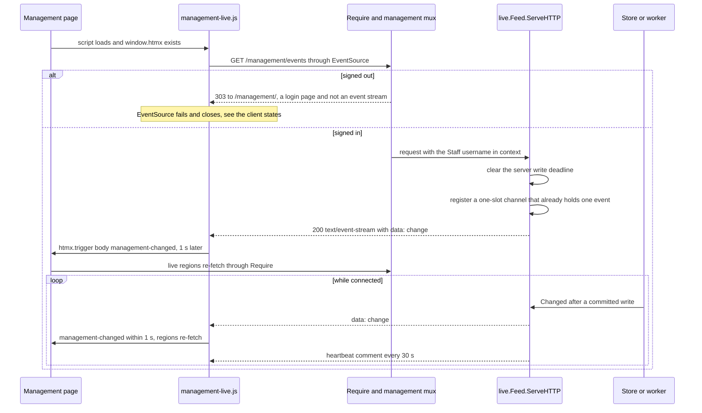
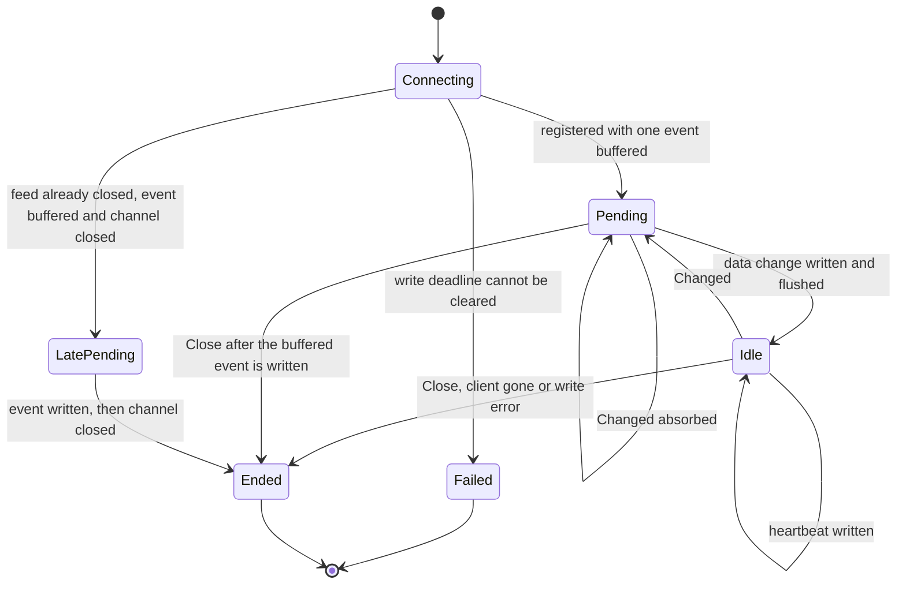
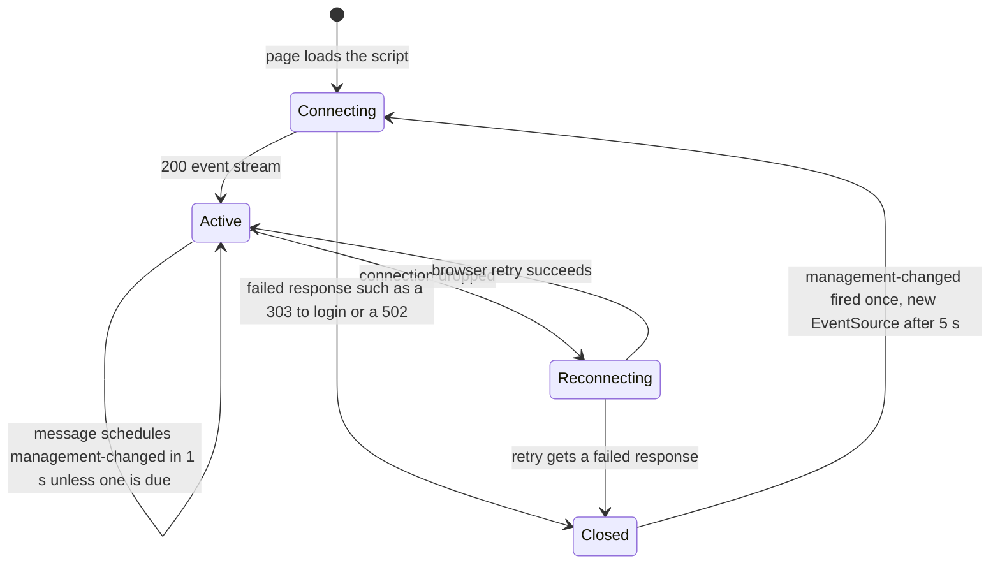
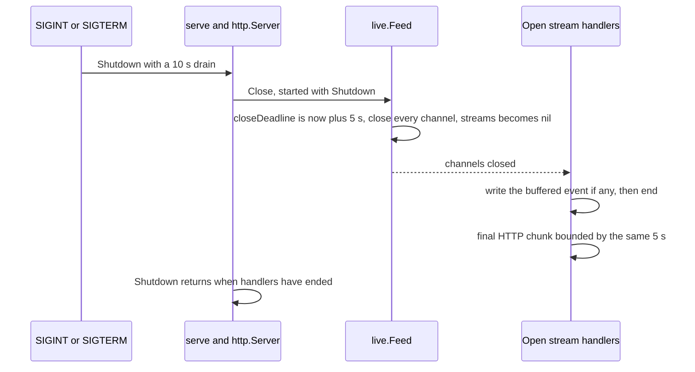

# Live updates

How open management pages learn that data they show has changed: one server-sent event stream per page, a content-free `data: change` message, and live regions that re-fetch themselves. The sign-in rules that gate the stream are in [Staff authentication](staff-auth.md); the script and its page matrix are in [Frontend](frontend.md); the server's start and stop order is in [Startup and shutdown](operations/startup-shutdown.md).

## Contract

| Item | Behavior |
|---|---|
| Endpoint | `GET /management/events`, mounted on the management mux, so it sits behind `auth.Require` like every staff page. |
| Wire format | `data: change` followed by a blank line. No record data, ever: pages re-fetch their own rows through ordinary authorized requests, so a stream never reveals what changed. |
| Headers | `Content-Type: text/event-stream`, `Cache-Control: no-store` (the session middleware adds `Vary: Cookie`). |
| First event | One event on connect (the channel is pre-filled), so a page catches up on anything it missed while disconnected. The same event costs a page one extra refresh at load. |
| Heartbeat | The comment line `: heartbeat` on a fixed 30-second ticker, whether or not events flowed, so proxies do not close a quiet stream. Railway's cutoff of five idle minutes is the figure in the code comment `[EXTERNAL]`. |
| Write deadline | The server's 10 s `WriteTimeout` is cleared at connect. Each write gets its own 5 s deadline, then the deadline is cleared again. A stalled reader is dropped after 5 s; a healthy stream lives as long as the page. If the response writer cannot clear the deadline, the answer is 500 `Live updates are unavailable.` |
| Failures | A write or flush error returns silently: it means the page went away. |

The deadline control works through `http.ResponseController`, which reaches the real connection because the scs session writer and `logging.statusWriter` both implement `Unwrap`.

## Publishing

`live.Feed.Changed` is passed as the `changed` callback to the stores and the billing service in `main.go`. Each calls it after the write commits.

| Publisher | Calls `Changed` after |
|---|---|
| links store | `CreateLink`, `RenameLink`, `StartEnrollment` (new enrollment), `AcceptTerms`, draft and submit saves (`SaveDraft`, `Submit`), `CancelLink`, and `billing.Service.CancelEnrollment` (via `CancelEnrollmentTx` + `changed`) |
| students store | `UpdateField` when the value actually changed (a normalized no-op notifies nobody) |
| billing | `StartCheckout` attempt changes, `UpdateContact`, `requestFee`, `evaluateDeadlines`, `evaluateReactivation`, and worker writes that change stored state (`fund`, `moveAttempt`, `store`, `mark`, `reviewObligation`) |
| settings store | **Never.** `settings.New(db)` takes no callback, so saving the link lifetime or program start date publishes no event. |

`Changed` takes one mutex and does a non-blocking send into each stream's one-slot channel. A stream with an event already pending absorbs further wake-ups, so a slow or stalled stream can never block a write path. The script then folds the messages of each second into one refresh ([Client](#client)).

## Stream flow

### Server side of one stream

## Client

`static/management-live.js` opens one `EventSource("/management/events")`. The first message starts a 1 s timer (`due`) that then fires `htmx.trigger(document.body, "management-changed")`; messages arriving while it is pending share it, so a tab refreshes at most once per second from the stream however fast commits land. It does nothing when `window.htmx` is missing. The browser's own reconnect handles dropped connections; the script adds a fixed retry for the case the browser gives up.

- While the browser is reconnecting (`readyState` is not `CLOSED`) the script does nothing. The server sends no `retry:` field, so the delay is the browser's default; every successful reconnect delivers the on-connect event and refreshes the page.
- A failed response (a deploy's 502, a sign-in redirect) leaves `EventSource` permanently closed. The script then fires `management-changed` once, immediately rather than through `due`, and calls `listenForChanges` again after a **fixed 5 seconds**. There is no growing backoff.
- Signed out, that single refresh is what recovers the page: the regions' request carries `HX-Request`, gets 401 with `HX-Redirect: /management/` ([Staff authentication](staff-auth.md)), and htmx navigates to the sign-in page.

### Live regions

Only the pages below load `management-live.js`. The settings page and the sign-in page open **no** stream.

| Page | Route | Region that listens for `management-changed` |
|---|---|---|
| Links | `/management/` | `#generated-links` (re-fetches `/management/`) |
| Trash | `/management/trash` | `#generated-links` (re-fetches `/management/trash`) |
| Students | `/management/students` | `#student-records`, plus the `.student-billing` block (both in an open dialog and on the full details view) |
| Dashboard | `/management/dashboard` | `.dashboard` |
| Settings, sign-in | `/management/settings`, `/management/` signed out | none |

Link create, rename and cancel and enrollment cancel answers to htmx requests also send `HX-Trigger: management-changed` (the `answer` helper in `management.go`), so the acting tab refreshes without waiting for its own event; see [Management overview](management/overview.md). The number of tabs a browser can hold open locally is covered in [Local development](operations/local-development.md).

## Authorization

Auth is checked only when the stream connects. A staff member whose account was removed or revoked keeps an already-open stream, and the 14-day session expiry does not end it either. That leaks nothing: the stream carries only `data: change` and heartbeats, and every re-fetch it provokes goes through `Require` again and is refused.

## Shutdown

`server.RegisterOnShutdown(feed.Close)` runs `Feed.Close` at the start of `http.Server.Shutdown`, in parallel with the drain, because an event stream never finishes on its own and would hold `Shutdown` for the whole drain window.

- Pending sends and the final HTTP chunk share one 5-second budget (`closeDeadline`); each write deadline is the earlier of its own 5 s and that limit (`TestStreamShutdownSharesWriteBudget`).
- A connection arriving after `Close` is registered late: it gets one event and ends within its own 5 s budget (`lateDeadline`).
- `Close` is idempotent. Open pages see their stream end, then reconnect (the browser or the 5 s retry above) to the next instance.

## Single replica

The feed is an in-process map of channels. A write handled by another process never reaches this process's streams, so with more than one replica a page would miss changes made through the other. Move the fan-out to PostgreSQL `LISTEN`/`NOTIFY` before running more than one replica ([Go-live](go-live.md)).

## Deliberate choices

- Clearing the deadline and then setting one per write lets a stream outlive the server's `WriteTimeout` while still dropping stalled readers (`TestStreamCatchesUpFollowsChangesAndEndsOnClose`, `TestStreamStalledReaderExpires`).
- `closeDeadline` and `lateDeadline` keep a stalled stream from holding `Shutdown` past 5 seconds and still end late connections.
- The script retries on its own because `EventSource` never retries a failed response, which is exactly what a deploy or a sign-out produces.
- The 1 s trailing refresh trades a second of staleness for one re-render per region during an enrollment burst; every region re-renders its whole unpaginated list, so per-commit refreshes would multiply that work by the commit rate.
- Events carry no data on purpose: there is nothing to authorize per event.

## Source

- `internal/live/live.go`: `Feed`, `New`, `Changed`, `Close`, `ServeHTTP`, `heartbeat`, `writeTimeout`, `closeDeadline`
- `internal/live/live_test.go`: `TestStreamCatchesUpFollowsChangesAndEndsOnClose`, `TestStreamStalledReaderExpires`, `TestStreamShutdownSharesWriteBudget`, `TestStreamIdleLifetimeAndHeartbeatsHTTP2`
- `static/management-live.js`: `listenForChanges`, `due`, `EventSource`, `management-changed`
- `main.go`: `newServer`, `serve`, `RegisterOnShutdown`, `live.New`
- `internal/auth/http.go`: `Require`
- `internal/logging/http.go`: `statusWriter`, `Unwrap`
- `internal/links/links.go`: `Store.CreateLink`, `Store.StartEnrollment`, `Store.AcceptTerms`, `Store.SaveDraft`, `Store.Submit`, `Store.CancelLink`, `CancelEnrollmentTx`
- `internal/students/students.go`: `UpdateField`
- `internal/billing/checkout.go`: `StartCheckout`
- `internal/billing/contact.go`: `UpdateContact`
- `internal/billing/suspension.go`: `requestFee`, `evaluateDeadlines`, `evaluateReactivation`
- `internal/billing/checkout.go`: `fund`, `moveAttempt`
- `internal/billing/worker.go`: `mark`
- `internal/billing/invoices.go`: `store`, `reviewObligation`
- `internal/settings/settings.go`: `New`
- `internal/management/templates/index.html`: `management-live.js`, `management-changed`, `generated-links`
- `internal/management/templates/students.html`: `management-live.js`, `student-records`, `student-billing`
- `internal/management/templates/dashboard.html`: `management-live.js`, `management-changed`
- `internal/management/management.go`: `answer`
