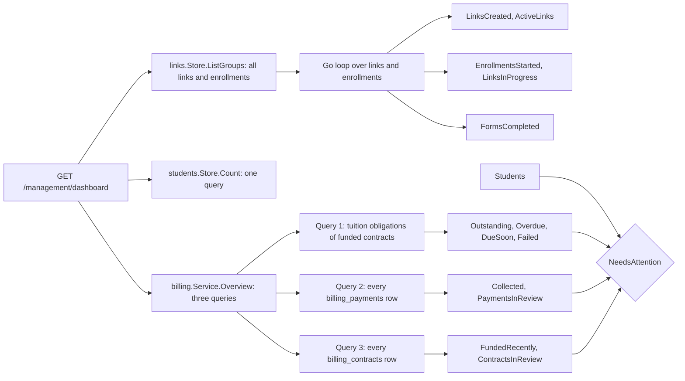

# Management: dashboard

`GET /management/dashboard` shows the staff "Needs attention" list and three groups of figures: students, tuition and enrollment. This page defines every figure exactly as the code derives it; route and fragment rules are in [Management overview](overview.md), and the billing terms are in [Billing overview](../billing/overview.md).

## Data sources

One handler loads three sources under a single 5 s context and fills `dashboardData`. If any fails it logs a `load` error and answers 500 "Could not load the dashboard. Please try again."

`now` is the application clock (`time.Now().UTC()`), passed into `Overview`; the SQL compares against that value, not the database clock. The link figures are computed in Go over the unpaginated link list.

## Time windows

`dashboardWindow` is 30 days. The heading text takes its day count from it (`Days`).

| Figure | Window |
|---|---|
| Links created (`LinksCreated`) | `links.created_at` not before `now - 30 d` |
| Enrollments started (`EnrollmentsStarted`) | `enrollments.created_at` not before `now - 30 d` |
| Forms completed (`FormsCompleted`) | `enrollments.submitted_at` not before `now - 30 d` |
| Due in the next 30 days (`DueSoon`) | `now <= due_at < now + 30 d` (looks ahead) |
| Overdue | `due_at < now` (no lower bound) |

## Figures

| Section | Label in the UI | Derivation |
|---|---|---|
| Students | Active | `students` rows with `is_active` true |
| Students | Suspended | `students` rows with `is_active` false |
| Students | Total enrolled | Active + Suspended, so every Student row; an enrollment's Student exists only after payment, and staff-added students count too |
| Tuition | Collected | `SUM(gross_received_cents - gross_refunded_cents)` over **every** `billing_payments` row. After refunds, before Stripe fees. No funding or obligation-kind filter, so reinstatement fee cash is included |
| Tuition | Outstanding | `SUM(amount_remaining_cents)` over tuition obligations of funded contracts, due or not. Reinstatement fee obligations and unfunded contracts are excluded |
| Tuition | Overdue (amount and count) | Amount: remaining cents of those obligations with `due_at < now`. Count: the same obligations with remaining above zero |
| Tuition | Due in the next 30 days (amount and count) | Same shape for `now <= due_at < now + 30 d` |
| Enrollment | Links created | Links created within the window, whatever became of them (Trash included) |
| Enrollment | Enrollments started | Enrollments started within the window, whatever became of them |
| Enrollment | Forms completed | Enrollments with `submitted_at` in the window, paid or not. The label says "completed"; the figure counts **submitted** enrollments |
| Enrollment | Paid enrollments | Contracts with `funded_at` in the window (funded contracts, hence Students created) |
| Enrollment | Active links ("Right now") | Reusable links with status `Active` |
| Enrollment | In progress ("Right now") | Enrollments currently `In progress` (unsubmitted, active) ([Links](../domain/links.md)) |
Three more counts appear only in the attention list:

| Count | Derivation |
|---|---|
| Failed installments (`FailedInstallments`) | Tuition obligations of funded contracts with `failure_or_action_required`, no `first_settled_at` and remaining above zero. No due-date condition |
| Contracts in review (`ContractsInReview`) | Contracts, **funded or not**, with `review_reason` set, or having any obligation (any kind) with `review_reason` set. Reasons: [Reviews](../billing/reviews.md) |
| Payments in review (`PaymentsInReview`) | `billing_payments` rows whose `dispute_or_fraud_review_state` is non-empty |

An installment that is both overdue and failed counts once in each of Overdue and Failed, and so twice in the attention total. Outstanding and Overdue use the same remaining-cents and due-date rules as a student's `RemainingTuitionCents` and `OverdueTuitionCents` ([Students](students.md)), so they equal those figures summed over funded students. Collected and Contracts in review do not filter on funding.

## Needs attention

`NeedsAttention` is true when `Students.Suspended + OverdueInstallments + FailedInstallments + ContractsInReview + PaymentsInReview` is above zero. The panel then lists only the non-zero rows:

| Row | Text | Link |
|---|---|---|
| Suspended students | "N suspended student(s)" | View students (`/management/students?status=suspended`) |
| Overdue installments | "N overdue installment(s), $X unpaid" | none |
| Failed installments | "N installment(s) failed or waiting on the customer" | none |
| Contracts in review | "N billing record(s) need(s) review" | none |
| Payments in review | "N payment(s) disputed or flagged for fraud" | none |

When all five are zero the panel reads "All clear". The Overdue amount gets the `dashboard-alert` style while it is non-zero.

## Live and static

The `.dashboard` element re-fetches `GET /management/dashboard` (fragment `dashboard-content`) on `management-changed`, so every figure is recomputed on each event. Events come from commits in the links store (create, first visit, drafts, submit, agreement acceptance, cancel), the students store (a field edit that wrote) and billing (funding, worker syncs that changed state, staff actions). Settings writes publish nothing ([Live updates](../live-updates.md)).

Nothing publishes an event for the clock alone. A figure that changes only because time passed (an installment crossing its due date, a link passing its expiry) updates on the next event or reload. The page loads `management-live.js` but no `<time>` script: it shows no timestamps.

## Deliberate choices

- **Links counted in Go.** The loop reuses `links.Entry.Cancelable` instead of restating the status rule in SQL. The ceiling is the unpaginated list ([Go-live](../go-live.md)).
- **A 30-day window in both directions.** Installments are monthly, so one window shows the last month's enrollment and the next collection.

## Source

- `internal/management/dashboard.go`: `dashboardWindow`, `dashboardData`, `NeedsAttention`, `dashboard`, `LinksCreated`, `ActiveLinks`, `EnrollmentsStarted`, `FormsCompleted`, `LinksInProgress`
- `internal/management/templates/dashboard.html`: `dashboard-content`, `dashboard-attention`, `dashboard-alert`, `management-changed`
- `internal/billing/overview.go`: `Overview`, `CollectedCents`, `OutstandingCents`, `OverdueInstallments`, `DueSoonInstallments`, `FailedInstallments`, `ContractsInReview`, `PaymentsInReview`, `FundedRecently`
- `internal/students/students.go`: `Counts`, `Count`, `Total`
- `internal/links/links.go`: `ListGroups`, `LinkEntry`, `EnrollmentEntry`
- `static/management-live.js`: `listenForChanges`
