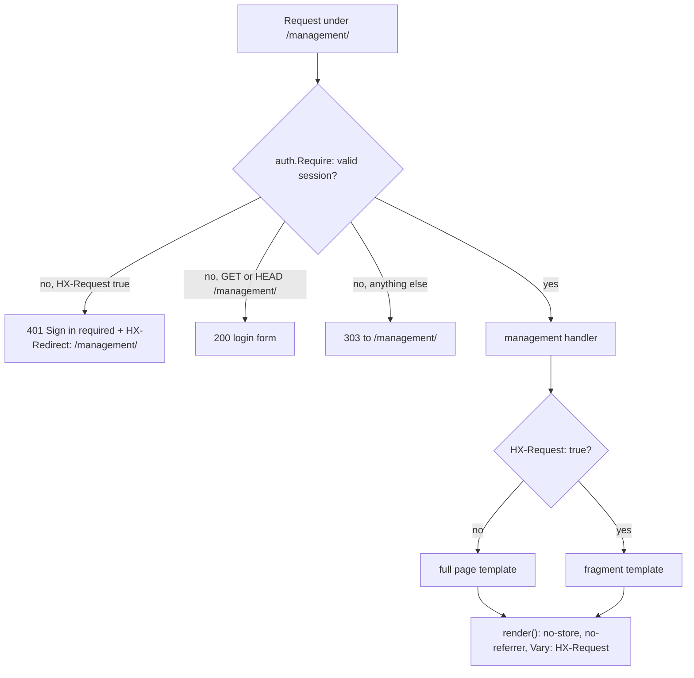

# Management overview

`internal/management` serves the staff pages behind sign-in: customer links and Trash, students with billing actions, the dashboard and settings. This page maps routes to templates and fragments and states the shared header, HTMX, limit and live-region rules. Link statuses live in [Links](../domain/links.md), the student pages in [Students](students.md), the figures in [Dashboard](dashboard.md), the browser scripts in [Frontend](../frontend.md) and the event stream in [Live updates](../live-updates.md).

## Where the pages are mounted

`newServer` in `main.go` builds a separate `managementMux`, registers `GET /management/events` on it, lets `management.RegisterRoutes` add every staff page, then mounts the whole mux at `/management/` behind `auth.Require` and `logging.Routes`. The package checks no session itself: its `staff` function is `auth.Staff`, which only reads the username `Require` already verified, for the audit trail. `POST /management/login` and `POST /management/logout` belong to the auth package and sit outside `Require` ([Staff auth](../staff-auth.md)). The full mounted-route table and middleware order are in [Architecture](../architecture.md).

`RegisterRoutes` parses the templates once into a `site` (the template set, the links, students and settings stores, the billing service and `staff`) and registers every route from one table; each handler is a `site` method. `timed` runs a handler under a 5 s request context (`dbTimeout`), and only handlers whose work is all database get it. The enrollment cancel and the student billing actions call Stripe through billing, which bounds that work with its own `providerBudget` (8 s) that a 5 s parent would cut short. They run on the request context, and the enrollment cancel builds a 5 s context only for the page reads after the billing call.

## Route and template map

| Route | Full page (no HTMX) | HTMX answer | Notes |
|---|---|---|---|
| `GET /management/{$}` | `index.html` | `link-rows` | Links tab. Hides trashed links without active enrollments and enrollments paid more than 24 h ago; also shows the program start date form. `?program-start-date-saved` adds the notice "Fecha de comienzo guardada." |
| `GET /management/trash` | `index.html` (Trash) | `link-rows` | Canceled and expired links and enrollments. |
| `POST /management/program-start-date` | 303 to `/management/?program-start-date-saved`, or 422 `index.html` | none | Ordinary form post. Semantics in [Agreement](../domain/agreement.md). |
| `POST /management/links` | `index.html`, new link's URL on its row | `result` + `HX-Trigger` | Notice "Link created." |
| `POST /management/links/{id}/rename` | `index.html` | `result` + `HX-Trigger`; 204 when the ID names no link | Trims whitespace, rejects empty/over-100-rune/control names with 422; no-op preserves existing row and notice "Link renamed." |
| `POST /management/links/{id}/cancel` | `index.html` | `result` + `HX-Trigger`; 204 when the ID names no link | Notice "Link canceled." or "Link can no longer be canceled." |
| `POST /management/enrollments/{id}/cancel` | `index.html` | `result` + `HX-Trigger`; 409 on `ErrCancelBlocked`; 204 when the ID names no enrollment | Delegates to `billing.Service.CancelEnrollment`; notices "Enrollment canceled.", "Expired PIN cleared.", or "Enrollment can no longer be canceled." |
| `POST /management/settings` | 303 to `/management/settings?saved`, or 422 `settings.html` | none | Ordinary form post; the link lifetime only. |
| `POST /management/bootcamp-date` | 303 to `/management/settings?bootcamp-date-saved`, or 422 `settings.html` "Enter a valid date (YYYY-MM-DD)." | none | Ordinary form post. Saves `settings.bootcamp_date`, the next Bootcamp Militarizado, which ProjectHephaestus prints on its employer letter and treats as over once the day has passed. |
| `GET /management/dashboard` | `dashboard.html` | `dashboard-content` | [Dashboard](dashboard.md). |
| `GET /management/students` | `students.html` | `student-records` + `HX-Replace-Url` | Filters in [Students](students.md). |
| `GET /management/students/new` | `add-students.html` | none | Add students: one form for a single student and a roster import. `?added={id}` confirms the student just added. |
| `POST /management/students` | 303 to `/management/students/new?added={id}`, or `add-students.html`: 422 for an invalid group or field, 409 when a PIN was just taken | none | Ordinary form post; adds one staff-added student through `students.Store.Add`. |
| `POST /management/students/import` | `add-students.html` with the import report, or with the reason: 413 over 2 MB, 422 for a missing or unreadable file or an invalid group, 409 when a PIN was just taken | none | Multipart `.xlsx` or `.csv` roster (`readRoster`), at most 1000 student rows (`maxRosterRows`); rows `Add` refuses come back as a downloadable rows-to-fix workbook (`fixWorkbook`). |
| `GET /management/students/{id}` | `students.html` (details page) | `student-detail` (dialog) | |
| `GET`, `POST /management/students/{id}/fields/{field}` | `students.html` | `student-field`, or `student-save` after a save | Non-HTMX save answers 303 to `?saved={field}`. |
| `GET /management/students/{id}/billing` | same fragment | `student-billing` | Read-only; never calls Stripe. |
| `POST /management/students/{id}/billing/reconcile` | same fragment | `student-billing` | Staff billing action. |
| `POST /management/students/{id}/billing/reinstatement` | same fragment | `student-billing` | Staff billing action. |
| `POST /management/students/{id}/billing/portal` | same fragment | `student-billing-portal` | One-off Stripe portal link. |
| `GET /management/students/{id}/billing/invoices/{obligation}` | none | none | 303 to the Stripe hosted invoice URL, `Cache-Control: no-store`. |
| `GET /management/events` | `text/event-stream` | n/a | Mounted in `main.go`, not in this package. |

`list` renders `index.html` instead of `link-rows` whenever the status is not 200, even for an HTMX request, so an error page is never a fragment. A signed-in request to an unknown path under `/management/` gets the mux's plain 404 after `Require`.

On the links page `list` also loads `DeclinedEnrollments` (skipped for Trash, which holds no `Awaiting payment` rows) and each `linkRow` carries it, so an `Awaiting payment` enrollment whose first payment was declined shows a "Payment declined" badge next to its status. Billing's change signal refreshes it live ([Live updates](../live-updates.md)).

All staff templates are parsed together from `templates/*.html`, so `brand`, `account`, `navigation`, `time`, `link-icon` and `trash-icon` defined in `index.html` serve every page. Only the login page ([Staff auth](../staff-auth.md)) has its own template set.

| File | Defines |
|---|---|
| `index.html` | `index.html`, `link`, `link-rows`, `result`, `brand`, `account`, `time`, `navigation`, `link-icon`, `trash-icon` |
| `students.html` | `students.html`, `student-records`, `student-row`, `student-detail`, `student-field`, `student-save`, `student-billing`, `student-billing-portal` |
| `add-students.html` | `add-students.html` |
| `dashboard.html` | `dashboard.html`, `dashboard-content` |
| `settings.html` | `settings.html` |

## Response headers

`site.render` sets `Content-Type: text/html; charset=utf-8`, `Cache-Control: no-store`, `Referrer-Policy: no-referrer` and `Vary: HX-Request`, then writes the status and template. `Vary` is required because one URL returns a full page to a browser and a fragment to htmx. The invoice redirect sets `no-store` itself. Plain-text errors (`http.Error`) skip `render`.

Staff pages carry the same server-wide CSP and browser headers as every response ([Frontend](../frontend.md)), so the settings slider's output is updated by `/static/settings.js`, not an inline handler. Cross-origin POSTs are rejected server-wide by `CrossOriginProtection` ([Architecture](../architecture.md)), not by this package.

## HTMX contract

Every live region re-fetches itself on the `management-changed` event, which comes from the event stream ([Frontend](../frontend.md) shows the sequence) or from an action's `HX-Trigger` header.

| Region | Element | Request on `management-changed` | Fragment | Swap |
|---|---|---|---|---|
| Link rows | `#generated-links` | `GET /management/` or `/management/trash` | `link-rows` | inner |
| Student records | `#student-records` (includes `#student-filter`, `hx-sync` replace) | `GET /management/students` | `student-records` + `HX-Replace-Url` | inner |
| Student billing | `#student-billing-{id}` | `GET /management/students/{id}/billing` | `student-billing` | outer |
| Dashboard | `.dashboard` | `GET /management/dashboard` | `dashboard-content` | inner |

- **One answer for link and enrollment actions.** Create, rename and both cancels report through `answer`. A browser gets `index.html` with the notice, at the action's status. htmx gets a refusal (any status but 200) as plain text, 204 when the ID names nothing, and otherwise `result` with `HX-Trigger: management-changed`. The forms use `hx-swap="none"`, and the list is replaced only by a GET, so a slower, older render never overwrites a newer one.
- **Create.** `POST /management/links` answers `result` (an out-of-band swap filling `#link-status`) with `HX-Trigger: management-changed`; the refreshed rows render each link's permanent `/customer/{token}` URL and Copy link button directly.
- **Dialogs.** A student row link loads `student-detail` into `#student-dialog-content` and `students.js` opens the `<dialog>`; see [Students](students.md).
- **Signed out.** An HTMX request without a valid session gets 401 and `HX-Redirect: /management/`, which sends the whole window to the login page rather than swapping a login form into a fragment. `HX-Refresh` is customer-only; management 404s and 500s are plain text, and staff pages do not swap 4xx or 5xx responses (`management.js` shows the server text in a status element; `students.js` shows plain-text server replies for billing actions and fixed client messages for field or roster failures).

## Limits and timeouts

| Surface | Limit |
|---|---|
| `POST /management/links/{id}/rename`, `/management/program-start-date` and `/management/bootcamp-date` body | 1 KiB and exactly one value (`postedValue`); otherwise 400 for a rename, 422 for a date |
| `POST /management/settings` body | 1 KiB (`http.MaxBytesReader`) |
| `POST .../fields/{field}` and `POST /management/students` body | 4 KiB (`readForm`); larger is 413 "This form is too large.", unreadable is 400 "Could not read this form. Please try again." |
| `POST /management/students/import` body | 2 MB multipart; larger is 413 with "The file is larger than 2 MB." on `add-students.html` |
| Billing actions (reconcile, reinstatement, portal, invoice) and enrollment cancel | No 5 s handler context around the billing call. Each billing method bounds its own provider work with `providerBudget` (8 s, under the 10 s server write timeout) |
| Every other handler | 5 s request context (`timed`) |
| `{id}` and `{obligation}` path values, `?added=` | Must parse as a positive PostgreSQL BIGINT (`pathID`), else the route's not-found answer without a query: 404 for students, 204 or the unchanged page for link and enrollment actions, no confirmation for `?added=` |

Other POST handlers read no body. `GET /management/events` clears its own write deadline ([Live updates](../live-updates.md)).

## Lists and live regions

- **Unpaginated.** `links.Store.ListGroups` returns every link with its enrollments, oldest first, and `list` filters by tab in Go; `students.Store.List` returns every matching student, newest first. Both carry `ponytail` ceilings; see [Go-live](../go-live.md).
- **Pages with a stream.** Links, Trash, students list, student details and the dashboard load `management-live.js`. Settings loads only `settings.js`, Add students and login load no script; none of them opens a stream.
- **Settings publish no event.** `settings.Store` has no `changed` callback, so a start date, bootcamp date or lifetime write does not refresh other tabs.
- **Auth is checked when the stream connects.** A tab signed out later keeps its open stream; the next event triggers a refresh, which the 401 plus `HX-Redirect` turns into the login page.

## Deliberate choices

- **`Vary: HX-Request` with `no-store`.** The same URL returns a page or a fragment; without `Vary` a cache could serve the wrong one.
- **Permanent link URLs on rows.** Links stay copyable from any browser session while visible; individual customer sessions use a separate `enrollment_session` cookie.
- **A catch-up event on every connect.** It costs one extra rows GET per page load but repairs pages that missed events while disconnected.
- **Links counted in Go on the dashboard.** Acceptable over the unpaginated list at current scale.

## Source

- `main.go`: `newServer`, `managementMux`, `RegisterRoutes`
- `internal/management/management.go`: `RegisterRoutes`, `site`, `timed`, `dbTimeout`, `render`, `htmx`, `answer`, `list`, `postedValue`, `readForm`, `pageData`, `linkRow`, `settingsData`, `cancelEnrollment`, `cancelEnrollmentNotice`, `plural`, `MaxBytesReader`
- `internal/management/students.go`: `pathID`, `billingFailure`, `act`
- `internal/management/addstudents.go`: `addStudentsPage`, `addStudent`, `importStudents`, `readRoster`, `maxRosterRows`, `fixWorkbook`
- `internal/management/dashboard.go`: `dashboard`
- `internal/management/templates/index.html`: `link-rows`, `link`, `result`, `navigation`, `brand`, `account`, `time`
- `internal/management/templates/students.html`: `student-records`, `student-detail`, `student-billing`
- `internal/management/templates/dashboard.html`: `dashboard-content`
- `internal/management/templates/add-students.html`: `add-students.html`
- `internal/management/templates/settings.html`: `settings.js`
- `internal/auth/http.go`: `Require`
- `internal/billing/billing.go`: `providerBudget`, `ErrCancelBlocked`
- `internal/billing/cancel.go`: `CancelEnrollment`
- `internal/billing/summary.go`: `DeclinedEnrollments`
- `internal/live/live.go`: `Feed`
- `internal/links/links.go`: `ListGroups`, `Archived`, `Trashed`, `RenameLink`, `CancelLink`, `CancelEnrollmentTx`
- `static/management-live.js`: `management-changed`
