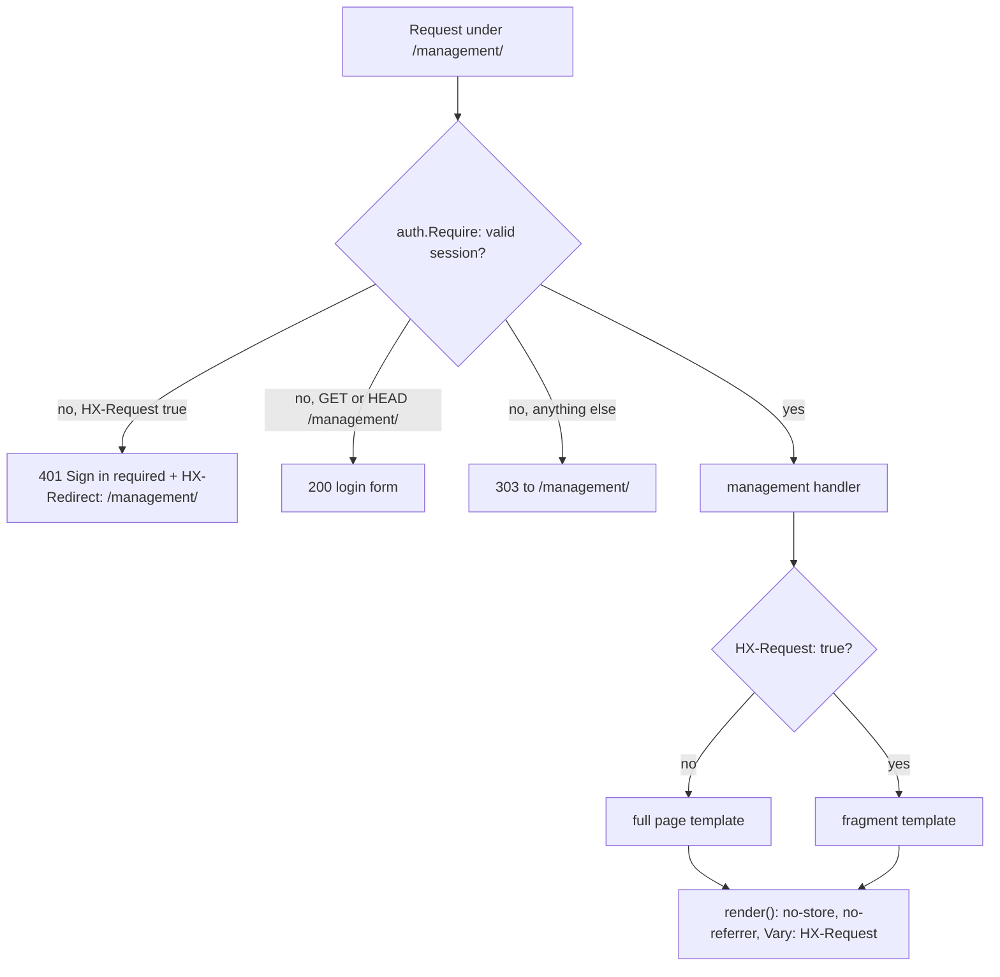

# Management overview

`internal/management` serves the staff pages behind sign-in: customer links and Trash, students with billing actions, the dashboard and settings. This page maps routes to templates and fragments and states the shared header, HTMX, limit and live-region rules. Link statuses live in [Links](../domain/links.md), the student pages in [Students](students.md), the figures in [Dashboard](dashboard.md), the browser scripts in [Frontend](../frontend.md) and the event stream in [Live updates](../live-updates.md).

## Where the pages are mounted

`newServer` in `main.go` builds a separate `managementMux`, registers `GET /management/events` on it, lets `management.RegisterRoutes` add every staff page, then mounts the whole mux at `/management/` behind `auth.Require` and `logging.Routes`. The package checks no session itself: its `staff` function is `auth.Staff`, which only reads the username `Require` already verified, for the audit trail. `POST /management/login` and `POST /management/logout` belong to the auth package and sit outside `Require` ([Staff auth](../staff-auth.md)). The full mounted-route table and middleware order are in [Architecture](../architecture.md).

## Route and template map

| Route | Full page (no HTMX) | HTMX answer | Notes |
|---|---|---|---|
| `GET /management/{$}` | `index.html` | `link-rows` | Links tab. Hides Trash links and links paid more than 24 h ago; also shows the program start date form. `?program-start-date-saved` adds the notice "Fecha de comienzo guardada." |
| `GET /management/trash` | `index.html` (Trash) | `link-rows` | Canceled and expired links only. |
| `POST /management/program-start-date` | 303 to `/management/?program-start-date-saved`, or 422 `index.html` | none | Ordinary form post. Semantics in [Agreement](../domain/agreement.md). |
| `POST /management/links` | `index.html`, new link's URL on its row | `result` + `HX-Trigger` | Notice "Link created." |
| `POST /management/links/{id}/cancel` | `index.html` | `result` + `HX-Trigger`; 204 when the ID names no link | Notice "Link canceled." or "Link can no longer be canceled." |
| `POST /management/links/cancel` | `index.html` | `result` + `HX-Trigger` | Cancels every cancelable link. |
| `GET /management/settings` | `settings.html` | same | `?saved` adds the lifetime notice "Saved."; `?bootcamp-date-saved` adds it under the bootcamp date. |
| `POST /management/settings` | 303 to `/management/settings?saved`, or 422 `settings.html` | none | Ordinary form post; the link lifetime only. |
| `POST /management/bootcamp-date` | 303 to `/management/settings?bootcamp-date-saved`, or 422 `settings.html` "Enter a valid date (YYYY-MM-DD)." | none | Ordinary form post. Saves `settings.bootcamp_date`, the next Bootcamp Militarizado, which ProjectHephaestus prints on its employer letter and treats as over once the day has passed. |
| `GET /management/dashboard` | `dashboard.html` | `dashboard-content` | [Dashboard](dashboard.md). |
| `GET /management/students` | `students.html` | `student-records` + `HX-Replace-Url` | Filters in [Students](students.md). |
| `GET /management/students/{id}` | `students.html` (details page) | `student-detail` (dialog) | |
| `GET`, `POST /management/students/{id}/fields/{field}` | `students.html` | `student-field`, or `student-save` after a save | Non-HTMX save answers 303 to `?saved={field}`. |
| `GET /management/students/{id}/billing` | same fragment | `student-billing` | Read-only; never calls Stripe. |
| `POST /management/students/{id}/billing/reconcile` | same fragment | `student-billing` | Staff billing action. |
| `POST /management/students/{id}/billing/reinstatement` | same fragment | `student-billing` | Staff billing action. |
| `POST /management/students/{id}/billing/portal` | same fragment | `student-billing-portal` | One-off Stripe portal link. |
| `GET /management/students/{id}/billing/invoices/{obligation}` | none | none | 303 to the Stripe hosted invoice URL, `Cache-Control: no-store`. |
| `GET /management/events` | `text/event-stream` | n/a | Mounted in `main.go`, not in this package. |

`list` renders `index.html` instead of `link-rows` whenever the status is not 200, even for an HTMX request, so an error page is never a fragment. A signed-in request to an unknown path under `/management/` gets the mux's plain 404 after `Require`.

All staff templates are parsed together from `templates/*.html`, so `header`, `navigation`, `link-icon` and `trash-icon` defined in `index.html` serve every page. Only the login page ([Staff auth](../staff-auth.md)) has its own template set.

| File | Defines |
|---|---|
| `index.html` | `index.html`, `link`, `link-rows`, `link-url`, `link-copy`, `result`, `header`, `navigation`, `link-icon`, `trash-icon` |
| `students.html` | `students.html`, `student-records`, `student-row`, `student-detail`, `student-field`, `student-save`, `billing-time`, `student-billing`, `student-billing-portal` |
| `dashboard.html` | `dashboard.html`, `dashboard-content` |
| `settings.html` | `settings.html` |

## Response headers

`render` sets `Content-Type: text/html; charset=utf-8`, `Cache-Control: no-store`, `Referrer-Policy: no-referrer` and `Vary: HX-Request`, then writes the status and template. `Vary` is required because one URL returns a full page to a browser and a fragment to htmx. The invoice redirect sets `no-store` itself. Plain-text errors (`http.Error`) skip `render`.

Staff pages carry the same server-wide CSP and browser headers as every response ([Frontend](../frontend.md)), so the settings slider's output is updated by `/static/settings.js`, not an inline handler. Cross-origin POSTs are rejected server-wide by `CrossOriginProtection` ([Architecture](../architecture.md)), not by this package.

## HTMX contract

Every live region re-fetches itself on the `management-changed` event, which comes from the event stream ([Frontend](../frontend.md) shows the sequence) or from an action's `HX-Trigger` header.

| Region | Element | Request on `management-changed` | Fragment | Swap |
|---|---|---|---|---|
| Link rows | `#generated-links` | `GET /management/` or `/management/trash` | `link-rows` | inner |
| Student records | `#student-records` (includes `#student-filter`, `hx-sync` replace) | `GET /management/students` | `student-records` + `HX-Replace-Url` | inner |
| Student billing | `#student-billing-{id}` | `GET /management/students/{id}/billing` | `student-billing` | outer |
| Dashboard | `.dashboard` | `GET /management/dashboard` | `dashboard-content` | inner |

- **Only refreshes write rows.** Link actions (`acknowledge`) answer with a notice plus `HX-Trigger: management-changed`, and the cancel forms use `hx-swap="none"`. The list is replaced only by a GET, so a slower, older render never overwrites a newer one.
- **Create.** The create response (`result`) carries the new link's one-time URL and copy button. htmx appends them to the hidden `#link-tokens`, and an out-of-band swap fills `#link-status`. The refreshed rows hold hidden `hx-preserve` placeholders (`link-url-{id}`, `link-copy-{id}`) that htmx replaces with the real elements from `#link-tokens`. The token is never stored, so this is the only moment it can reach the page.
- **Dialogs.** A student row link loads `student-detail` into `#student-dialog-content` and `students.js` opens the `<dialog>`; see [Students](students.md).
- **Signed out.** An HTMX request without a valid session gets 401 and `HX-Redirect: /management/`, which sends the whole window to the login page rather than swapping a login form into a fragment. `HX-Refresh` is customer-only; management 404s and 500s are plain text, and staff pages do not swap 4xx or 5xx responses (`management.js` shows the server text in a status element; `students.js` shows plain-text server replies for billing actions and fixed client messages for field or roster failures).

## Limits and timeouts

| Surface | Limit |
|---|---|
| `POST /management/program-start-date`, `/management/bootcamp-date` and `/management/settings` body | 1 KiB (`http.MaxBytesReader`) |
| `POST .../fields/{field}` body | 4 KiB; larger is 413 "This value is too large.", unreadable is 400 |
| Handler database work | 5 s context per handler |
| Billing actions (reconcile, reinstatement, portal, invoice) | No 5 s handler context. Each billing method bounds its own provider work with `providerBudget` (8 s, under the 10 s server write timeout) |
| `{id}` and `{obligation}` path values | Must parse as a positive PostgreSQL BIGINT, else 404 without a query |

Other POST handlers read no body. `GET /management/events` clears its own write deadline ([Live updates](../live-updates.md)).

## Lists and live regions

- **Unpaginated.** `links.Store.List` returns every link, oldest first, and `list` filters by tab in Go; `students.Store.List` returns every matching student, newest first. Both carry `ponytail` ceilings; see [Go-live](../go-live.md).
- **Pages with a stream.** Links, Trash, students list, student details and the dashboard load `management-live.js`. Settings loads only `settings.js`, login loads no script; neither opens a stream.
- **Settings publish no event.** `settings.Store` has no `changed` callback, so a start date, bootcamp date or lifetime write does not refresh other tabs.
- **Auth is checked when the stream connects.** A tab signed out later keeps its open stream; the next event triggers a refresh, which the 401 plus `HX-Redirect` turns into the login page.

## Deliberate choices

- **`Vary: HX-Request` with `no-store`.** The same URL returns a page or a fragment; without `Vary` a cache could serve the wrong one.
- **Hidden `#link-tokens` with `hx-preserve` placeholders.** Lets the one-time URL survive refreshes when only refreshes write rows.
- **A catch-up event on every connect.** It costs one extra rows GET per page load but repairs pages that missed events while disconnected.
- **Links counted in Go on the dashboard.** Acceptable over the unpaginated list at current scale.

## Source

- `main.go`: `newServer`, `managementMux`, `RegisterRoutes`
- `internal/management/management.go`: `RegisterRoutes`, `render`, `htmx`, `pageData`, `settingsData`, `acknowledge`, `MaxBytesReader`
- `internal/management/students.go`: `registerStudentRoutes`, `billingFailure`, `pathID`
- `internal/management/dashboard.go`: `registerDashboardRoutes`
- `internal/management/templates/index.html`: `link-rows`, `link-url`, `link-copy`, `result`, `link-tokens`, `navigation`
- `internal/management/templates/students.html`: `student-records`, `student-detail`, `student-billing`
- `internal/management/templates/dashboard.html`: `dashboard-content`
- `internal/management/templates/settings.html`: `settings.js`
- `internal/auth/http.go`: `Require`
- `internal/billing/billing.go`: `providerBudget`
- `internal/live/live.go`: `Feed`
- `internal/links/links.go`: `List`, `Archived`, `Trashed`
- `internal/students/students.go`: `List`
- `static/management-live.js`: `management-changed`
