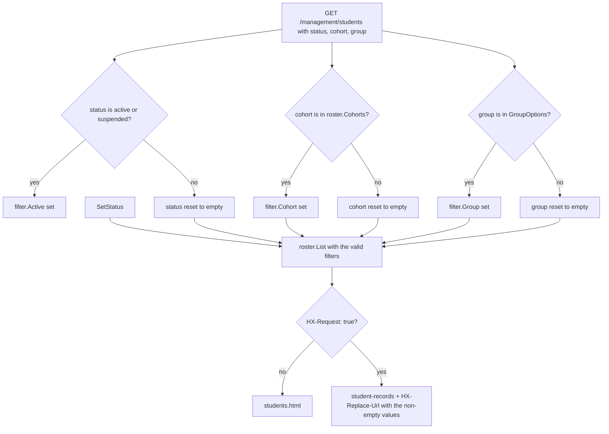
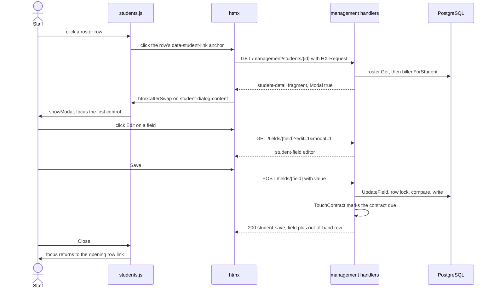
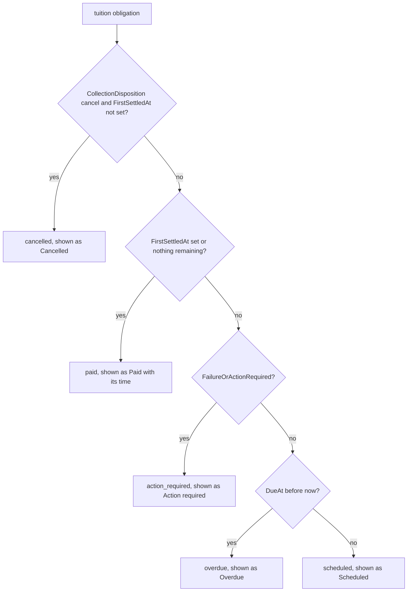

# Management: students

The staff roster of paid enrollments and staff-added students, the student dialog, per-field editing and the billing block with its staff actions. Route mapping and shared HTMX rules are in [Management overview](overview.md); field parsing and PIN rules are in [Students](../domain/students.md); what the billing figures mean is in [Billing overview](../billing/overview.md).

An enrollment's Student row exists only after payment: `links.Enroll` creates it inside the funding transaction ([Lifecycle](../domain/lifecycle.md)). Staff can also add students on Add students (`students.Store.Add`, one at a time or by roster import); those have no enrollment, no contract and no cohort. The roster therefore lists paid enrollments and staff-added students, and its "Enrolled" column is the payment time, or the time staff added the student.

## Roster and filters

`GET /management/students` lists students newest first (`created_at DESC, id DESC`), unpaginated. Columns are the eight staff fields (Name, Email, Phone, Municipality, Date of birth, Gender, PIN, Group), then Cohort (shown as "November 2026" by `CohortLabel`), Enrolled and a Status badge: Withdrawn when `withdrawn_at` is set, else Active or Suspended from `is_active`. The first cell is the link that opens the dialog. Empty states: "No students yet" and, under filters, "No matching students" with a link that clears them.

The filters are one GET form (`#student-filter`): a Status radio group, a Cohort select and a Group select. A change sends `hx-get` and swaps only `#student-records`, so focus stays on the control. Without JavaScript a `<noscript>` Apply button submits the same form. Set filters combine (a student must match every one).

- `status` selects, in `List`: `active` is `is_active`; `suspended` is not active and never withdrawn (`withdrawn_at` NULL); `withdrawn` is `withdrawn_at` set ([Withdrawal](../billing/withdrawal.md)). The three never overlap.
- `cohort` must be a cohort that has at least one student (`Cohorts`, newest first), not merely a well-formed month; `group` must be one of `GroupOptions` (Básico, Regular). An unknown value is reset, never an error, so a stale bookmark shows everyone.
- For HTMX requests `HX-Replace-Url` is `/management/students` plus the encoded non-empty values, so a reload or bookmark reopens the same filters.
- `#student-records` also re-fetches on `management-changed`, including the filter form (`hx-include`), so rows enter and leave the view as students change. The form has `hx-history="false"` so student rows stay out of htmx history snapshots.
- There is no test for the filters or `HX-Replace-Url` ([Testing](../testing.md)).

## Student dialog and field edit

Clicking a row (not a control inside it) opens its link: `GET /management/students/{id}` with `HX-Request` returns `student-detail` with `Modal` set, into `#student-dialog-content`; `students.js` then calls `showModal()`. Without HTMX the same URL is a full "Student details" page with a back link.

One field saves at a time, with the same handler for GET (read or editor) and POST (save):

| Request | Result |
|---|---|
| `GET .../fields/{field}` | The read-only `student-field`. `?edit=1` returns the editor; `?modal=1` keeps dialog form fields. |
| `POST`, value rejected by the field's parser or the PIN check | 422 `student-field` editor with the attempted value and a `role="alert"` message. `students.js` forces htmx to swap this one 4xx. |
| `POST`, value saved or unchanged after normalizing | 200 `student-save`: the field with "Saved." (`role="status"`). In the dialog, an out-of-band `<template>` also replaces `#student-row-{id}`, so the table behind the dialog updates. |
| `POST`, body unreadable or over 4 KiB | 400 or 413 plain text. |
| Unknown field key, malformed ID or missing student | 404 "Student or field not found." |
| Database failure | 500 "Could not save this field. Please try again." |

Failures that are not swapped (404, 413, 500, network) appear in the field's own `.student-request-error`. Without HTMX a save answers 303 to `/management/students/{id}?saved={field}`, which shows "Saved." on the details page.

`modal = partial && modal`: a non-HTMX request can never receive dialog markup. The ID bound (`pathID`) rejects anything outside PostgreSQL BIGINT before a query runs.

### Locking and what a save triggers

`students.Store.UpdateField` parses the value first, then opens a transaction that selects the student `FOR UPDATE`, compares the normalized value with the stored one and writes only if they differ. A PIN is checked against enrolled students and submitted links, and `idx_student_pin` backs the check at write time; both answer "That PIN is already in use." A normalized no-op returns the current row, writes nothing and publishes no live event.

After every successful POST, including no-ops and PIN or group edits, the handler calls `billing.Service.TouchContract(ctx, enrollmentID)`. It marks the contract due for sync now, only if the contract already has a Stripe customer (and ignores staff-added students whose `EnrollmentID` is nil), and wakes the worker; the worker then copies a changed name or email to the Stripe customer ([Billing worker](../billing/worker.md)). The edit still reports "Saved." whatever `TouchContract` does, because it ignores errors.

Staff edits are not locked by funding, a payment in flight or the contract lease: the field handler consults no billing state. This differs from the customer's own contact edit, which funding locks ([Customer flow](../domain/customer-flow.md)). Staff field edits carry no staff name, so they are not attributed ([Go-live](../go-live.md)).

## Billing block

`student-billing` is rendered inside the dialog and the details page, and re-fetches itself (`GET .../billing`, outer swap) on `management-changed`. A student whose contract is missing shows "No billing record for this student." The block reads local data only; it never calls Stripe.

| Row | Source in `billing.Summary` |
|---|---|
| Funding | `Funded`, `FundedAt`; an enrollment's student exists only after funding and a staff-added one has no contract, so this normally reads Funded |
| Plan, Tuition total | `PlanName`, `TotalCents` |
| Tuition paid | sum of tuition obligations' `AmountPaidCents` |
| Stripe cash paid | sum over every payment of gross received minus gross refunded; includes reinstatement fee cash |
| Other settlement | sum of obligations' `OtherSettlementCents` |
| Remaining tuition, Overdue tuition | sum of tuition `AmountRemainingCents`, leaving out `cancelled` installments; the overdue part has `DueAt` before now |
| Reinstatement fee remaining | remaining on reinstatement obligations whose `CollectionDisposition` is `collect`; a fee of a corrected episode or a withdrawn contract is no longer owed |
| Status | "Withdrawn", its time and "by" the staff name when `WithdrawnAt` is set; else "Billing-suspended" when an episode is open (`IsSuspended`); else "Active" |
| Last synced | `LastSyncedAt` or "Never" |
| Needs review | `ReviewReasons`, each in `<code>`; meanings in [Reviews](../billing/reviews.md) |
| Refund pending | Only on a withdrawn contract with `RefundableCents` above zero: "Refund pending: $X, retried automatically; Reconcile retries now." ([Withdrawal](../billing/withdrawal.md#refunds)) |

The installments table shows number, due date ("Set when funded" before funding), amount, status and an invoice link. The status label comes from the first matching rule:

"View invoice" appears only when `InvoiceReady`: the obligation has a Stripe invoice whose latest status is not empty, `draft` or `deleted`. The link opens a new tab on `.../billing/invoices/{obligation}`, which asks Stripe for the current hosted URL on each click (hosted URLs expire and are never stored) and answers 303 with `no-store`. A refusal there shows as plain text in that tab. The newest collectable reinstatement fee gets a "View fee invoice" link the same way ([Invoices](../billing/invoices.md)).

When the contract has payments, a Payments table follows, oldest first (`Summary.Payments`, one `SummaryPayment` each): Paid (payment time), Amount (gross received), Refunded (gross refunded), Note (the dispute or fraud state in `<code>`, when set) and an "Open in Stripe" link that opens that PaymentIntent in the Stripe Dashboard in a new tab (`rel="noopener noreferrer"`; URL shape in [Stripe setup](../operations/stripe-setup.md#dashboard-payment-links)). Staff make partial refunds there; on a contract that is not withdrawn such a refund flags `payment_review` ([Reviews](../billing/reviews.md)).

## Staff billing actions

| Button | Route | Shown | What it does |
|---|---|---|---|
| Reconcile | `POST .../billing/reconcile` | Always | Runs the worker's full contract sync for this student under the contract lease; may create or arm invoices, finalize a past-due one and evaluate deadlines. Never charges a card. Returns the fresh block. |
| Request Reinstatement | `POST .../billing/reinstatement` | Only while `IsSuspended` | Creates or resumes the open episode's fee invoice, recording the signed-in staff name. Returns the fresh block. See [Suspension](../billing/suspension.md). |
| Customer Portal | `POST .../billing/portal` | Always | Creates a short-lived Stripe customer-portal link and shows it in `#student-billing-portal-{id}` (`role="status"`). It is a bearer credential: `no-store`, `no-referrer`, opened with `rel="noopener noreferrer"`. |
| Withdraw and refund | `POST .../billing/withdraw` | Only while `Funded` and not yet withdrawn | First an `hx-confirm`: "Withdraw this student and refund $X? Unpaid installments are cancelled and the student is deactivated. This cannot be undone." with `RefundableCents` as $X. Then `Withdraw` records the signed-in staff name, cancels every unpaid installment and fee, deactivates the student and refunds every undisputed payment. Irreversible. Returns the fresh block. See [Withdrawal](../billing/withdrawal.md). |
| View invoice | `GET .../billing/invoices/{obligation}` | Per installment | 303 to Stripe, as above. |

Students are looked up through their Student row. An enrollment's row exists only after funding, and a staff-added student has no contract (`ErrUnavailable`), so these actions always act on a funded contract in production. Reconcile, Request Reinstatement and Withdraw and refund share the contract lease with the worker; while the worker holds it they answer `ErrPaymentPending`. Each billing method bounds its provider work with `providerBudget`.

The four POST buttons are `type="button"` with `hx-post` only: they need JavaScript, unlike the rest of the page. Refusals map to staff-readable text by `billingFailure`:

| Error | Status | Text | Can come from |
|---|---|---|---|
| `ErrUnavailable` | 404 | Student or billing record not found. | all five (missing contract, an unfunded contract for withdraw, or no Stripe customer for the portal) |
| `ErrNotSuspended` | 409 | This student is not suspended for billing. | reinstatement |
| `ErrNeedsReview` | 409 | This student's billing needs review before this can continue. | reinstatement |
| `ErrPaymentPending` | 409 | A payment is still pending. Try again shortly. | reconcile, reinstatement, withdraw |
| `ErrInvoiceNotReady` | 409 | This invoice is not ready yet. | invoice |
| anything else | 500 | Could not complete the billing request. Please try again. | all; logged as a `billing` error. For withdraw this includes a Stripe failure after the withdrawal was recorded; the worker finishes it ([Withdrawal](../billing/withdrawal.md)) |

htmx does not swap 4xx or 5xx on staff pages, so `students.js` tracks every billing action, meaning any request whose source is inside `.student-billing` other than the block itself. On failure it writes the response text into `p#student-billing-{id}-error` (`role="alert"`) when the response is `text/plain`, and the generic "Could not complete the billing request. Please try again." otherwise (for example on a network error). That slot sits beside the block, not inside it: the block re-fetches itself on every `management-changed`, which any change anywhere fires (a customer's draft autosave included), so an inner slot would lose a refusal within seconds. The block's own refresh is untracked, so only the next billing action hides the message; a failed refresh leaves the previous block in place without a message. No staff action releases a review hold directly; a withdrawal only changes how `payment_review` is computed ([Reviews](../billing/reviews.md)).

## Deliberate choices

- **`modal = partial && modal` and `pathID`.** Dialog markup never reaches a non-HTMX request, and no number SQL cannot hold reaches a query.
- **`TouchContract` after no-ops too.** The handler does not know whether a normalized value changed the row, and a spurious touch costs one skipped sync.
- **Hosted invoice URLs fetched per click.** They expire, so storing them would hand staff dead links.

## Source

- `internal/management/students.go`: `studentList`, `student`, `studentField`, `studentBilling`, `load`, `withBilling`, `studentDisplay`, `pathID`, `billingRefusals`, `billingFailure`, `TouchContract`, `HX-Replace-Url`, `act`, `withdraw`
- `internal/management/management.go`: `RegisterRoutes`
- `internal/management/templates/students.html`: `student-filter`, `student-records`, `student-row`, `student-detail`, `student-field`, `student-save`, `student-billing`, `student-billing-portal`, `student-request-error`
- `static/students.js`: `requestError`, `htmx:beforeSwap`, `htmx:afterRequest`, `showModal`
- `internal/students/students.go`: `UpdateField`, `List`, `Cohorts`, `CohortLabel`, `Filter`, `WithdrawnAt`
- `internal/students/fields.go`: `StaffFields`, `FindStaffField`, `GroupOptions`
- `internal/billing/billing.go`: `ReconcileStudent`, `InvoiceURL`, `PortalURL`, `ErrPaymentPending`
- `internal/billing/summary.go`: `Summary`, `SummaryInstallment`, `SummaryPayment`, `ForStudent`, `summarize`, `invoiceReady`, `dashboardURL`
- `internal/billing/suspension.go`: `RequestReinstatement`
- `internal/billing/withdraw.go`: `Withdraw`
- `internal/billing/contact.go`: `TouchContract`
