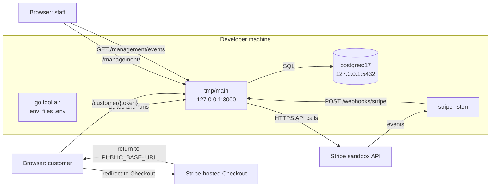

# Local development

How to run the app on one machine: Compose PostgreSQL, the Air rebuild loop, a staff account and Stripe webhook forwarding. Environment variables are defined in [Configuration](configuration.md); the deployed setup is in [Railway](railway.md); checks are in [Testing](../testing.md).

## Quick start

```fish
test -f .env; or cp .env.example .env
docker compose up --detach --wait --wait-timeout 90 db
go tool air
```

- `.env.example` holds the local Compose `DATABASE_URL`, `SESSION_COOKIE_SECURE=false` and Stripe **placeholders**. The server refuses to start without a valid sandbox Stripe key, webhook secret, `PUBLIC_BASE_URL`, two configuration IDs and the six catalog prices; see [Stripe setup](stripe-setup.md).
- `go.mod` declares Air as a project tool, so run `go tool air`, never a global `air`.
- The server listens on `127.0.0.1:3000` unless `PORT` is set ([Configuration](configuration.md)).
- Create a staff account before opening `/management/` (below).



## Database

[compose.yaml](../../compose.yaml) runs one `db` service, `postgres:17`, published only on `127.0.0.1:5432` with database `hermes` and user and password `postgres`. Data lives in the named volume `postgres_data`, so it survives `docker compose down`; `docker compose down --volumes` discards it. `--wait` blocks until `pg_isready` passes (checked every 2 s, up to 15 retries).

The app creates its own tables: startup runs `AutoMigrate` ([Startup and shutdown](startup-shutdown.md)). Mock data may be dropped freely ([AGENTS.md](../../AGENTS.md#production-ready-false)).

This repository owns the `hermes` database. ProjectHephaestus (`../ProjectHephaestus`) connects to the same database and has no Compose database of its own, so start it from here.

## Air

Air is configured in [.air.toml](../../.air.toml), which sets only four things.

| Setting | Value | Effect |
|---|---|---|
| `env_files` | `[".env"]` | Air loads `.env` into the app's environment. A variable already set in your shell wins. **The app never reads `.env` itself.** |
| `build.entrypoint` | `./tmp/main` | The binary Air runs; the build is Air's default `go build -o ./tmp/main .`. |
| `build.include_ext` | `go`, `html`, `css`, `js` | A change to any such file rebuilds and restarts. Air skips `_test.go` files by default. |
| `build.exclude_dir` | `tmp`, `loadtest` | Air ignores its own build output and the k6 scripts, so editing a load test never restarts the server. The repository has none of Air's other default exclusions (`assets`, `vendor`, `testdata`). |

Consequences:

- **Static files are embedded.** `main.go` embeds `static/` (`assets`), so a CSS or script edit takes effect only after Air rebuilds.
- **No browser refresh.** `.air.toml` has no `[proxy]` section; reload the page yourself.
- **Rebuilds kill the server.** `.air.toml` does not set `send_interrupt`, so Air stops the old process with SIGKILL. Locally there is no graceful drain and no `shutdown_*` log lines; the shutdown sequence in [Startup and shutdown](startup-shutdown.md) applies to SIGINT and SIGTERM only.
- **Environment edits.** `.env` is not a watched file. Air re-reads it on the next rebuild, so save any watched file or restart Air after changing it.
- **Run exactly one Air.** It owns port 3000 and `tmp/main`. Reuse the running instance and start one only if nothing listens on port 3000 (rule and reasoning in [AGENTS.md](../../AGENTS.md#dev-server)).

## Staff accounts

Accounts exist only through the CLI; there is no registration or email recovery. The CLI needs `DATABASE_URL` in its own environment (not a running server or Stripe configuration), and because the app never loads `.env`, pass it explicitly:

```fish
env (string match -r '^DATABASE_URL=.*' < .env) go run . user add alice
go run . --help   # usage, username and password rules; needs no environment
```

- Commands: `add`, `passwd`, `revoke`, `remove` take a username; `list` takes none. Passwords are read twice from a hidden terminal prompt, so run `add` and `passwd` in an interactive terminal, never through a pipe.
- Every `user` command connects to the database and runs `AutoMigrate` first, so point `DATABASE_URL` only at the database you mean to migrate.
- Account rules, sessions and login limiting: [Staff auth](../staff-auth.md). The deployed equivalent is `./user.fish` ([Railway](railway.md)).

## Stripe webhooks

Checkout and invoice outcomes reach the app as signed webhooks ([Webhooks](../billing/webhooks.md)). Locally the Stripe CLI forwards them:

```fish
stripe listen --forward-to http://127.0.0.1:3000/webhooks/stripe
```

1. The CLI prints a `whsec_...` signing secret.
2. Put it in `STRIPE_WEBHOOK_SECRET` in `.env` and let Air rebuild (see **Air** above).
3. Keep `stripe listen` running while you test payments.

Local development uses the `stripe listen` secret; a deployed environment uses the signing secret of the registered webhook endpoint ([Stripe setup](stripe-setup.md)). Without forwarding no event reaches the app, so the worker only notices a payment on a scheduled contract re-sync, which runs every 15 minutes while a Checkout attempt is in flight ([Worker](../billing/worker.md)).

## Management tabs and live updates

Every open links, Trash, students or dashboard page holds one server-sent-event stream (`GET /management/events`). The local server speaks plain HTTP/1.1, and browsers allow six connections per host, so six such tabs starve every other request to that host. **Keep fewer than six management tabs open locally.** The settings and sign-in pages open no stream. Stream behavior: [Live updates](../live-updates.md).

## Source

- `compose.yaml`: `postgres:17`, `POSTGRES_DB`, `postgres_data`, `pg_isready`
- `.air.toml`: `env_files`, `entrypoint`, `include_ext`, `exclude_dir`
- `.env.example`: `DATABASE_URL`, `SESSION_COOKIE_SECURE`, `STRIPE_WEBHOOK_SECRET`, `PUBLIC_BASE_URL`
- `main.go`: `assets`, `run`, `newServer`, `models`
- `internal/auth/cli.go`: `Usage`, `RunCLI`, `readNewPassword`
- `internal/live/live.go`: `Feed`
- `static/management-live.js`: `listenForChanges`
- `AGENTS.md`: `Production ready: false`, `Dev server`
