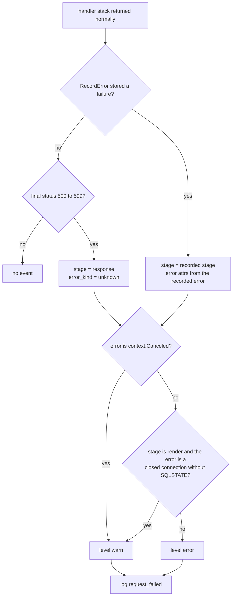

# Observability

What the application logs, in what shape, and what it deliberately never logs. The logging package sits at the outer edge of the middleware chain described in [Architecture](../architecture.md); lifecycle events are explained in [Startup and shutdown](startup-shutdown.md); the billing events are produced by the code in [Worker](../billing/worker.md), [Checkout](../billing/checkout.md) and [Webhooks](../billing/webhooks.md).

## Output format

Each event is one JSON object per line. The web server writes to stdout; every `user` CLI command writes to stderr so stdout stays clean.

| Key | Value |
|---|---|
| `time` | slog's default timestamp |
| `level` | Lowercase: `info`, `warn` or `error` |
| `message` | The event name (the catalogue below) |
| `service` | `RAILWAY_SERVICE_NAME`, default `ProjectHermes` |
| `environment` | `RAILWAY_ENVIRONMENT_NAME`, default `local` |
| `version` | `RAILWAY_GIT_COMMIT_SHA`, default `unknown` |
| `deployment_id`, `replica_id` | `RAILWAY_DEPLOYMENT_ID`, `RAILWAY_REPLICA_ID`; present only when set |

The variables are listed in [Configuration](configuration.md). There is no access log: successful requests and ordinary 4xx responses are not logged.

## Request IDs

`logging.Requests` assigns every request an ID and returns it in the `X-Request-ID` response header.

- The ID is taken from the request header `X-Railway-Request-Id` only when exactly one value is present, it is 1 to 128 characters, and every character is `A-Z a-z 0-9 . _ -`.
- Otherwise the ID is a fresh `rand.Text()` value.
- A client-supplied `X-Request-ID` is ignored.
- The ID appears in `request_failed` events and the response header; no other event carries it. Matching it to Railway's own HTTP logs is [EXTERNAL].

## `request_failed`

At most one event per request, emitted after the whole handler stack returns normally. A handler reports a failure with `logging.RecordError(r, stage, err)`, which stores the first failure and its stage and emits nothing itself; later reports for the same request are dropped. The state is shared through the request context, so a late report from a request-copying middleware (for example the SCS session commit) still reaches the same request.

| Field | Meaning |
|---|---|
| `request_id` | See above |
| `method` | The request method when it is one of the nine standard verbs, otherwise `OTHER` |
| `route` | The matched mux pattern, for example `POST /management/links/{id}/cancel`. `/management/` when the management mux did not match, or `auth.Require` answered with a 500 first; `unmatched` when the outer mux matched nothing |
| `stage` | The `RecordError` stage, or `response` when only the status was a 5xx |
| `status` | First final status written; informational 1xx statuses (except 101) are skipped; 0 becomes 200 |
| `duration_ms` | Time from the start of `Requests` |
| `error_kind`, `error_type`, `sqlstate` | See the next section; a 5xx without a recorded error has `error_kind` `unknown` and no `error_type` |

A 4xx is logged only if a handler called `RecordError`. A render failure after the status was written logs with the original status (often 200).

Current stage values come from the `RecordError` callers: `session`, `authenticate`, `login`, `logout`, `render`, `load`, `lookup`, `list`, `save`, `create`, `cancel`, `cancel_all`, `checkout`, `billing`, `stream`, and `response`.

A handler panic is not a `request_failed`: `Requests` has no recover, so net/http recovers the panic and reports it through the server error log, which becomes `http_server_error` with `kind` `panic`.

## Error attributes

Every event that reports an error builds it with `logging.ErrorAttrs`. It exposes the class, the concrete Go type that matched, and a valid SQLSTATE; never the message or wrapped values. Rules are evaluated in this order: canceled, deadline, SQLSTATE (`connection_failure`, `query_canceled`, `database`), transaction done, the remaining connection errors, other network errors, unknown.

| `error_kind` | Matches |
|---|---|
| `canceled` | `context.Canceled` anywhere in the error tree |
| `deadline_exceeded` | `context.DeadlineExceeded`, or a network error that reports a timeout |
| `connection_failure` | SQLSTATE class `08`, `57P01`, `57P02`, `57P03`; `sql.ErrConnDone`, `driver.ErrBadConn`, `net.ErrClosed`, `io.ErrClosedPipe`, `EPIPE`, `ECONNRESET`, `ECONNREFUSED`, `io.EOF`, `io.ErrUnexpectedEOF`; any other network error |
| `query_canceled` | SQLSTATE `57014` |
| `database` | Any other well-formed SQLSTATE (five characters, `A-Z` and `0-9`); `sqlstate` is included |
| `transaction_done` | `sql.ErrTxDone` |
| `unknown` | Everything else |

`error_type` is the Go type string of the matched error; `sqlstate` appears only when the error carries a well-formed SQLSTATE.

## Event catalogue

"Error attrs" means `error_kind`, `error_type` and, when present, `sqlstate`.

| `message` | Level | Extra fields | Emitted when |
|---|---|---|---|
| `startup_started` | info | none | Web server start, before any other work (not for CLI commands) |
| `startup_failed` | error | error attrs, `stage` | A startup stage failed; stages are in [Configuration](configuration.md) |
| `server_listening` | info | `addr` | The listener is bound |
| `shutdown_requested` | info | `drain_timeout_ms` (10000) | SIGINT or SIGTERM reached `serve` |
| `shutdown_completed` | info | `duration_ms` | The drain finished cleanly |
| `shutdown_failed` | error | error attrs, `duration_ms` | The drain deadline passed or `Serve` returned an error |
| `server_failed` | error | error attrs, `stage` = `serve` | `Serve` stopped with anything but `http.ErrServerClosed` |
| `http_server_error` | error | `kind`: `panic`, `accept`, `response_header` or `other` | net/http wrote to its `ErrorLog` |
| `request_failed` | warn or error | see above | A request failed |
| `database_slow_summary` | warn | `operation`, `count`, `worst_duration_ms`, `threshold_ms` | A flush found slow queries for a label |
| `orm_warning` | warn | none | GORM called the logger's `Warn`; the message is discarded |
| `session_cleanup_failed` | error | error attrs | The 5-minute expired-session delete failed (not logged once the auth manager is closing) |
| `stripe_webhook_rejected` | warn | error attrs | Signature or payload verification failed; answered 400 |
| `stripe_webhook_store_failed` | error | error attrs, `event` (Stripe event id) | Storing an allowlisted event failed; answered 500 so Stripe retries |
| `checkout_create_uncertain` | warn | error attrs, `attempt` (attempt reference) | Creating a Checkout Session ended with an unknown outcome; the attempt is marked `uncertain` |
| `checkout_expire_unresolved` | warn | error attrs, `attempt` | A Session being expired could not be resolved; the attempt stays `expiring` |
| `billing_reconcile_failed` | warn | error attrs, `stage`, `ref` | A worker step failed; silent once the worker context is cancelled |
| `billing_review_required` | warn | `contract` and `reason`, or `contract` and `obligation`, or `obligation` and `reason` | A review flag was newly set; reasons are in [Reviews](../billing/reviews.md) |

`billing_reconcile_failed` stages and `ref` values:

| `stage` | `ref` |
|---|---|
| `event_claim`, `contract_claim`, `lease_release` | empty |
| `event_lease`, `event_finish` | Stripe event id |
| a Stripe event type (processing that event failed) | Stripe event id |
| `contract_sync`, `contract_retry` | contract reference |

## Slow-query summaries

`logging.DBLogger` is GORM's logger. It never logs SQL, parameters or errors: `Trace` ignores the SQL callback and counts only successful queries slower than 200 ms (`threshold_ms`), per label. `Flush` swaps the counters out and emits at most one `database_slow_summary` per label, sorted by label, so a slow period costs a handful of lines instead of one per query.

A query's label is its request's route pattern (or `unmatched`), else the background operation set with `logging.WithOperation`, else `other`:

| Label | Source |
|---|---|
| route pattern, `unmatched` | Any query made while serving a request |
| `startup_migrate` | `AutoMigrate` at startup |
| `cli_user` | The `user` CLI |
| `billing_worker` | Everything the billing worker does, including detached persists |
| `session_cleanup` | The expired-session delete |
| `other` | A context with neither label |

Flush points are three distinct moments: right after the startup migration, every 30 s while serving, and at process exit. Session reads and writes through the SCS store use the SQL pool directly rather than GORM, so they are not counted.

## Privacy rules

- Error text never leaves `ErrorAttrs`: only kind, type and a validated SQLSTATE.
- SQL is never logged. `LogMode`, `Info` and `Error` on the GORM logger do nothing, and `Warn` logs only its name.
- Routes are logged as mux patterns, so `GET /customer/{token}` appears instead of a path, and no query string, header, cookie, IP address or user agent is logged.
- Methods outside the nine standard verbs are logged as `OTHER`.
- `http_server_error` keeps only a fixed class; the standard library's diagnostic text, which can include remote addresses, is dropped.
- Stripe webhook body, signature and secret are never logged, and the Stripe SDK's own logger is set to null.
- Billing events carry only opaque references the app generated (`contract`, `obligation`, `attempt`) or Stripe event ids; no names, emails, phone numbers, PINs or tokens appear in any event above.

## Deliberate choices

- **Three slow-query flush points.** Exit, post-migration and the 30 s ticker are different moments: without the first two, a short-lived CLI run or a startup that failed would lose its counts.
- **No `recover` in `Requests`.** The event is emitted only after the stack returns normally, so a panic cannot leave a half-built event; net/http's own recovery and `http_server_error` cover it.
- **Aggregated slow queries.** Per-query lines would let one slow spell flood the log.

## Source

- `internal/logging/logging.go`: `New`, `ErrorAttrs`, `classifyError`, `requestLevel`, `ServerErrorLog`, `serverErrorWriter`
- `internal/logging/http.go`: `Requests`, `Routes`, `RecordError`, `WithOperation`, `labelFromContext`, `requestID`, `validRequestID`, `requestMethod`, `statusWriter`
- `internal/logging/database.go`: `DBLogger`, `slowQueryThreshold`, `Trace`, `Flush`, `database_slow_summary`, `orm_warning`
- `main.go`: `startup_started`, `startup_failed`, `server_listening`, `shutdown_requested`, `shutdown_completed`, `shutdown_failed`, `server_failed`, `RAILWAY_SERVICE_NAME`
- `internal/auth/http.go`: `session_cleanup_failed`, `deleteExpiredSessions`
- `internal/billing/webhook.go`: `stripe_webhook_rejected`, `stripe_webhook_store_failed`
- `internal/billing/checkout.go`: `checkout_create_uncertain`, `checkout_expire_unresolved`
- `internal/billing/worker.go`: `billing_reconcile_failed`, `billing_review_required`, `logFailure`
- `internal/billing/stripe.go`: `NewStripeClient`
