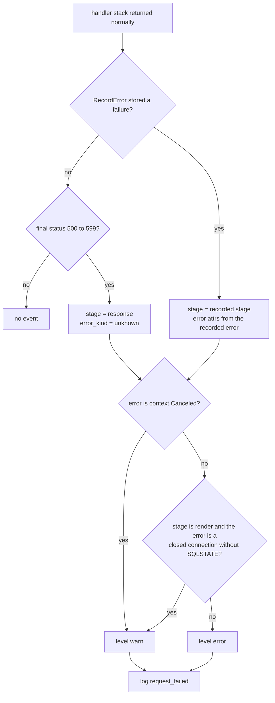

# Observability

What the application logs, in what shape, what it reports to Sentry, and what it deliberately never sends anywhere. Logging spans four packages, listed in [Architecture](../architecture.md#packages): `internal/logging` (the format, error attributes and labels, stdlib only), `internal/logging/httplog` (requests and Stripe calls), `internal/logging/dblog` (the pgx query tracer) and `internal/logging/sentrylog` (Sentry). `httplog.Requests` sits at the outer edge of the middleware chain described there; lifecycle events are explained in [Startup and shutdown](startup-shutdown.md); the billing events are produced by the code in [Worker](../billing/worker.md), [Checkout](../billing/checkout.md), [Webhooks](../billing/webhooks.md) and [Withdrawal](../billing/withdrawal.md).

## Output format

Each event is one JSON object per line. The web server writes to stdout; every CLI command (`user`, `sentry-check`) writes to stderr so stdout stays clean.

| Key | Value |
|---|---|
| `time` | slog's default timestamp |
| `level` | Lowercase: `info`, `warn` or `error` |
| `message` | The event name (the catalogue below) |
| `service` | `RAILWAY_SERVICE_NAME`, default `Apollo` |
| `environment` | `RAILWAY_ENVIRONMENT_NAME`, default `local` |
| `version` | `RAILWAY_GIT_COMMIT_SHA`, default `unknown` |
| `deployment_id`, `replica_id` | `RAILWAY_DEPLOYMENT_ID`, `RAILWAY_REPLICA_ID`; present only when set |

The variables are listed in [Configuration](configuration.md). There is no access log: successful requests and ordinary 4xx responses are not logged.

## Request IDs

`httplog.Requests` assigns every request an ID and returns it in the `X-Request-ID` response header.

- The ID is taken from the request header `X-Railway-Request-Id` only when exactly one value is present, it is 1 to 128 characters, and every character is `A-Z a-z 0-9 . _ -`.
- Otherwise the ID is a fresh `rand.Text()` value.
- A client-supplied `X-Request-ID` is ignored.
- The ID appears in `request_failed` events and the response header; no other event carries it. With Sentry on, a request's Sentry events carry it as the `request_id` tag. Matching it to Railway's own HTTP logs is [EXTERNAL].

## `request_failed`

At most one event per request, emitted after the whole handler stack returns normally. A handler reports a failure with `httplog.RecordError(r, stage, err)`, which stores the first failure and its stage and emits nothing itself; later reports for the same request are dropped. The state is shared through the request context, so a late report from a request-copying middleware (for example the SCS session commit) still reaches the same request.



| Field | Meaning |
|---|---|
| `request_id` | See above |
| `method` | The request method when it is one of the nine standard verbs, otherwise `OTHER` |
| `route` | The matched mux pattern, for example `POST /management/links/{id}/cancel`. `/management/` when the management mux did not match, or `auth.Require` answered with a 500 first; `unmatched` when the outer mux matched nothing |
| `stage` | The `RecordError` stage, or `response` when only the status was a 5xx |
| `status` | First final status written; informational 1xx statuses (except 101) are skipped; 0 becomes 200 |
| `duration_ms` | Time from the start of `Requests` |
| `error_kind`, `error_type`, `sqlstate` | See the next section; a 5xx without a recorded error has `error_kind` `unknown` and no `error_type` |

A 4xx is logged only if a handler called `RecordError`. A render failure after the status was written logs with the original status (often 200).

Current stage values come from the `RecordError` callers: `session`, `authenticate`, `login`, `logout`, `render`, `load`, `lookup`, `list`, `save`, `create`, `start`, `rename`, `cancel`, `accept`, `checkout`, `billing`, `export`, `stream`, and `response`.

A handler panic is not a `request_failed`: `Requests` has no recover, so net/http recovers the panic and reports it through the server error log, which becomes `http_server_error` with `kind` `panic`. With Sentry on, `sentrylog`'s middleware reports the panic to Sentry first, and that `http_server_error` stays in the log only ([Sentry](#sentry)).

## Error attributes

Every event that reports an error builds it with `logging.ErrorAttrs`. It exposes the class, the concrete Go type that matched, and a valid SQLSTATE; never the message or wrapped values. Rules are evaluated in this order: canceled, deadline, SQLSTATE (`connection_failure`, `query_canceled`, `database`), transaction done, the remaining connection errors, other network errors, unknown.

| `error_kind` | Matches |
|---|---|
| `canceled` | `context.Canceled` anywhere in the error tree |
| `deadline_exceeded` | `context.DeadlineExceeded`, or a network error that reports a timeout |
| `connection_failure` | SQLSTATE class `08`, `57P01`, `57P02`, `57P03`; `sql.ErrConnDone`, `driver.ErrBadConn`, `net.ErrClosed`, `io.ErrClosedPipe`, `EPIPE`, `ECONNRESET`, `ECONNREFUSED`, `io.EOF`, `io.ErrUnexpectedEOF`; any other network error |
| `query_canceled` | SQLSTATE `57014` |
| `database` | Any other well-formed SQLSTATE (five characters, `A-Z` and `0-9`); `sqlstate` is included |
| `transaction_done` | `sql.ErrTxDone` |
| `unknown` | Everything else |

`error_type` is the Go type string of the matched error; `sqlstate` appears only when the error carries a well-formed SQLSTATE.

## Event catalogue

"Error attrs" means `error_kind`, `error_type` and, when present, `sqlstate`.

| `message` | Level | Extra fields | Emitted when |
|---|---|---|---|
| `startup_started` | info | none | Web server start, before any other work (not for CLI commands) |
| `startup_failed` | error | error attrs, `stage` | A startup stage failed; stages are in [Configuration](configuration.md) |
| `database_migrated` | info | `migration` (its number; the logger's `version` is the build), `adopted`, `duration_ms` | Startup applied a migration. `adopted` is true only for version 1 recorded with no DDL ([Data model](../data-model.md#migrations)). No SQL |
| `server_listening` | info | `addr` | The listener is bound |
| `shutdown_requested` | info | `drain_timeout_ms` (10000) | SIGINT or SIGTERM reached `serve` |
| `shutdown_completed` | info | `duration_ms` | The drain finished cleanly |
| `shutdown_failed` | error | error attrs, `duration_ms` | The drain deadline passed or `Serve` returned an error |
| `server_failed` | error | error attrs, `stage` = `serve` | `Serve` stopped with anything but `http.ErrServerClosed` |
| `http_server_error` | error | `kind`: `panic`, `accept`, `response_header` or `other` | net/http wrote to its `ErrorLog` |
| `request_failed` | warn or error | see above | A request failed |
| `database_slow_summary` | warn | `operation`, `count`, `worst_duration_ms`, `threshold_ms` | A flush found slow queries for a label |
| `database_pool_wait` | warn | `count`, `total_wait_ms` | A flush found queries that waited for a busy pooled connection since the previous flush |
| `stripe_call_summary` | info | `operation`, `count`, `avg_duration_ms`, `worst_duration_ms` | A flush found Stripe HTTP attempts for a label |
| `session_cleanup_failed` | error | error attrs | The 5-minute expired-session delete failed (not logged once shutdown has cancelled the cleanup) |
| `stripe_webhook_rejected` | warn | error attrs | Signature or payload verification failed; answered 400. Logged at most once a minute so unsigned POSTs cannot flood the log |
| `staff_login_failed` | warn | none | A sign-in with an unknown username or wrong password; the username is never logged |
| `staff_login_throttled` | warn | none | The sign-in limiter refused an attempt; at most one line per minute |
| `stripe_webhook_store_failed` | error | error attrs, `event` (Stripe event id) | Storing an allowlisted event failed; answered 500 so Stripe retries |
| `checkout_create_uncertain` | warn | error attrs, `attempt` (attempt reference) | Creating a Checkout Session ended with an unknown outcome; the attempt is marked `uncertain` |
| `checkout_expire_unresolved` | warn | error attrs, `attempt` | A Session being expired could not be resolved; the attempt stays `expiring` |
| `billing_reconcile_failed` | warn | error attrs, `stage`, `ref` | A worker step failed; silent once the worker context is cancelled |
| `billing_review_required` | warn | `contract` and `reason`, or `contract` and `obligation`, or `obligation` and `reason` | A review flag was newly set; reasons are in [Reviews](../billing/reviews.md) |
| `installment_retry` | info | `contract`, `obligation`, `attempt` (the retry number being made), `decline` (Stripe code of the failure, `""` when none is on record), `retried` | A failed installment's retry came due. `retried=false` means the decline needs the payer and no charge was made; see [Invoices](../billing/invoices.md#retrying-a-failed-installment) |
| `student_withdrawn` | info | `contract` | A staff withdrawal committed; logged once per contract, since a repeat writes nothing. See [Withdrawal](../billing/withdrawal.md) |
| `withdrawal_refund` | info | `contract`, `amount_cents` | Stripe answered a withdrawal refund request for one payment with success; `amount_cents` is what was asked back. See [Withdrawal](../billing/withdrawal.md#refunds) |
| `sentry_check` | error | none | `apollo sentry-check` ran with Sentry on ([Sentry](#sentry)) |

`billing_reconcile_failed` stages and `ref` values:

| `stage` | `ref` |
|---|---|
| `event_claim`, `contract_claim`, `lease_release` | empty |
| `event_finish` | Stripe event id |
| a Stripe event type (processing that event failed) | Stripe event id |
| `contract_sync`, `contract_retry` | contract reference |

## Slow-query summaries

`dblog.Tracer` is the `pgx.QueryTracer` of the one pgx pool (`internal/db`), so it times every query whichever library issued it: GORM and the SCS session store reach the pool through `database/sql` (`stdlib.OpenDBFromPool`). GORM's own logger is `logger.Discard`. The tracer never reads SQL, arguments or rows and never logs errors: `TraceQueryStart` only stamps the start time on the query's context, and `TraceQueryEnd` counts only successful queries slower than 200 ms (`threshold_ms`), per label. `Flush` swaps the counters out and emits at most one `database_slow_summary` per label, sorted by label, so a slow period costs a handful of lines instead of one per query.

A query's clock starts once it holds a connection, so its time excludes the pool wait (reported as `database_pool_wait` below). It runs to the end of the server round trip for an exec, and until the rows are closed for a query, so reading the rows counts; an autocommit write's time includes its own WAL flush. `BEGIN`, `COMMIT` and `ROLLBACK` are traced like any statement, under the transaction's label, so a slow commit appears.

A query's label (`logging.Label`) is its request's route pattern (or `unmatched`), else the background operation set with `logging.WithOperation`, else `other`:

| Label | Source |
|---|---|
| route pattern, `unmatched` | Any query made while serving a request |
| `startup_migrate` | The goose migrations at startup |
| `cli_user` | The `user` CLI |
| `billing_worker` | Everything the billing worker does, including detached persists |
| `session_cleanup` | The expired-session delete |
| `other` | A context with neither label |
| `startup_catalog` | The Stripe price list at startup (Stripe calls only) |
| `sentry_check` | `apollo sentry-check` (Sentry events only) |

Flush points are three distinct moments: right after the startup migration, every 30 s while serving, and at process exit. The SCS store's session reads and writes are counted too, but its `postgresstore` passes no context to `database/sql`, so they carry the label `other`.

## Pool waits and Stripe calls

Both ride on the same flushes and labels, and split a request's time into the database's, Stripe's and the app's own.

- **Pool waits.** `Tracer.WatchPool(pool)` makes every flush read the pool's cumulative counters (`pool.Stat()`). `count` is `EmptyAcquireCount` minus `NewConnsCount`: at least this many acquires found all 10 connections busy and waited for one to be released, the saturation `database/sql`'s `WaitCount` counted before. It undercounts by each failed connection attempt, each acquire abandoned while its connection was opening, and each waiter that ended up opening a replacement for an expired or broken connection. pgx also counts an acquire that opened a new connection as a wait; the pool opens connections only on demand (`db.Open` holds `MinConns` and `MinIdleConns` at 0) and recycles them ([pool limits](startup-shutdown.md#budgets-and-limits)), and subtracting the openings keeps those silent. `total_wait_ms` is the growth of `EmptyAcquireWaitTime`, which cannot be split, so it also holds the time spent opening connections in the same window. When the count grew, one `database_pool_wait` carries the growth since the previous flush. The pool holds 10 connections (`internal/db`), and the count includes the session store's queries.
- **Stripe calls.** `httplog.StripeTimer` wraps the Stripe client's HTTP transport and times every attempt, SDK retries and failures included, up to the response headers. `Flush` (the 30 s ticker and process exit) emits one `stripe_call_summary` per label. For `POST /customer/{token}/payments`, the request's latency minus `avg_duration_ms` is the app's own share.

## Sentry

Errors also go to Sentry, through `internal/logging/sentrylog`, with no request or student data beyond the JSON log line's fields. It is switched on by `SENTRY_DSN` alone ([Configuration](configuration.md)).

**Off without `SENTRY_DSN`.** `sentrylog.New` returns a nil `*Reporter`, and `main` then builds exactly the pre-Sentry logger and middleware chain: no Sentry client, hub or transport exists, nothing is sent, and no Sentry goroutine starts. The SDK's global hub is never used, even when Sentry is on. An invalid DSN fails startup with stage `sentry_configuration`.

**What is reported.**

- Every log event at `error` level, through an extra handler beside the JSON one (`slog.NewMultiHandler` in `main.newLogger`): `startup_failed`, `shutdown_failed`, `server_failed`, `http_server_error` except `kind` `panic` (next item), `request_failed` at `error`, `session_cleanup_failed`, `stripe_webhook_store_failed`, `sentry_check`. Warnings and info events are not. The event's message is the log event name, and its attributes, the logger's own included, are the event's `attributes` context.
- Handler panics. `Reporter.Middleware` wraps `sentryhttp` with `Repanic: true` just inside `httplog.Requests`, so the panic is reported with its type, stack trace, route and request ID, then net/http still recovers it and logs `http_server_error` with `kind` `panic`. The Sentry handler skips that record, so one panic makes one Sentry event.

**Event fields.**

| Field | Value |
|---|---|
| transaction | The event's label, `logging.Label`: the route pattern (`POST /customer/{token}/draft/{field}`), `unmatched`, a background operation, or `other`; never a path |
| fingerprint | Sentry's default grouping plus the transaction, so one failure in two routes is two issues |
| tag `request_id` | The request ID, for events raised while serving a request |
| environment | `RAILWAY_ENVIRONMENT_NAME`, default `local` |
| release | `RAILWAY_GIT_COMMIT_SHA`, default `unknown`: the log's `version` |
| exception | Panic events only: type and stack trace, with the function, module, build path and line of each frame. No values, locals or source lines |
| modules | Every Go module linked into the binary, with its version |

**Scrubbing.** `SendDefaultPII` is false and `BeforeSend` (`scrub`) drops, on every event: the request (URL, query string, headers, cookies, body), the user and client IP, the host name, breadcrumbs, every context except `attributes`, and the text of every exception. A panic's message becomes `panic`, since a non-error panic value would arrive there. Exception types and stack traces stay. `sentryhttp` buffers up to 10 KiB of a request body for its request record; `scrub` drops that record, so the body never leaves the process. The middleware deletes a client's `sentry-trace` and `baggage` headers before `sentryhttp` reads them: it would copy them into the envelope header, which `BeforeSend` never sees.

**Tracing is off.** `EnableTracing` is false, so `sentryhttp`'s per-request transaction is never sampled or sent.

**Flush.** `main` flushes for at most 2 s as its last step, after `startup_failed` or the shutdown events ([Startup and shutdown](startup-shutdown.md#shutdown)).

**Verifying the live pipeline.** No HTTP route triggers Sentry. On a deployed environment, run the deployed binary over Railway SSH:

```
railway ssh --project <id> --environment <env> --service Apollo -- /app/out sentry-check
```

`sentry-check` needs no database. It logs one `sentry_check` error, which carries only the logger's service, environment and version fields, plus `deployment_id` and `replica_id` where Railway sets them, through the same logger as the server, waits up to 2 s for the SDK to send it, and prints its event ID. The SDK does not report Sentry's answer, so a wrong key or a blocked network still prints the ID: search Sentry for that ID to confirm the event arrived and carries nothing but the fields above. Without `SENTRY_DSN` it prints that Sentry is off and exits 1.

## Privacy rules

- Error text never leaves `ErrorAttrs`: only kind, type and a validated SQLSTATE.
- SQL is never logged. The pgx tracer never reads a query's SQL, arguments or rows, and GORM's own logger is `logger.Discard`.
- Routes are logged as mux patterns, so `GET /customer/{token}` appears instead of a path, and no query string, header, cookie, IP address or user agent is logged.
- Methods outside the nine standard verbs are logged as `OTHER`.
- `http_server_error` keeps only a fixed class; the standard library's diagnostic text, which can include remote addresses, is dropped.
- Stripe webhook body, signature and secret are never logged, and the Stripe SDK's own logger is set to null.
- Billing events carry only opaque references the app generated (`contract`, `obligation`, `attempt`), Stripe event ids and amounts; no names, emails, phone numbers, PINs, tokens or staff usernames appear in any event above (the withdrawing staff name goes only to Stripe refund metadata).
- `main_logging_integration_test.go` drives real failures through `newServer` and fails if a query string, header, credential, cookie, token, contact value, client IP or SQL text reaches the log event or the Sentry events, which it captures through the SDK's `Transport` interface. Its panic test reads the whole envelopes the SDK posts to a loopback sink, so client trace headers are checked too ([Testing](../testing.md)).
- Sentry gets the log's fields, after the scrubbing above, plus panic stack traces and the module list ([Sentry](#sentry)).

## Deliberate choices

- **Three slow-query flush points.** Exit, post-migration and the 30 s ticker are different moments: without the first two, a short-lived CLI run or a startup that failed would lose its counts.
- **No `recover` in `Requests`.** The event is emitted only after the stack returns normally, so a panic cannot leave a half-built event; net/http's own recovery and `http_server_error` cover it.
- **Aggregated slow queries.** Per-query lines would let one slow spell flood the log.
- **Sentry off means absent.** A nil `*sentrylog.Reporter` leaves the logger and the middleware chain as they were, so an environment without `SENTRY_DSN` runs no Sentry code at all.
- **One panic, one Sentry event.** The `sentryhttp` event has the stack trace, route and request ID; the `http_server_error` of `kind` `panic` that follows has none of them and would group every route's panics into one `other` issue, so the Sentry handler skips it. The JSON log keeps it. The middleware wraps every handler `newServer` mounts; a panic outside it, in `httplog.Requests` itself, would reach the log only.

## Source

- `internal/logging/logging.go`: `New`, `ErrorAttrs`, `classifyError`, `RequestLevel`, `WithOperation`, `WithRoute`, `Label`
- `internal/logging/httplog/http.go`: `Requests`, `Routes`, `RecordError`, `RequestID`, `requestID`, `validRequestID`, `requestMethod`, `statusWriter`, `ServerErrorLog`, `serverErrorWriter`
- `internal/logging/dblog/database.go`: `Tracer`, `slowQueryThreshold`, `TraceQueryStart`, `TraceQueryEnd`, `Flush`, `WatchPool`, `database_slow_summary`, `database_pool_wait`
- `internal/db/db.go`: `Open`, `maxConns`
- `internal/db/migrate.go`: `database_migrated`
- `internal/logging/httplog/stripe.go`: `StripeTimer`, `NewStripeTimer`, `RoundTrip`, `Flush`, `stripe_call_summary`
- `internal/logging/sentrylog/sentrylog.go`: `New`, `Options`, `Reporter`, `Handler`, `Middleware`, `Flush`, `LastEventID`, `scrub`, `flatten`
- `main.go`: `startup_started`, `startup_failed`, `server_listening`, `shutdown_requested`, `shutdown_completed`, `shutdown_failed`, `server_failed`, `sentry_check`, `newLogger`, `checkSentry`, `RAILWAY_SERVICE_NAME`, `SENTRY_DSN`
- `internal/auth/http.go`: `session_cleanup_failed`, `deleteExpiredSessions`, `staff_login_failed`, `staff_login_throttled`
- `internal/billing/webhook.go`: `stripe_webhook_rejected`, `stripe_webhook_store_failed`
- `internal/billing/checkout.go`: `checkout_create_uncertain`, `checkout_expire_unresolved`
- `internal/billing/worker.go`: `billing_reconcile_failed`, `billing_review_required` (contract), `logFailure`
- `internal/billing/invoices.go`: `billing_review_required` (obligation)
- `internal/billing/retry.go`: `installment_retry`
- `internal/billing/withdraw.go`: `student_withdrawn`, `withdrawal_refund`
- `internal/billing/stripe.go`: `NewStripeClient`
