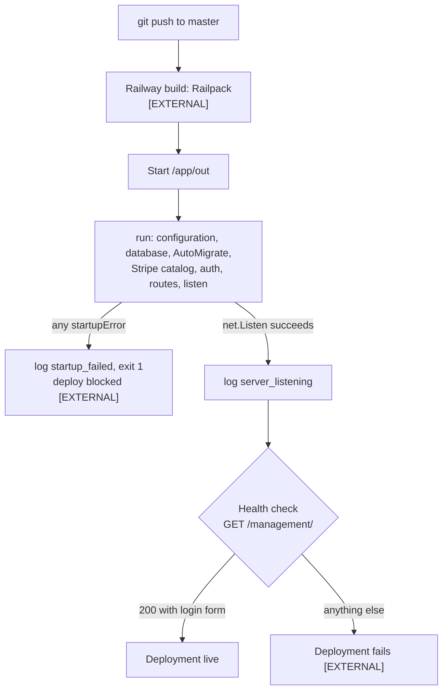

# Railway

How the app is deployed and operated on Railway: service layout, variables, deploy flow, the health check and the `user.fish` account launcher. Variable validation lives in [Configuration](configuration.md), Stripe dashboard prerequisites in [Stripe setup](stripe-setup.md), and the local equivalent in [Local development](local-development.md).

The repository carries no Dockerfile, `railway.json`, Nixpacks file or CI workflow. Everything about the Railway project itself is `[EXTERNAL]`: it cannot be proven from this repository, only from the Railway dashboard and the rules in [AGENTS.md](../../AGENTS.md#railway).

## Deployment

| Item | Value |
|---|---|
| Project | `amused-light` `[EXTERNAL]`; its ID is hard-coded in `user.fish` |
| Service | `ProjectHermes` (`user.fish`; also the log fallback in `main.go`) |
| Environment | `production`, the `user.fish` default. It is test-only: use no real customer or payment data ([AGENTS.md](../../AGENTS.md#production-ready-false)) |
| Build | Railpack from GitHub `devGabriel131/ProjectHermes`, branch `master` `[EXTERNAL]` |
| Deploy trigger | every push to `master` `[EXTERNAL]`; push only with approval ([AGENTS.md](../../AGENTS.md#railway)) |
| Binary | `/app/out`, the path `user.fish` runs `[EXTERNAL]` |
| Database | Railway PostgreSQL service `Postgres` `[EXTERNAL]` |
| Replicas | one; see [Go-live](../go-live.md) |



Every `startupError` makes the process exit 1 after logging `startup_failed`, so a missing or invalid Stripe setting, a failed migration or an unreachable database stops the new deployment. The stages and their order are in [Startup and shutdown](startup-shutdown.md). The server handles SIGTERM with a 10 s drain (same page); that Railway sends SIGTERM on redeploy is `[EXTERNAL]`.

## Service variables

Validation, defaults and failure stages for each variable are in [Configuration](configuration.md); this table is only what the Railway service sets.

| Variable | Value on Railway |
|---|---|
| `DATABASE_URL` | `${{Postgres.DATABASE_URL}}` `[EXTERNAL]`, a private-network host a laptop cannot reach |
| `SESSION_COOKIE_SECURE` | `true` `[EXTERNAL]`; also the default when unset, but a set-and-empty value fails startup |
| `PORT` | `8080` `[EXTERNAL]`; when set the server binds all interfaces on `:8080` |
| `STRIPE_API_KEY` | restricted key (code also accepts `sk_` keys) whose `test` or `live` prefix matches `STRIPE_MODE` `[EXTERNAL]` |
| `STRIPE_MODE` | `sandbox` or `live` |
| `STRIPE_WEBHOOK_SECRET` | signing secret of the **registered webhook endpoint**, not the `stripe listen` secret used locally |
| `PUBLIC_BASE_URL` | the public HTTPS origin; the Stripe webhook endpoint is `<PUBLIC_BASE_URL>/webhooks/stripe` |
| `STRIPE_PAYMENT_METHOD_CONFIGURATION_ID`, `STRIPE_PORTAL_CONFIGURATION_ID` | IDs from the same Stripe mode |

Railway also provides metadata variables the app reads for log fields: `RAILWAY_SERVICE_NAME`, `RAILWAY_ENVIRONMENT_NAME`, `RAILWAY_GIT_COMMIT_SHA`, `RAILWAY_DEPLOYMENT_ID`, `RAILWAY_REPLICA_ID` ([Observability](observability.md)). Never copy Railway credentials into `.env` or `.env.example`; `.gitignore` excludes `.env`.

## Health check

The health-check path is `/management/` `[EXTERNAL]` (a dashboard setting). The code side: `auth.Require` answers a signed-out `GET` or `HEAD` on exactly `/management/` with **200 and the login form**, so the check passes with no credentials. Any other signed-out management path answers 303 to `/management/`, and a signed-out HTMX request gets 401 with `HX-Redirect`. Route and middleware details: [Architecture](../architecture.md).

## Account CLI: `user.fish`

`./user.fish` runs the deployed binary's `user` commands over Railway SSH:

```
./user.fish add <username>
./user.fish passwd <username>
./user.fish revoke <username>
./user.fish remove <username>
./user.fish list
./user.fish --environment <name> list
```

| Rule | Detail |
|---|---|
| Requirements | Fish, the Railway CLI, `railway login` and an SSH key registered with `railway ssh keys add` `[EXTERNAL]`. No local `DATABASE_URL` is needed. |
| Help | `--help`, `-h` or no command prints usage and exits 0 without any Railway access. |
| Terminal check | `add` and `passwd` need stdin and stdout on a terminal (hidden password prompts); otherwise the script exits 2. |
| Environment | `production` unless `--environment <name>` comes **before** the command (`argparse --stop-nonopt`). |
| What runs | `railway ssh --project <id> --environment <env> --service ProjectHermes -- /app/out user <args>`: the **deployed** build, not your working tree. |
| Not a substitute | `railway run` and `railway shell` execute on your machine and cannot reach the private database host `[EXTERNAL]`. |

Account rules and sessions: [Staff auth](../staff-auth.md).

## The CLI migrates the database

Every `user` command, including `list` and a mistyped subcommand, connects to the database and runs `AutoMigrate` before it does anything else. Run through `user.fish`, that applies the **deployed** binary's models to the target environment's database. `AutoMigrate` adds tables, columns and constraints but never drops a column the models no longer declare, so a renamed column leaves the old one behind until it is dropped by hand. Locally, `go run . user ...` migrates whatever `DATABASE_URL` points at ([Local development](local-development.md)).

## Deliberate choices

- The health check targets the login page rather than a dedicated `/healthz`: `auth.Require` special-cases exactly `GET`/`HEAD` `/management/` and its comment names Railway, so the check needs no extra route and no session.
- `user.fish` uses SSH instead of `railway run`: the database host is private, and a remote shell runs the exact binary the service runs.
- Slow-query summaries are batched every 30 s and live streams send a 30 s heartbeat because of Railway platform limits (500 log lines per second, a five-minute idle cutoff for streams) `[EXTERNAL]`; see [Observability](observability.md) and [Live updates](../live-updates.md).

## Changing server-side dependencies

A change to `go.mod`/`go.sum`, the Go toolchain, or build or deploy configuration needs a verified preview deployment in a non-production Railway environment before it reaches `master`. The rule is owned by [AGENTS.md](../../AGENTS.md#railway).

## Source

- `user.fish`: `argparse`, `--environment`, `isatty`, `railway ssh`, `/app/out`, `ProjectHermes`
- `main.go`: `RAILWAY_SERVICE_NAME`, `RAILWAY_ENVIRONMENT_NAME`, `RAILWAY_GIT_COMMIT_SHA`, `RAILWAY_DEPLOYMENT_ID`, `RAILWAY_REPLICA_ID`, `PORT`, `startupError`, `serve`, `run`
- `internal/auth/http.go`: `Require`
- `internal/auth/cli.go`: `Usage`, `RunCLI`
- `.env.example`: `DATABASE_URL`, `STRIPE_MODE`, `PUBLIC_BASE_URL`
- `.gitignore`: `/.env`
- `AGENTS.md`: `Production ready: false`, `Railway`
