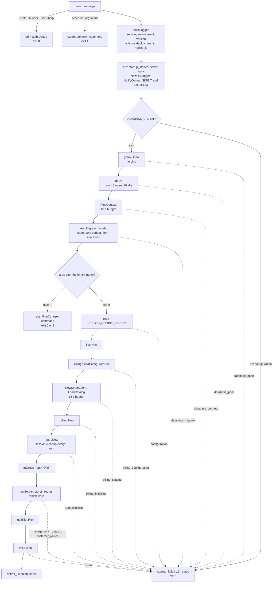
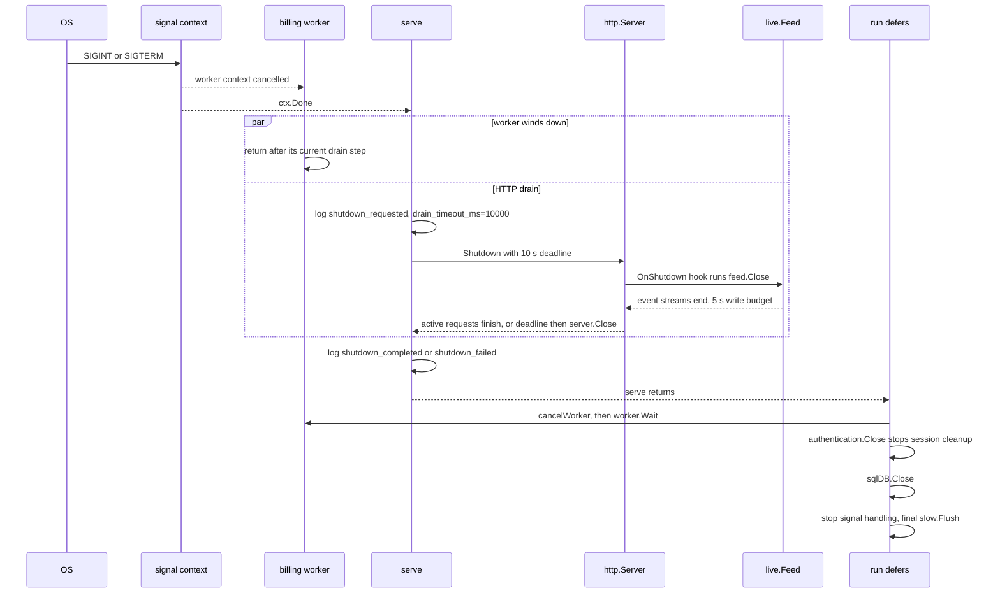

# Startup and shutdown

The order `run` brings the process up, the budgets it applies, and how it winds down on SIGINT or SIGTERM. Variables and the full list of failure stages are in [Configuration](configuration.md); log events are in [Observability](observability.md); the packages involved are in [Architecture](../architecture.md).

## Startup

Facts the diagram compresses:

- The logger is built first, from the `RAILWAY_*` variables; only the web server logs to stdout ([Observability](observability.md)).
- Ping and `AutoMigrate` share one 10 s context derived from the signal context. The slow-query summary is flushed right after the migration.
- `AutoMigrate(models()...)` creates or alters every table: `auth.User`, `auth.Session`, `settings.Settings`, `links.Link`, `students.Student` and `billing.Models()`. There are no migration files ([Data model](../data-model.md)).
- Cookie and Stripe settings are read only after the database is migrated, so a bad Stripe variable still leaves the schema migrated.
- The worker goroutine starts before `net.Listen`; a `listen` failure unwinds through the deferred stop, which cancels and awaits it.
- Any startup failure is logged by `main` after `run` returns, so deferred cleanup (including the final slow-query flush) happens first.

### CLI branch

`projecthermes user <command>` takes the same path as the server through `AutoMigrate`, then calls `auth.RunCLI` instead of building the web stack ([Staff authentication](../staff-auth.md) documents the commands).

| Invocation | Behavior |
|---|---|
| `--help`, `-h`, `user`, `user --help`, `user -h` | Print `auth.Usage`, exit 0. No logger, no environment, no database |
| Any other first argument | `unknown command` on stderr, exit 1. No database |
| `user <anything else>` | Connects to `DATABASE_URL`, runs `AutoMigrate`, then `RunCLI` |

Consequences:

- Every `user` command, including an invalid subcommand, needs a reachable database and migrates it first; an invalid subcommand only reports its usage error after that.
- Logs go to stderr, so stdout stays clean for `user list`. No `startup_started` is logged. Database failures still log `startup_failed` (to stderr); a command's own error is printed to stderr and exits 1 without that event.
- The CLI uses the slow-query label `cli_user`.

## Budgets and limits

| Setting | Value | Where |
|---|---|---|
| Ping plus `AutoMigrate` | 10 s, one shared budget | `run` |
| Stripe catalog load | 15 s; the Stripe HTTP client also times out each call at 5 s with up to 2 retries | `run`, `billing.NewStripeClient` |
| Pool | 10 open, 10 idle connections; shared with the SCS session store | `run`, `auth.New` |
| GORM | `SkipDefaultTransaction`, `DisableAutomaticPing`; `Logger` is the slow-query logger | `run` |
| `ReadHeaderTimeout` | 5 s; there is no `ReadTimeout` | `newServer` |
| `WriteTimeout` | 10 s; event streams replace it per write ([Live updates](../live-updates.md)) | `newServer` |
| `IdleTimeout` | 60 s | `newServer` |
| Drain on shutdown | 10 s | `serve` argument in `run` |
| Slow-query flush ticker | 30 s while serving | `serve` |
| Expired-session cleanup | every 5 min, each delete bounded at 5 s | `auth.New` |

## Shutdown

SIGINT or SIGTERM cancels the context from `signal.NotifyContext`. The worker's context is derived from it, so the worker stops at the signal, in parallel with the HTTP drain. Only the wait for the worker happens after `serve` returns.

Details:

- `Shutdown` closes the listeners and starts the `feed.Close` hook at its beginning; the drain then waits for active connections up to 10 s. If the deadline passes, `server.Close()` is joined into the error and `shutdown_failed` is logged; the process exits 1.
- The deferred calls unwind last-in first: worker cancel and `Wait`, `authentication.Close`, the catalog and migration contexts, `sqlDB.Close`, `stop`, then the final `slow.Flush`.
- A clean shutdown exits 0. A signal during startup cancels the budgeted contexts, so the step in progress fails under its own stage (`database_connect`, `database_migrate` or `billing_catalog`) and the process exits 1.
- Worker steps run under leases and resume from stored state. A webhook stored during the drain is only an event record that the next worker picks up ([Worker](../billing/worker.md)).

### Locally under Air

`.air.toml` sets no `send_interrupt`, and Air's default is to send SIGKILL to the process group on rebuild. A local rebuild therefore never reaches the code above: no `shutdown_*` events, no drain, and the worker dies mid-step; leases it held expire by themselves ([Worker](../billing/worker.md)). Graceful shutdown happens only on a real SIGINT/SIGTERM, such as Ctrl-C of a binary run directly or a Railway redeploy [EXTERNAL].

## Deliberate choices

- **`startupError` type.** It carries the `stage` string out of `run` and `newServer`; `main` logs it once as `startup_failed`, so no stage logs its own failure.
- **`RegisterOnShutdown(feed.Close)`.** Event streams never finish on their own. Without the hook `Shutdown` would wait on them until the 10 s drain expired.
- **Help dispatch before logger and database.** `--help` works offline and without environment variables.
- **Worker context from the signal context.** The worker stops at once instead of running Stripe calls through the drain; its work is resumable.

## Source

- `main.go`: `main`, `run`, `serve`, `newServer`, `startupError`, `models`, `signalContext`, `cancelWorker`
- `internal/auth/http.go`: `New`, `Close`, `deleteExpiredSessions`
- `internal/auth/cli.go`: `Usage`, `RunCLI`
- `internal/live/live.go`: `Feed.Close`, `writeTimeout`
- `internal/billing/stripe.go`: `NewStripeClient`, `LoadCatalog`
- `internal/billing/worker.go`: `Service.Run`, `leaseSQL`
- `.air.toml`: `env_files`
- `main_test.go`: `TestServeLifecycle`
