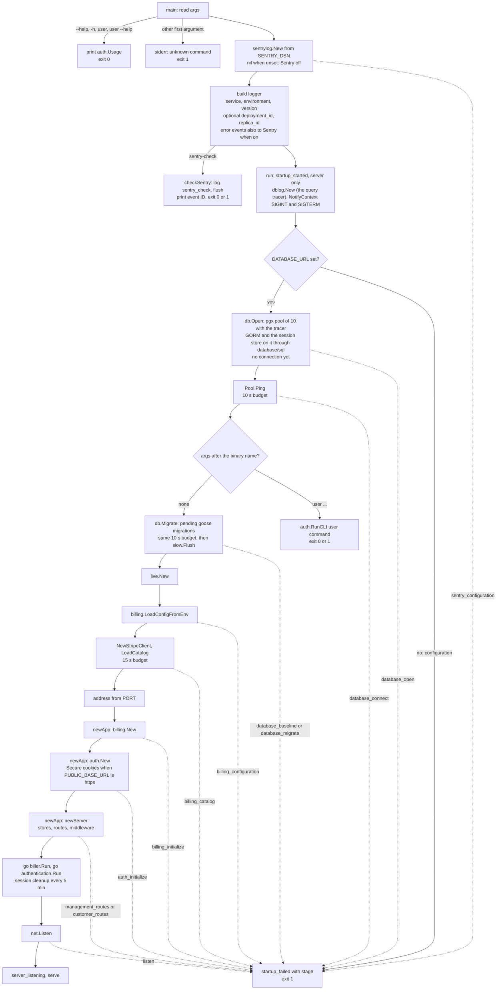
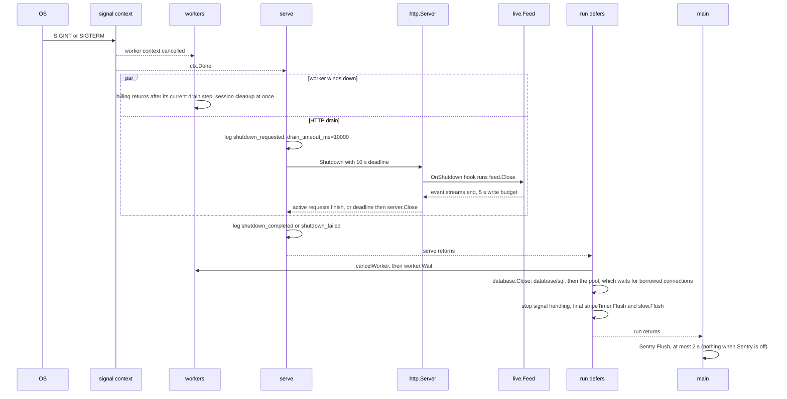

# Startup and shutdown

The order `run` brings the process up, the budgets it applies, and how it winds down on SIGINT or SIGTERM. Variables and the full list of failure stages are in [Configuration](configuration.md); log events are in [Observability](observability.md); the packages involved are in [Architecture](../architecture.md).

## Startup

Facts the diagram compresses:

- The Sentry reporter, then the logger, are built first, from `SENTRY_DSN` and the `RAILWAY_*` variables; only the web server logs to stdout ([Observability](observability.md)). Without `SENTRY_DSN` the reporter is nil and nothing Sentry-related runs.
- `apollo sentry-check` stops after the logger: it needs no database ([Observability](observability.md#sentry)).
- After every path but help and an unknown command, `main` logs `startup_failed` if a stage failed, then flushes Sentry for at most 2 s, then exits.
- Ping and the migration share one 10 s context derived from the signal context. The slow-query summary is flushed right after the migration.
- `db.Migrate` applies the pending migrations in `internal/db/migrations/` and logs `database_migrated` for each ([Data model](../data-model.md#migrations)). A schema holding only some of the baseline tables fails as `database_baseline` before any DDL; any other migration failure, including the spent budget, is `database_migrate` and rolls back that migration's transaction.
- Stripe settings, and the cookie `Secure` flag derived from `PUBLIC_BASE_URL`, are read only after the database is migrated, so a bad Stripe variable still leaves the schema migrated.
- Both worker goroutines start before `net.Listen`; a `listen` failure unwinds through the deferred stop, which cancels and awaits them.
- Any startup failure is logged by `main` after `run` returns, so deferred cleanup (including the final slow-query flush) happens first.

### CLI branch

`apollo user <command>` takes the same path as the server through the ping, then calls `auth.RunCLI` instead of migrating and building the web stack ([Staff authentication](../staff-auth.md) documents the commands).

| Invocation | Behavior |
|---|---|
| `--help`, `-h`, `user`, `user --help`, `user -h` | Print `auth.Usage`, exit 0. No logger, no environment, no database |
| Any other first argument | `unknown command` on stderr, exit 1. No database |
| `user <anything else>` | Connects to `DATABASE_URL`, pings, then `RunCLI` |

Consequences:

- Every `user` command, including an invalid subcommand, needs a reachable database; an invalid subcommand only reports its usage error after the ping. The CLI never migrates, so it needs a database a server start has migrated.
- Logs go to stderr, so stdout stays clean for `user list`. No `startup_started` is logged. Database failures still log `startup_failed` (to stderr); a command's own error is printed to stderr and exits 1 without that event.
- The CLI uses the slow-query label `cli_user`.

## Budgets and limits

| Setting | Value | Where |
|---|---|---|
| Ping plus migration | 10 s, one shared budget | `run` |
| Stripe catalog load | 15 s; the Stripe HTTP client also times out each call at 5 s with up to 2 retries | `run`, `billing.NewStripeClient` |
| Pool | One pgx pool of 10 connections, opened on demand, each closed after an hour (pgx default) or 30 min idle; GORM and the SCS session store borrow from it through `database/sql`, which keeps no idle connections of its own | `internal/db` |
| GORM | `SkipDefaultTransaction`, `DisableAutomaticPing`; `Logger` is `logger.Discard`, the pool's tracer times queries instead | `internal/db` |
| `ReadHeaderTimeout` | 5 s; there is no `ReadTimeout` | `newServer` |
| `WriteTimeout` | 10 s; event streams replace it per write ([Live updates](../live-updates.md)) | `newServer` |
| `IdleTimeout` | 60 s | `newServer` |
| Drain on shutdown | 10 s | `serve` argument in `run` |
| Summary flush ticker (slow queries, pool waits, Stripe calls) | 30 s while serving | `serve` |
| Expired-session cleanup | every 5 min, each delete bounded at 5 s | `auth.Manager.Run` |

## Shutdown

SIGINT or SIGTERM cancels the context from `signal.NotifyContext`. The workers' context is derived from it, so the billing worker and the session cleanup stop at the signal, in parallel with the HTTP drain. Only the wait for them happens after `serve` returns.

Details:

- `Shutdown` closes the listeners and starts the `feed.Close` hook at its beginning; the drain then waits for active connections up to 10 s. If the deadline passes, `server.Close()` is joined into the error and `shutdown_failed` is logged; the process exits 1.
- The deferred calls unwind last-in first: worker cancel and `Wait`, the catalog context, the final `stripeTimer.Flush`, the migration context, `database.Close`, `stop`, then the final `slow.Flush`. Then `main` flushes Sentry, so `shutdown_failed` or `server_failed` reaches it before the process exits.
- The pool closes after the server and the workers have stopped, so no query of theirs meets a closed pool. `Pool.Close` waits for every borrowed connection to come back: after a drain that ran out of time, it waits for the handlers `server.Close` left running to finish their queries.
- A clean shutdown exits 0. A signal during startup cancels the budgeted contexts, so the step in progress fails under its own stage (`database_connect`, `database_migrate` or `billing_catalog`) and the process exits 1.
- Worker steps run under leases and resume from stored state. A webhook stored during the drain is only an event record that the next worker picks up ([Worker](../billing/worker.md)).

### Locally under Air

`.air.toml` sets no `send_interrupt`, and Air's default is to send SIGKILL to the process group on rebuild. A local rebuild therefore never reaches the code above: no `shutdown_*` events, no drain, and the worker dies mid-step; leases it held expire by themselves ([Worker](../billing/worker.md)). Graceful shutdown happens only on a real SIGINT/SIGTERM, such as Ctrl-C of a binary run directly or a Railway redeploy [EXTERNAL].

## Deliberate choices

- **`startupError` type.** It carries the `stage` string out of `run` and `newServer`; `main` logs it once as `startup_failed`, so no stage logs its own failure.
- **`RegisterOnShutdown(feed.Close)`.** Event streams never finish on their own. Without the hook `Shutdown` would wait on them until the 10 s drain expired.
- **Help dispatch before logger and database.** `--help` works offline and without environment variables.
- **Worker context from the signal context.** The workers stop at once instead of running Stripe calls or a session delete through the drain; their work is resumable.
- **One pool under every library.** GORM and the SCS store reach the pgx pool through `stdlib.OpenDBFromPool`, so the 10-connection limit and the tracer cover every query while contexts move from GORM to sqlc on pgx.

## Source

- `main.go`: `main`, `newLogger`, `checkSentry`, `run`, `newApp`, `serve`, `newServer`, `startupError`, `signalContext`, `cancelWorker`
- `internal/db/db.go`: `Open`, `DB.Close`, `maxConns`
- `internal/db/migrate.go`: `Migrate`, `ErrPartialSchema`
- `internal/logging/sentrylog/sentrylog.go`: `New`, `Reporter.Flush`
- `internal/auth/http.go`: `New`, `Run`, `deleteExpiredSessions`
- `internal/auth/cli.go`: `Usage`, `RunCLI`
- `internal/live/live.go`: `Feed.Close`, `writeTimeout`
- `internal/billing/stripe.go`: `NewStripeClient`, `LoadCatalog`
- `internal/billing/worker.go`: `Service.Run`, `leaseSQL`
- `.air.toml`: `env_files`
- `main_test.go`: `TestServeLifecycle`
