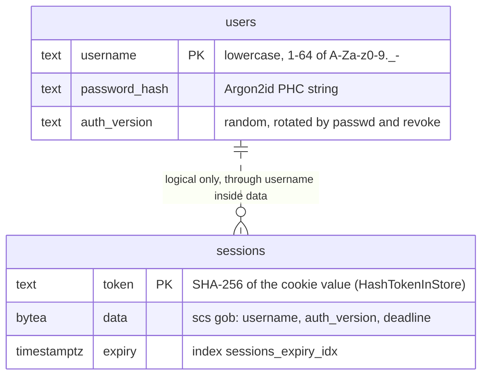
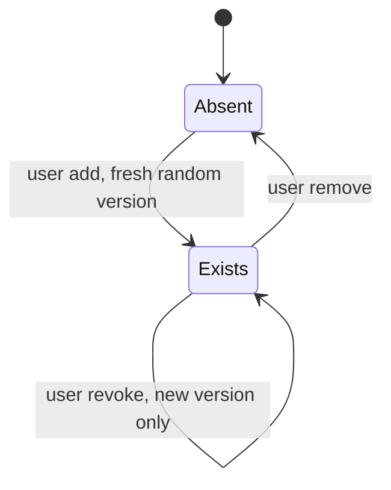
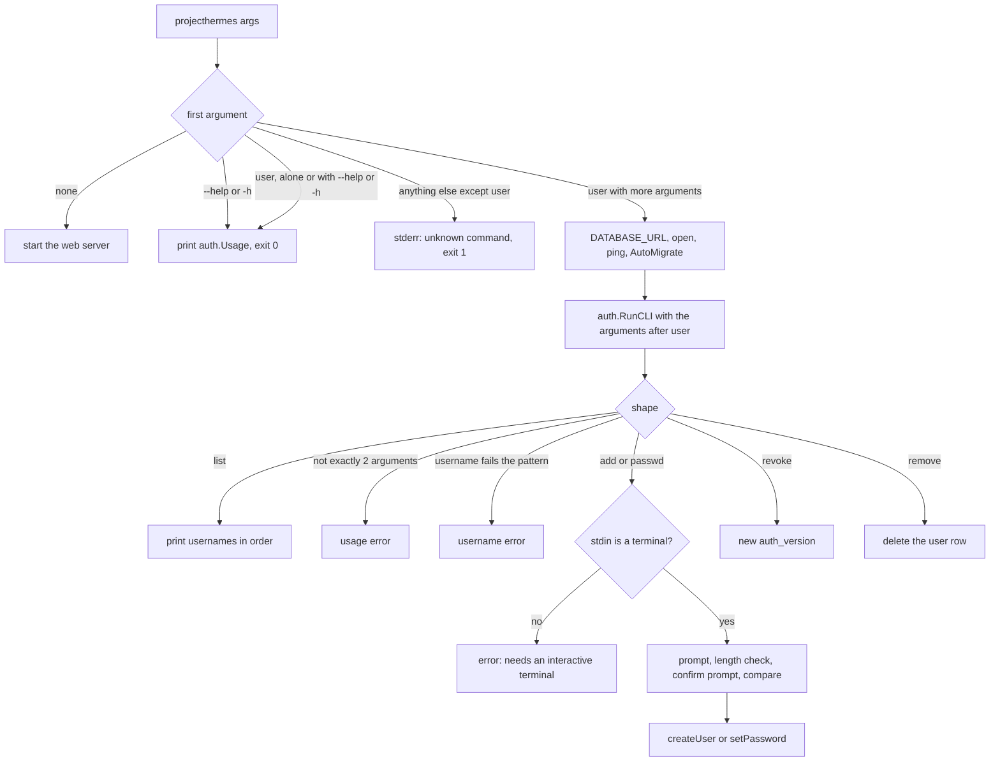
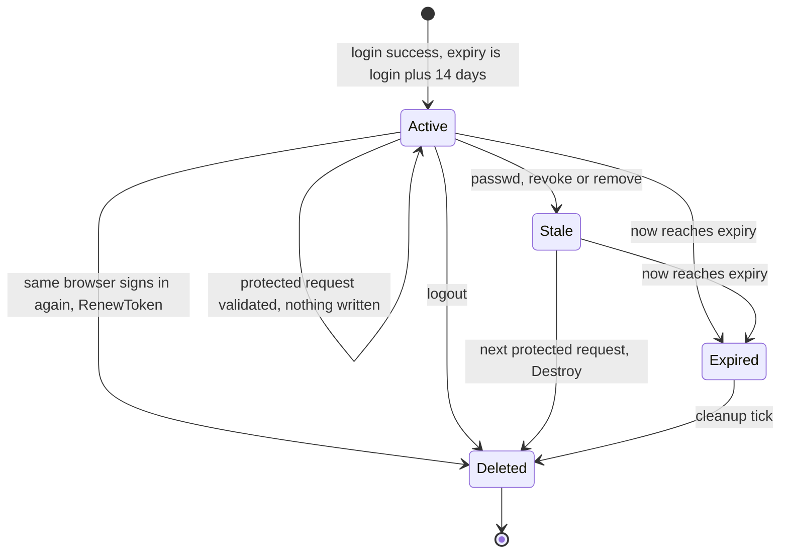
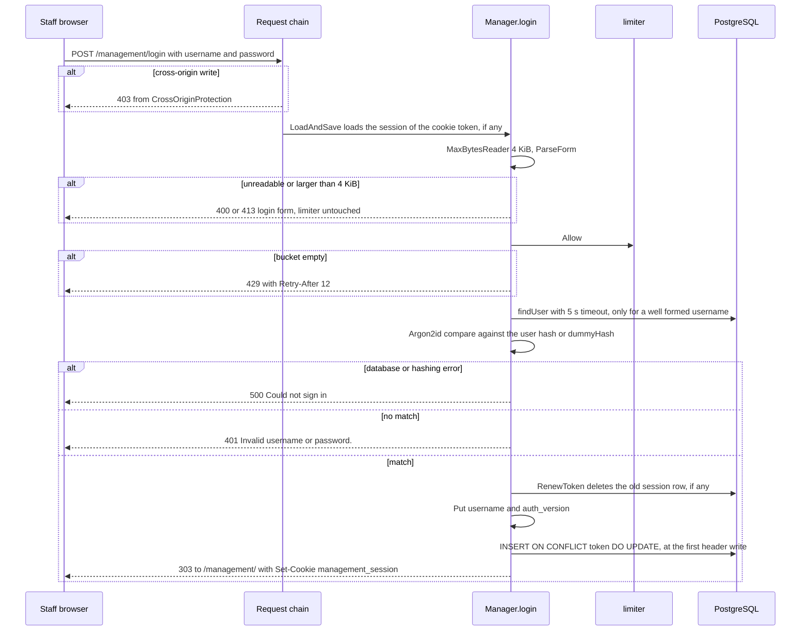
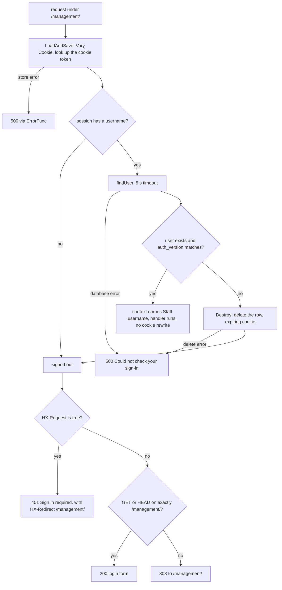
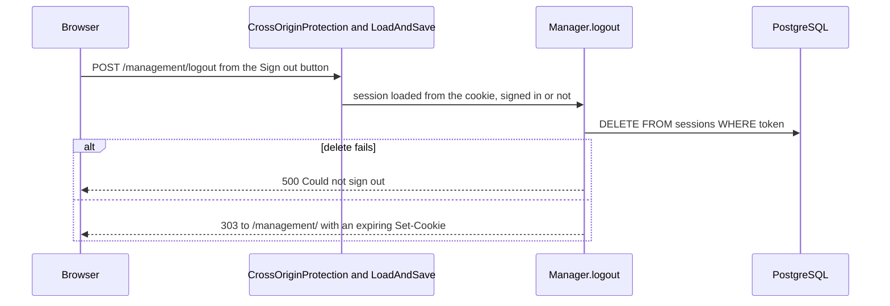

# Staff authentication

Staff accounts, sign-in, sessions and the `auth.Require` boundary in front of every `/management/` page. The route table and middleware order live in [Architecture](architecture.md); the open event stream's own auth rule is in [Live updates](live-updates.md); the environment variable behind the cookie flag is in [Configuration](operations/configuration.md).

## Pieces

| Piece | Role |
|---|---|
| `auth.User` | Staff account row: username, Argon2id hash, `AuthVersion`. Managed only by the CLI. |
| `auth.Session` | Row shape the scs PostgreSQL store expects (`sessions`). |
| `auth.Manager` | Session configuration, `login`, `logout`, `Require`, expired-session cleanup ticker. |
| `auth.RunCLI` | The `projecthermes user ...` commands. |
| `auth.Staff` | Returns the username `Require` verified, or `""` outside `Require`. |

`POST /management/login` and `POST /management/logout` are registered on the root mux behind `LoadAndSave` only. Everything under `/management/` sits behind `Require`. Customer pages, static files, the favicon and the Stripe webhook never load a session, and the cookie path is `/management/`, so the browser does not send it to them either. A broken `sessions` table therefore stops staff pages (500, never fail-open) and leaves customer pages untouched (`TestPublicCustomerIgnoresStaffSessions`).

## Data

`sessions` has no foreign key to `users`. The only link is the `username` and `auth_version` values inside the gob in `data`, which is why removing or re-versioning an account cannot delete its sessions: they go stale and are destroyed on their next request (see below). Neither table has timestamps. Column types are GORM's defaults for the Go field types. Whole-database view: [Data model](data-model.md).

## Accounts

Accounts exist only through the CLI. There is no sign-up page, no password reset and no inactive flag: removing the row is the only way to disable an account, and `revoke` only signs its sessions out.

| Rule | Value |
|---|---|
| Username | 1-64 of `A-Za-z0-9._-`, trimmed, validated **before** lowercasing (so the Kelvin sign cannot fold into an ASCII name), case-insensitive. |
| Password | At least 4 characters (temporary development minimum), at most 1024 bytes. Typed twice at a hidden terminal prompt; never an argument, environment variable or pipe. |
| Hash | Argon2id from `argon2id.DefaultParams` (64 MiB, 1 pass, parallelism = CPU count, 16-byte salt, 32-byte key); parameters live inside the stored string. |
| `AuthVersion` | `rand.Text()`, never a counter. Generated by `add`, replaced by `passwd` and `revoke`. |

A version changed by `passwd` or `revoke`, or a row deleted by `remove`, invalidates every session of that account at its next protected request. A re-added username gets a new random version, so old session rows cannot revive. `add` on an existing name and any command on a missing name fail (`already exists`, `does not exist`).

### CLI

Every `user` command opens the database, then pings it and runs `AutoMigrate` inside one 10-second budget before the command runs ([Startup and shutdown](operations/startup-shutdown.md)). The CLI needs only `DATABASE_URL` (no Stripe) and logs to stderr. Session rows are not touched by any command.

## Sessions

| Setting | Value |
|---|---|
| Store | scs v2.9.0 with its PostgreSQL store on the shared SQL pool. The store's own cleanup is off (interval 0). |
| Lifetime | Fixed 14 days from login. `IdleTimeout` is unset, so visits never extend or rewrite the session and reissue no cookie. |
| Cookie | `management_session`, path `/management/`, `HttpOnly`, `SameSite=Lax`, persistent (`Expires` and `Max-Age`). `Secure` unless `SESSION_COOKIE_SECURE` parses as false. |
| Contents | `username` and `auth_version` (gob in `sessions.data`). |
| Cleanup | A 5-minute ticker in `Manager` runs `DELETE ... WHERE expiry < CURRENT_TIMESTAMP` through GORM with a 5 s timeout; failures log `session_cleanup_failed` ([Observability](operations/observability.md)). `Close` stops it without closing the pool. |

Session SQL goes through scs's store, which takes no context: it has no 5 s timeout and ignores request cancellation ([Go-live](go-live.md)).

An expired row is invisible to the store's lookup (`current_timestamp < expiry`), so the browser is signed out at once even though the row remains until the next cleanup tick. There is no "touch" state: a session is validated on every protected request and never refreshed.

## Sign-in

| Status | When | Message |
|---|---|---|
| 303 `/management/` | Credentials match. | Cookie issued. |
| 401 | Wrong password, unknown user or malformed username. | `Invalid username or password.` The username is echoed back; the password never is. |
| 429 | Limiter empty. | `Too many sign-in attempts. Please wait a few seconds and try again.` |
| 400 / 413 | Form unreadable / body over 4 KiB. | `Could not read your sign-in. Please try again.` |
| 500 | Database, hashing or token-renewal error. | `Could not sign in. Please try again.` |

Every login page response carries `Cache-Control: no-store` and `Referrer-Policy: no-referrer`. `RenewToken` issues a fresh token on every sign-in (session-fixation defense). An unknown or malformed username is compared against `dummyHash`, an Argon2id hash of a random password made at startup, so it costs the same time and returns the same text as a wrong password.

Failed sign-ins (`staff_login_failed`) and limiter refusals (`staff_login_throttled`, at most one a minute) log a warning with no fields; the submitted username is never logged. Successful sign-ins log nothing. The session cookie value is never stored: `sessions.token` holds its SHA-256, so a database read yields no usable cookie.

### Rate limiter

| Property | Behavior |
|---|---|
| Scope | One limiter per process, shared by every client and username. |
| Rate | Burst of 2, then one attempt per 12 seconds. |
| Spent | **Before** the Argon2id work and by **successful** sign-ins as well as failures. |
| Not spent | Unreadable or oversized forms (400/413). Existing sessions and `Require` never touch it. |
| Refusal | 429 with a fixed `Retry-After: 12` (the refill interval, not the exact remaining wait). |

Accepted risk: an outsider who keeps the bucket empty blocks new staff sign-ins; the fix would be to key the limiter per client IP. The shared bucket also bounds the 64 MiB each hash costs.

## Protected requests

`auth.Require(logging.Routes(managementMux))` is the access boundary. Folder layout is not.

| Signed-out request | Answer |
|---|---|
| `HX-Request: true`, any method or path | 401, `HX-Redirect: /management/`, so htmx leaves for the full sign-in page instead of swapping a login form into a list region. |
| `GET` or `HEAD` on exactly `/management/` | 200 with the login form. This keeps the Railway health check passing while signed out ([Railway](operations/railway.md)). |
| Anything else, including a plain form `POST` | 303 to `/management/`. |

## Sign-out

Only this browser's session row is deleted; other devices stay signed in. A signed-out or repeated sign-out has nothing to delete and answers the same 303.

## Audit identity

`main.go` passes `auth.Staff` into `management.RegisterRoutes` as a `func(context.Context) string`, so management does not import `auth`. Stores that record a username refuse an empty one, so an anonymous audit entry cannot be written.

| Action | Recorded in | Source |
|---|---|---|
| Link created | `links.created_by` | `links.Store.Create` |
| Link canceled (one or all) | `links.canceled_by`; the first cancellation's audit is kept | `Store.Cancel`, `Store.CancelAll` |
| Link lifetime, program start date or bootcamp date saved | `settings.updated_by` and `updated_at`, row-level: the last writer of any setting | `SetLinkLifetimeDays`, `SetProgramStartDate`, `SetBootcampDate` |
| Reinstatement requested | `billing_suspensions.requested_by`; a repeated request keeps the first | `billing.Service.RequestReinstatement` |

**Not attributed:** student field edits (`students.Store.UpdateField` takes no staff argument) and the Reconcile, portal and invoice billing actions. See [Go-live](go-live.md).

## Deliberate choices

- Session cleanup is the app's own ticker, not the store's: it logs structured `session_cleanup_failed` events with no private data, stays silent on shutdown and stops without closing the shared pool (`TestSessionCleanupDeletesOnlyExpired`).
- `dummyHash` and the process-wide limiter look redundant but pair: equal cost for unknown users, and a hard cap on concurrent 64 MiB hashes.
- `AuthVersion` is random rather than a counter so a re-created username cannot match old session data (`TestCredentialChangesEndSessions`).
- The 401 plus `HX-Redirect` branch is also how the live-updates client recovers after sign-out.
- `auth.Usage` holds the server's top-level help too, so one help text is not split across `main` and `auth`.

## Source

- `internal/auth/auth.go`: `User`, `Session`, `normalizeUsername`, `findUser`, `createUser`, `setPassword`, `revokeSessions`, `removeUser`, `existingUser`
- `internal/auth/http.go`: `Manager`, `New`, `Close`, `deleteExpiredSessions`, `RegisterRoutes`, `Staff`, `Require`, `authenticated`, `logout`, `login`, `verify`, `render`, `cookieName`, `loginInterval`, `dummyHash`
- `internal/auth/cli.go`: `Usage`, `RunCLI`, `listUsers`, `readNewPassword`, `promptPassword`
- `internal/auth/http_test.go`: `TestSignIn`, `TestCredentialChangesEndSessions`, `TestSignOutEndsOnlyThisBrowser`, `TestSessionCleanupDeletesOnlyExpired`
- `main.go`: `main`, `run`, `newServer`, `SESSION_COOKIE_SECURE`
- `main_wiring_integration_test.go`: `TestPublicCustomerIgnoresStaffSessions`, `TestCrossOriginWritesAreRejected`
- `internal/links/links.go`: `Store.Create`, `Store.Cancel`, `Store.CancelAll`, `errNoStaff`, `CreatedBy`, `CanceledBy`
- `internal/settings/settings.go`: `SetLinkLifetimeDays`, `SetProgramStartDate`, `SetBootcampDate`, `UpdatedBy`
- `internal/billing/suspension.go`: `RequestReinstatement`, `errStaffRequired`
- `internal/billing/models.go`: `RequestedBy`
- `internal/students/students.go`: `UpdateField`
- `go.mod`: `github.com/alexedwards/scs/v2`, `github.com/alexedwards/scs/postgresstore`, `github.com/alexedwards/argon2id`, `golang.org/x/time`
